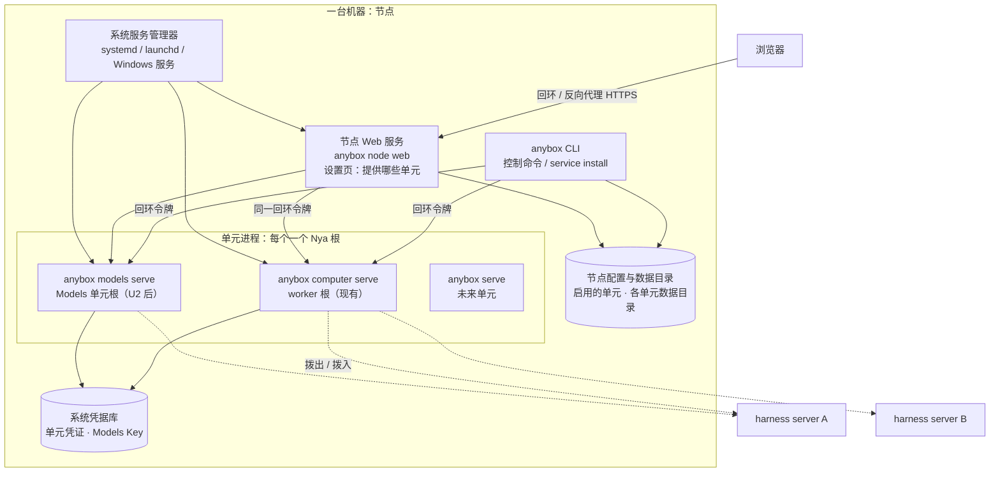

# Anybox 节点程序设计：在任意机器上提供单元（2026-10-15）

[文档首页](README.md) · [可组合部署单元设计](composable-units-design.md) · [Computer 资源模块](modules/computers/README.md) · [架构评估（2026-10-15）](harness-architecture-review-2026-10-15.md) · [部署说明](harness-server-deployment.md) · [命名与边界](naming.md)

后续决定：已采用[统一发行与独立运行角色](runtime-roles-and-distribution.md)，各平台统一交付 Anybox，桌面组合四种独立运行角色，同时支持无头部署。本文原先“不做桌面应用”“桌面不作为交付物”和单独决定节点程序分发的假设已被该决定替代。下文保留为未采纳的方案记录；额外节点应用、独立 Models、拨入传输、身份及凭据调整均未随本次决定采纳，不据此预建组件。

状态：2026-10-15 目标设计稿，未采纳为计划。依据 HEAD `fd161c6` 加当日未提交的 U1 变更、[可组合部署单元设计](composable-units-design.md)与[架构评估](harness-architecture-review-2026-10-15.md)写成，不改变任何组件文档描述的当前行为。本文回答一个问题：用户在 Windows、macOS、Linux 的任意一台机器上安装一个软件，这台机器就能为一个或多个 harness server 提供 Computer 环境、Models 服务以及后续其他单元，这个软件应该是什么形态、怎样接入现有契约、分几步交付。“节点程序”是本文的工作名称，采纳时在 [naming.md](naming.md) 定名，见第 3 节。

## 1. 目标、范围与非目标

### 1.1 目标

- 一台机器装一个程序，机器拥有者在本机决定它提供哪些单元（Computer、Models、将来的其他单元），并把每个单元附着到一个或多个 harness server。
- 三个平台都同时提供两种外壳：带浏览器界面的节点 Web 服务和无界面的命令行（headless CLI）。普通用户在浏览器里启用单元、附着与撤销，不接触命令行；服务器和自动化部署不需要浏览器。不做桌面应用。
- harness server 不关心单元在哪台机器、用哪种外壳启动；它只看到附着记录和[可组合单元设计第 4 节](composable-units-design.md#4-通用单元契约)定义的契约。
- 新增单元种类不新增程序，只新增该单元的进程入口、契约与代理组件（U4 的要求）。

| 平台 | 节点 Web 服务 | 无头 CLI |
| --- | --- | --- |
| macOS | 需要 | 需要 |
| Windows | 需要 | 需要 |
| Linux | 需要 | 需要 |

### 1.2 非目标

- 不拆分 harness server 内部结构，不改变 Session、Run、RunRuntime 契约；节点程序只是现有单元进程的新入口与控制面。
- 不建立多租户或用户体系：附着仍是两侧拥有者的同意，harness server 对客户端仍是单拥有者。
- 不做集中调度、单元发现服务或市场；单元只接 harness server，星形拓扑不变。
- 不在一个进程里跑多个单元；每进程一个 Nya 根的规则不变。
- 不做桌面应用外壳：本机界面只是浏览器访问节点 Web 服务；现有 Electron 桌面版不在本文范围，也不作为节点程序的交付物。
- 不承诺容器沙箱作为单元宿主；见第 6 节凭据决策。

## 2. 现状与差距

### 2.1 已有的部分

| 能力 | 位置 | 说明 |
| --- | --- | --- |
| 自洽的 Computer 单元进程 | [worker 根装配](../src/applications/harness/core/computer/worker-server.ts)、[入口](../src/entrypoints/computer-worker-main.ts) | 独占 worker.sqlite 与图片目录、四个工具组件、附着账本（凭证在系统凭据库）、拨出循环。入口的传递导入闭包 41 个文件，外部依赖只有 NyaCore、ripgrep、picomatch、sharp、keyring 与 Models 包（多为类型导入） |
| 附着账本与凭证认证 | [单元附着](modules/units/unit-attachments.md)、[单元传输](modules/units/unit-transport.md) | 一次性附着码、按单元的凭证、作用域上限、epoch、两侧撤销 |
| 位置透明的 Computer 契约 | [Worker 路由](modules/computers/worker-router.md) | `computer.worker` 按附着路由到回环 worker 或拨出单元，核心代码不感知差别 |
| 真实跨机器验收 | [可组合单元设计第 9 节](composable-units-design.md#9-分阶段实施与验收) | 远端 harness server 操作本机 macOS worker；本机 harness server 经 SSH 反向隧道操作服务器 worker |
| 独立服务示例 | [computer-worker.service.example](../deploy/computer-worker.service.example) | Linux 用户级 systemd unit，worker 独立于 harness server 的 cgroup |
| Web 外壳 | [Web 客户端设计](web-client-design.md)、[Application HTTP 监听组件](modules/web/web-frontend.md)、[通用客户端宿主](../src/host/client.ts) | 通用监听器同时服务静态页面与 `/api/client/v1`、`/api/v1`，显式接收应用目录（空目录也是合法宿主）；执行端用设备令牌认证，回环客户端页面校验 Host/Origin；浏览器外壳按目录挂载应用界面 |
| 各入口 | `src/entrypoints/` | harness server、computer worker、客户端三个独立 main；后续已接入 `anybox-main.ts` 统一分派，`npm run web` 仅启动客户端，`serve.ts` 的显式组合命令改为 `npm run web:local`；当前桌面行为见统一发行约定 |

### 2.2 差距

1. **Computer 单元没有自己的控制面。** 消费附着码只能经该机器上的 harness server 连接管理页面，由它转发到 worker 的回环控制接口（[本机 worker 客户端](modules/computers/local-worker-client.md)）。没有 harness server 的机器无法附着；现有页面与网关都属于 Anybox Harness 客户端，没有面向节点本身的页面与路由。
2. **单元身份挂在 harness server 上。** worker 数据目录默认是业务库路径加 `.computer-worker` 后缀，由 harness server 在第一次本地调用时懒启动（[worker-client.ts](../src/applications/harness/core/computer/worker-client.ts)）；`local:computer` 是写死的附着 ID，路由、Projects、Operations 各有专门分支。
3. **形态是启动期决定。** `ANYBOX_COMPUTER_UNIT=local|remote`（[server-config.ts](../src/applications/harness/server-config.ts)）固定 harness server 有没有本机 worker，切换要重启。
4. **只有拨出传输。** worker 只监听回环，远端 harness server 必须能被单元访问；harness server 在 NAT 后、单元在服务器上的场景要靠隧道。
5. **代码边界。** worker 入口的导入闭包仍包含 `run/`、`prompt/`、`workspace/`、`unit/` 与 `core/index.ts` 的文件以及 `@anybox/api-key-manager`；单独构建会带上半个 harness server。
6. **平台。** 本设计记录形成时 Windows 真实 worker 尚未支持；后续原生实现与验收见[原生平台支持](native-platform-support.md)。无头 Linux 的系统凭据服务需要手工准备。
7. **Models 尚不是独立进程。** U2/U3 未实施，节点程序提供 Models 服务依赖它们。

## 3. 形态与命名

### 3.1 形态：一个程序、多个角色、每进程一个角色

基础设施领域处理同类需求的通行做法是单个可执行文件加子命令选角色，由操作系统服务管理器监督长驻进程，并配一组与本机长驻进程通信的控制子命令：k3s（`k3s server` / `k3s agent`）、Nomad 与 Consul 的 agent、CI 的 runner、dockerd 和 tailscaled 加各自的控制 CLI。Grafana Loki 的 `-target` 允许多个模块同进程，本项目不采用，因为每进程一个 Nya 根是既有规则，也正好是单元之间的故障隔离边界。

Codex 的 app-server 是另一种模式：面向富客户端的 JSON-RPC 层（stdio 上的 JSONL），服务 VS Code 插件和桌面 App。它对应的是 harness server 的 HTTP/SSE API 与客户端网关，不是本文的程序。Codex CLI 本身倒是“单二进制多模式”的例子：TUI、exec、app-server、mcp-server 共用一个可执行文件。

### 3.2 命名

- 不叫 agent：Anybox Harness 本身是 Agent 产品，稳定应用 ID 也是 `agent`。
- 沿用设计文档已有的“单元”（unit、`unitKind`）概念：一台机器是一个节点，节点上运行若干单元进程。
- 建议 CLI 可执行文件就叫 `anybox`，单元种类做一级子命令（`anybox computer …`、`anybox models …`、`anybox harness …`），节点自身的命令在 `anybox node …` 下（`info`、`web`、`service`），不新造品牌词；产品文案中称“Anybox 节点程序”或直接称“节点”，浏览器界面称“节点设置页”。替代方案是独立名字如 “Anybox Node”。采纳时在 [naming.md](naming.md) 增加一行，并登记子命令、应用 ID 与环境变量。

## 4. 架构

### 4.1 一个核心、两种外壳

- **核心**是各单元进程与它们的控制接口；节点 Web 服务与 CLI 只是两种外壳，调用同一组回环控制接口，共用同一份节点配置。设置页里“提供 Computer”的开关与 CLI 的 `anybox computer enable` 做完全相同的事。
- **单元进程**由系统服务管理器启动与监督，程序不内置 supervisor。节点 Web 服务在没有登记系统服务时可以自己拉起单元进程；一旦用户选择“开机提供”，就把单元进程和节点 Web 服务本身都登记为系统服务并交出监督权。
- **控制接口**沿用 worker 现有的回环 HTTP 加私有令牌（endpoint 文件按私有权限写入节点数据目录）；节点 Web 服务与 CLI 读取同一个 endpoint。不引入新的认证模型。
- **节点 Web 服务**是独立进程、一个 Nya 根，由 `anybox node web` 启动：复用通用客户端宿主（[client.ts](../src/host/client.ts)）、浏览器外壳与现有构建产物，应用目录只含一个“节点”应用。该应用的浏览器入口是节点设置页，其 `/api/client/v1/apps/<节点应用 ID>` 路由把请求转发到各单元的回环控制接口并读写节点配置；它不持有单元数据、单元凭证或业务库。默认只监听 `127.0.0.1`，以客户端宿主的无认证形态运行，页面沿用 Host/Origin 同源校验；需要从其他机器管理时经前置反向代理提供 HTTPS，并改用通用宿主的设备令牌认证形态（与 harness server 的 `host.access` 相同，令牌摘要存节点目录下独立的访问库）。单元令牌只在节点 Web 服务进程内使用，不进入浏览器。

### 4.2 节点配置与数据目录

| 内容 | 位置 | 说明 |
| --- | --- | --- |
| 节点配置 | 节点数据目录下的 JSON | 节点 ID 与显示名、启用的单元、各单元数据目录与端口策略、凭据命名空间；人工可读可改，程序读取时校验 |
| Computer 单元数据 | `<节点目录>/computer/` | 现有 worker 目录内容：worker.sqlite、workerId、endpoint、图片与结果资料；不再以 harness server 业务库路径命名 |
| Models 单元数据 | `<节点目录>/models/` | 由 U2 定义：配置 JSON、目录缓存、暂存字节 |
| 节点 Web 服务访问库 | `<节点目录>/web/` | 仅在启用远端管理时存在：设备令牌摘要；回环默认形态不需要 |
| 凭证 | 系统凭据库 | 单元凭证按单元各自命名空间（现有 `anybox.computer-worker`），Models Key 按 Models 规则 |

默认节点目录按平台惯例（macOS `~/Library/Application Support/Anybox/node`、Linux `$XDG_DATA_HOME/anybox/node`、Windows `%LOCALAPPDATA%\Anybox\node`），可由环境变量或 `--data-dir` 覆盖。同一机器上的 harness server 不再拥有 worker 目录。

### 4.3 命令面

| 命令 | 作用 | 对应现有实现 |
| --- | --- | --- |
| `anybox computer serve` | 前台运行 Computer 单元进程 | `computer-worker-main.ts` |
| `anybox computer attach <harness-url> <code> --projects <dir>… --tools <id>…` | 消费附着码并设定上限；必须显式列目录，不提供“不限”的默认 | worker 的 `/attachments/consume` |
| `anybox computer status` / `list` / `revoke <id>` | 查看附着与连接状态、撤销 | worker 的 `/attachments/list` 与 `/attachments/revoke` |
| `anybox computer listen --address <host:port>` | 服务器类节点开启拨入监听（第 5 节） | 新增 |
| `anybox models serve` / `attach` / `status` | Models 单元（U2/U3） | 待实施 |
| `anybox harness serve` | 运行 harness server | `harness-server-main.ts` |
| `anybox <unit> service install` / `uninstall` / `status`，`anybox node service …` | 生成并登记该单元或节点 Web 服务的系统服务定义 | 现有 service.example 的程序化版本 |
| `anybox node info` | 节点 ID、平台、架构、已启用单元、各单元版本与契约版本 | 新增 |
| `anybox node web --bind <host:port>` | 前台运行节点 Web 服务（浏览器设置页），默认只监听 `127.0.0.1` | 新增，复用 `host/client.ts` 宿主与 Web 外壳 |

CLI 子命令只做参数校验与调用；单元逻辑全部留在各单元的根装配中，保证 Web 外壳与 CLI 行为一致。

## 5. 附着、分组与网络方向

### 5.1 附着仍按单元

授权事实仍是每个单元一条附着：各自的 unitId、凭证、作用域上限与 epoch，账本规则不改。节点只是界面上的分组：单元在 `attach` 时多上报节点 ID（随机生成、保存在节点配置）与节点显示名，harness server 存进附着记录供设置页按机器归并。节点 ID 不进入任何栅栏或摘要。

“一个节点码同时附着多个单元”的便捷流程可以后置：harness server 把一个节点码展开成多条 pending 附着，单元侧逐条消费。这是界面层便利，不改变授权粒度。

### 5.2 拨出为默认，拨入为服务器类单元的第二传输

- **拨出**（现有）：单元向 harness server 的 HTTPS 地址长轮询。适合笔记本和桌面机：不开入站端口、不配证书、NAT 后可用。
- **拨入**（新增）：单元监听一个地址，harness server 主动连接。适合有固定地址的服务器单元，解决“harness server 在 NAT 后、单元在服务器上”的场景，不再依赖 SSH 反向隧道。契约第 2 节已写明不固定网络方向，两种传输下操作生命周期、幂等与栅栏相同。

拨入需要：附着记录增加传输字段（`dial-out`，或 `dial-in` 加地址）；单元侧以同一套单元凭证机制认证 harness server（harness server 在附着时拿到对应的调用凭证，同样只返回一次、只存摘要）；TLS 由单元自身或前置代理提供，回环之外拒绝明文 HTTP；harness server 侧的传输组件在 Worker 路由之下按附着的传输字段选择邮箱或直接请求。失败分类沿用现有 `worker-unreachable` 与 `worker-unavailable` 规则。

## 6. 凭据与平台服务

| 平台 | 服务形式 | 凭据库 | 注意 |
| --- | --- | --- | --- |
| macOS | 用户会话的 LaunchAgent | Keychain | 必须是 LaunchAgent 而不是系统级 LaunchDaemon，否则读不到用户 Keychain；无头 CLI 在 SSH 会话中需要已解锁的登录钥匙串 |
| Windows | 以登录用户身份运行的服务，或登录时启动的任务 | Credential Manager | 以 LocalSystem 运行的服务使用系统账户的凭据库，与用户设置的凭据不同；必须定下运行账户 |
| Linux 桌面 | systemd 用户单元 | Secret Service（gnome-keyring / KWallet） | 与现有 service.example 一致 |
| Linux 无头服务器 | systemd 用户或系统单元 | 需决策 | Secret Service 需要 D-Bus 会话并在无登录时解锁；容器基本不可用 |

无头服务器的决策（两选一）：

1. **坚持现规则**：附着凭证与模型 Key 一样只进系统凭据库。安装步骤写明准备并解锁 gnome-keyring；每台服务器多一道手工配置，容器不支持。
2. **对单元凭证单独放宽**：单元凭证可撤销、有作用域、泄露后果远小于模型 Key。允许服务器类节点以显式提供方保存单元凭证（systemd-creds 可绑 TPM，或服务用户独占的 0600 文件），模型 Key 仍只进 Vault。这要求修改[可组合单元设计 1.3 节](composable-units-design.md#13-非目标)的非目标与 AGENTS.md 中的对应约束。

本文倾向第二项，但它改变现有规则，由项目拥有者决定。

## 7. 平台矩阵与能力顺序

| 单元 | macOS | Linux | Windows |
| --- | --- | --- | --- |
| Computer | 已作为单元真实验收 | 已完成真实进程故障验收 | 不支持：Bash、进程组、路径语义需单独设计（PowerShell、Job Object） |
| Models | 待 U2/U3 | 待 U2/U3 | 待 U2/U3；无进程工具，比 Computer 容易 |
| harness server | 可用 | 可用（当前生产形态） | 纯模型与资源契约可验证，真实 worker 不支持 |
| 节点 Web 服务 | 需新增 | 需新增 | 需新增（同一份 Node 代码，无平台差异） |
| 无头 CLI | 需新增 | 需新增（替代现有 main 入口） | 需新增 |

建议的能力落地顺序：Linux Computer → macOS Computer → Linux/macOS Models → Windows Models → Windows Computer。节点 Web 服务三平台同一份代码，不需要桌面打包、签名与公证；程序本身的分发形式见第 11 节。

## 8. harness server 一侧

- **设置页“节点与单元”**：按节点分组列出附着、单元种类与能力（Computer 的平台/架构与工具上限，Models 的可用配置）、连接状态与传输方向、版本与契约版本、撤销。替代现有“单元附着”分类。
- **建项目选 Computer**：从已批准的 Computer 附着中选择，目录浏览经所选单元的只读查询面（现有 `query` 已有 stat 与列目录）；现有宿主目录选择器只用于本机。
- **选模型看到 Models 单元**：U3 之后，来自 Models 单元的配置与本机配置并列，带来源单元标识。
- **兼容**：单元上报程序版本与契约版本，harness server 对不兼容单元显示原因并拒绝新 Run 准入，已接受操作按原规则收尾。
- **默认 Computer** 成为按设备保存的设置（与新会话默认模型同一机制），替代 `ANYBOX_COMPUTER_ATTACHMENT`。

## 9. 对现有代码的改动

| 区域 | 改动 | 依赖 |
| --- | --- | --- |
| `src/entrypoints/` | 新增统一 CLI 入口（子命令分派、`service install` 模板生成）；现有 `computer-worker-main.ts`、`harness-server-main.ts` 成为子命令实现；npm 脚本保留为委托 | 无 |
| worker 根 | 数据目录改为节点目录；`attach` 上报节点 ID 与显示名；可选拨入监听 | 节点配置 |
| [组合根](../src/applications/harness/core/index.ts)、[server-config.ts](../src/applications/harness/server-config.ts) | 删除 `ANYBOX_COMPUTER_UNIT` 形态开关；总是安装 Worker 路由；本机 Computer 由附着记录发现并经回环连接已运行的单元进程，不再 spawn；`local:computer` 变为 origin 为本机的普通附着 | 评审[建议 5](harness-architecture-review-2026-10-15.md#建议-5computer-目录按进程侧拆分)先行 |
| 单元传输 | 增加拨入传输与附着传输字段 | 附着账本迁移 v2 |
| 节点 Web 服务 | 新增节点应用（工作目录 `src/applications/node/`，按正式目录注册）：浏览器“提供服务”设置页、附着/状态/撤销与系统服务登记的路由，转发到单元回环控制接口；`anybox node web` 以通用客户端宿主加只含该应用的目录装配；可选设备令牌认证形态 | 统一 CLI、节点配置 |
| 文档 | naming.md 定名与命令表；部署说明改为节点安装步骤；Computer 模块与单元模块文档更新；AGENTS.md 对应段落 | 采纳后同步 |

`@anybox/api-key-manager` 出现在 worker 入口的导入闭包中，需核实是否为实际运行依赖；若否，在拆分时剔除。

## 10. 分阶段实施与验收

| 阶段 | 交付 | 验收 |
| --- | --- | --- |
| N1 统一 CLI 与 Computer 控制面 | `anybox computer serve/attach/status/revoke/service install`、节点目录与配置、节点 ID 上报 | 一台只装 Node 与本程序、没有 harness server 的 Linux 与 macOS 机器，经 CLI 附着到远端 harness server 并完成 Bash、Apply Patch、文件读取 Run；systemd/launchd 登记后重启机器单元自动上线 |
| N2 本机 Computer 普通化 | 删除形态开关与懒 spawn；本机 harness server 附着到已运行单元；`local:computer` 特殊分支收敛 | 现有 computer-*、conversation-tree、harness-server-core 行为测试不改断言通过；同一机器只有一个 worker 进程同时服务本机与远端 harness server |
| N3 拨入传输 | 附着传输字段、单元监听、harness server 侧直连传输 | 本机 harness server 在 NAT 后直接使用服务器单元，无隧道；故障注入矩阵（网络中断、单元重启、单元 SIGKILL、harness server SIGKILL、在途撤销）在拨入下通过 |
| N4 Models 单元接入 | U2/U3 的 Models 进程以 `anybox models serve/attach` 运行 | U2/U3 的验收在节点程序形态下通过 |
| N5 节点 Web 服务 | 节点应用与 `anybox node web`：“提供服务”设置页、附着/状态/撤销、系统服务登记；回环默认形态，可选反向代理加设备令牌的远端管理 | 用户只在浏览器中操作即可提供 Computer（macOS/Linux）与 Models；重启后单元与节点 Web 服务自动上线；行为测试覆盖页面、路由转发与认证形态，不需要 Electron 或成品包验证 |
| N6 无头凭据与 Windows Computer | 第 6 节决策的实现；Windows 工具执行 | 容器或无会话服务器节点可附着；Windows 节点完成 Computer Run |

N1 到 N3 不改 Session、Run 与 RunRuntime，只动入口、组合根、computer 目录与单元传输，与评审稿建议 3、5 的改动范围重叠，可一起排期。每个阶段结束运行根 `npm run check`，真实多机器验收单独记录。

## 11. 待决定事项

- 无头服务器的单元凭证保存方式（第 6 节两选一）。
- 正式名称与可执行文件名：`anybox` 加子命令，或独立名字。
- 拨入传输的 TLS 责任归单元自身还是只接受前置代理。
- 是否提供“节点码”一次附着多个单元的便捷流程，或只保留按单元附着。
- Windows Computer 的工具契约范围：是否以 PowerShell 替代 Bash，Codex/Claude 工具契约在 Windows 的语义。
- 节点 Web 服务与 CLI 在同一台机器并存时，谁拥有系统服务登记；两者调用同一控制接口，登记需幂等。
- 节点 Web 服务是通用客户端宿主上的一个应用（复用外壳、监听器与构建产物），还是独立的最小页面；远端管理（反向代理加设备令牌）是否进入首版，或首版只允许回环访问。
- 节点程序的分发形式：npm 全局包、自带 Node 运行时的压缩包或单文件可执行；没有桌面安装包后这是用户拿到程序的唯一途径。

## 12. 未验证与局限

- 没有运行 `npm run check`；导入闭包与依赖列表来自静态脚本统计，`@anybox/models` 是否全部为类型导入未逐一核对。
- 没有验证 Windows 服务账户与 Credential Manager、macOS LaunchAgent 与 Keychain 在无头 SSH 会话下的实际行为；表中的结论来自平台文档的一般规则。
- 拨入传输的具体消息形状未设计，只给出约束。
- 节点目录的平台默认路径为建议，需与现有 `./data` 默认路径及[部署说明](harness-server-deployment.md)的环境变量核对。
- 以通用客户端宿主承载只含“节点”应用的目录未在代码中试验；`src/host/client.ts` 接受显式目录，但应用目录注册与设备令牌认证形态在客户端宿主上的组合尚未验证。
