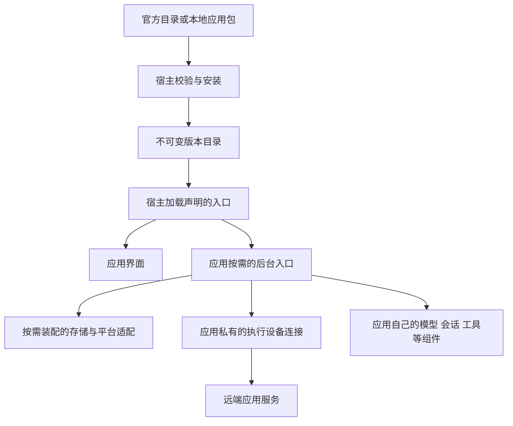

# Anybox 应用模块化分发与按需安装设计

[文档首页](README.md) · [发行与运行角色](runtime-roles-and-distribution.md) · [通用应用宿主](products-v1.md) · [应用接入](application-development.md)

状态：2026-10-17 已实施 D0a 源码包与最小接入契约：npm workspaces、宿主/两个应用/既有共享库独立 Package、公共入口和依赖方向已落地。D0a 之后增加 [D0a.1 应用业务服务独立运行](application-standalone-services.md)：同一套应用业务装配既可由应用自己的入口启动，也可接入 Anybox；HTTP 和认证由各应用自己处理，不提取公共 HTTP 或认证模块。当前发行仍由 `distribution` 显式组合两个应用及原生适配。随后按[应用客户端业务独立归属](application-client-isolation.md)取消应用间共享业务层：各应用拥有自己的连接、凭据、配对、转发与管理界面，旧共享记录只读迁入。D0b 已完成基础能力按消费者装配、入口生命周期门禁和本机运行时加载验证；D1.1 已增加独立安装事实、操作账本和跨进程使用凭证基础，D1.2 已增加空宿主产物、完整签名应用包与只读验证/准备工具。D1.3 已将受管文件读取、签名验证、独立准备、不可变目录提交及显式恢复接到安装账本和本机管理入口，成功保留为已安装待生效。D1.4 已接入最小宿主的正式角色加载、版本交接和全部页面保护；D1.5 已接入本机卸载、代码回收及显式恢复，在线下载留作 D2，旧完整默认发行迁入由 D3 继续。文件安装或 selected 改变均不能解释为新代码已经运行。

2026-10-17 补充完整生命周期目标：宿主负责下载、校验、安装、使版本生效、打开运行、关闭和卸载；应用自己负责业务初始化、业务准入、取消、资源清理和数据迁移。两层状态图及生命周期契约以[宿主目标生命周期](products-v1.md#目标生命周期)为准；本文件第 2 节逐项对照当前代码，第 12 节给出实施依赖与验收顺序。目标状态图不等于当前 Products 枚举，D1.1 的实际契约见第 6.3 节。

## 1 产品目标与首期范围

Anybox 是应用的安装和承载平台。只安装宿主时，用户可以查看应用、安装和管理应用、使用宿主自己的设置；安装具体应用后，再获得它的业务功能。应用源码包构建为签名的 `.anybox-app` 文件，支持在线下载及完整离线安装。

宿主的管理对象是应用身份、包与版本、受管入口、界面挂载、运行目标和生命周期操作。宿主通过通用契约取得就绪、忙碌、可关闭、清理完成或失败的结果；不读取应用业务表判断忙碌，不解释 Session、Run、模型、设备连接或审批，也不直接调用其业务取消与恢复接口。通用监听、管理认证、平台适配和进程控制服务于这些生命周期职责，不能据此增加宿主业务层。

### 功能分层

| 层次 | 负责什么 | 是否所有应用必须使用 |
| --- | --- | --- |
| 最小宿主核心 | 应用身份、包校验与版本管理、加载入口、有界面应用的展示与切换、退出协调、宿主自己的设置与管理记录 | 所有应用遵守最小接入规则；界面和后台入口分别按需提供 |
| 可选公共能力 | 系统目录选择、SQL 存储提供方、系统凭据适配 | 按应用及运行入口的真实需要选择 |
| Anybox Harness 应用 | 本应用的设备连接、凭据、转发与连接管理；项目、会话、Prompt、模型配置与模型 Key、Agent Run、工具、Computer worker 及附着管理 | 随 Harness 包提供 |
| Claude Agent 应用 | 本应用的设备连接、凭据、转发与连接管理；项目与会话界面、Claude 调用、审批及结果展示 | 随 Claude Agent 包提供 |

“可以被多个应用复用”不等于“必须进入宿主核心”。包管理是宿主管理应用的职责，不要求应用自己调用安装服务；目录选择等则是供应用按需调用的能力。宿主只管理自身的全局设置，应用业务设置及其数据归所属应用。

最小验证样例应是一个只有界面的计算器：它只声明身份、界面资源和界面清理方式，没有执行设备、业务数据库、密钥、后台服务或 worker，也能安装、打开、切换和卸载。此样例用于证明核心足够通用，不作为新增正式产品。

### 首期交付边界

- 下载的宿主只包含最小核心及其实际运行依赖。宿主可以为自己的安装、启停和身份记录使用 SQLite，这不构成向所有应用强制提供业务数据库。
- 应用管理提供在线目录和“从文件安装”，统一完成校验、登记、版本激活及默认保留数据的卸载。
- 每个正式应用有独立 `package.json`、版本、公开入口、依赖、静态资源、构建和测试。共享库也有自己的包边界，宿主不静态依赖具体应用。
- 首期按一个逻辑应用提供目标平台的完整应用包，依赖库和需要的提供方实现进入该应用的发行闭包。按客户端、执行端、worker 分别下载留作后续优化；安装、加载与启动分别管理。
- 可选提供方只在已启用消费者确有需要时初始化。空宿主不初始化设备连接、连接 Vault、应用目录窗口、Models、应用业务表或 worker 数据目录。
- 首期只接纳官方受信签名包。可选库不是独立用户应用、插件市场或新常驻服务；包名、能力声明和 Nya 服务名均不构成代码权限隔离。

以上是完整发行目标。D0a 已完成源码包边界，根构建按工作区依赖顺序构建各包；D0a.1 先完成业务服务脱离宿主，独立入口不要求安装 host、distribution 或另一应用。当前默认发行仍包含两个静态受信应用；D1.3 已有独立本地文件安装入口，但不会自动把安装版本并入当前运行目录。

## 2 现有基础与需要补齐的边界

### 2.1 已有源码边界

| 当前位置 | 当前事实 | 后续调整 |
| --- | --- | --- |
| [host/client.ts](../packages/host/src/client.ts)、[host/execution.ts](../packages/host/src/execution.ts) | 显式接收受信应用目录；宿主只依赖公共 API、自己的 SQL 控制存储和 Nya；客户端与执行端通过受信 `providers` 接收延迟提供方，按实际消费者选择、保留和释放；宿主自用 SQL 常驻 | D1 将当前静态声明接入已验证的安装快照 |
| [application-api](../packages/application-api/) | 核心身份类型、可选 Web/Node/Nya 适配分入口；`createRuntime` 与 `apiBase` 可省略，SQL/连接/目录不进入必需端口 | 补齐安装快照及按入口兼容与能力版本门禁，不开放全量 `hostApi` |
| [registration.ts](../packages/host/src/applications/registration.ts)、[nya.ts](../packages/application-api/src/nya.ts)、[activity.ts](../packages/host/src/applications/activity.ts) | 静态注册目录、组件归属、准入冻结和实际退出等待保留；无后台入口的应用无需伪造组件运行时 | 最小宿主已由 D1.4 接正式快照加载；默认静态发行迁入仍由 D3 推进 |
| 应用私有连接 | 两应用各自拥有连接、凭据、配对、转发与管理界面，随应用启停 | 不重建跨应用业务包；旧共享记录只读迁入 |
| [directory-picker](../packages/directory-picker/) | 原生目录组件、Electron 取消适配与原生源码独立；默认组合只注册延迟工厂，应用按本代选择条件注入原服务；未消费或不支持时不创建 | 已覆盖缺失、降级与最后消费者实际退出；正式原生窗口和平台验收单列 |
| [storage-sqlite](../packages/storage-sqlite/) | 存储端口与提供方已独立，服务名、路径、排他连接、迁移账本和跨领域事务未变 | 不在本阶段分库或搬表；提供方选择按后续消费者模型推进 |
| [distribution](../packages/distribution/) | 持有正式静态目录、CLI/桌面角色入口和默认兼容组合；应用包不反向依赖它，host 不依赖具体应用 | D1 最小宿主已从已验证安装快照选择入口；D0b 已按启用消费者选择基础提供方；distribution 默认完整组合迁入仍由 D3 推进 |
| [Harness 服务](../packages/app-harness/src/server.ts)、[Claude Agent 服务](../packages/app-claude-agent/src/server.ts) | D0a.1 在各自包内提供独立业务入口、HTTP/认证与关闭，复用 Anybox 接入使用的业务装配 | 保持原命令默认组合；不把业务独立运行等同于独立桌面、host-only 发行或应用下载安装 |
| [package.json](../package.json)、[build-workspaces.mjs](../scripts/build-workspaces.mjs) | 根工作区编排，各包独立声明依赖、exports、构建与测试；浏览器资源仍沿用稳定 HTTP 地址 | 默认发行保持完整静态组合；D1.2 已独立构建 host-only 与完整应用生产闭包，D1.3 接本地安装 |
| [stage-application.mjs](../scripts/stage-application.mjs)、[verify-staged-application.mjs](../scripts/verify-staged-application.mjs) | 适配工作区产物，保持现有 Node/桌面发行流程 | 默认 staging 不等同签名应用包；D1.2 独立构建和 D1.3 文件安装另有验证路径 |


`app-products` v2 的 `desired_enabled` 是运行目标，不是文件安装状态；`ApplicationInstallation.install()` 是本代 Nya 组件装配，也不等于安装软件包。可选能力端口、安装记录和运行目标须分别管理。

当前桌面成品仍限定 macOS arm64，本机 ad hoc 签名不代表正式签名与公证；Node 发行仍需外部 Node/npm。Anybox Harness 0.1.2 已接入[Windows 原生 Computer](native-platform-support.md)，归属应用自己的工具与 worker；宿主 Windows prepare、独立角色启动和成品发行限制仍分别保留。拆包与可选能力声明不扩大这些验收事实。

### 2.2 生命周期能力对照

以下按 2026-10-17 工作区源码区分已实现、部分实现与缺失。已有代码与行为测试只证明对应的当前行为，不能用源码拆包、开发时的 staging 或 Nya 组件卸载证明软件包安装与卸载。

| 能力 | 当前状态与证据 | 缺失能力及落地阶段 |
| --- | --- | --- |
| 宿主与应用业务分离 | **已实现基础边界**：[host](../packages/host/src/index.ts) 不导入具体应用；[独立服务](application-standalone-services.md)与[私有连接](application-client-isolation.md)由应用拥有 | D0b 已通过通用 Activity 协调全部应用的桌面保护；后续包管理继续保持该边界 |
| 应用身份与注册 | **D1.4 已接正式加载**：[加载器](../packages/host/src/package-management/loader.ts)消费确切身份/快照，导入前持锚并重验签名、资源和运行条件；纯注册不打开业务 | 默认完整 distribution 组合保留，旧发行迁入在 D3；损坏隔离、兼容与信任失败分别报告 |
| 按需能力与提供方 | **D0b 已实现**：[提供方管理](../packages/host/src/applications/providers.ts)执行 SemVer 选择、版本固定、相交资源协调和最后消费者退出；默认目录工厂延迟创建，应用按快照降级 | D1 增加安装版本使用凭证和生产快照；宿主自用 SQL 已作为常驻消费者保留 |
| 下载与在线目录 | **缺失**：[运行管理 API](../packages/host/src/products-api.ts)仍只有查询和 open/stop/retry，D1.3 包管理入口仅接本地文件 | D2 接入受信目录、版本/平台选择、受管下载、摘要校验、重试、取消和离线回退 |
| 本地包读取、验证与安装 | **D1.3 已实现**：[安装器](../packages/host/src/package-management/installer.ts)先登记再接收字节，接入签名校验、独立准备、不可变目录提交和已安装待生效登记；提供本机管理与 CLI | Electron/Windows 后台工厂准备仍报告运行时不可用，不静默跳过；当前 macOS Node 验收不扩大为跨平台成品 |
| 安装记录与操作恢复 | **D1.4 已接批次交接**：[注册库](../packages/host/src/package-management/component.ts) v4 保留 v3 生效批次与文件任务，增加显式 remove 和 reclaiming，旧 JSON 缺省归一 activate | 查询不重放；resume 显式重建准入保护，旧使用实际退出后才继续，未知结果保留恢复 |
| 已安装待生效与版本切换 | **D1.4 已接最小宿主**：[生效组件](../packages/host/src/package-management/activation.ts)和[父监督器](../packages/host/src/package-management/managed-process.ts)协调安全重启、单写交接与全部角色 ready | 新装保持关闭；actual 与 selected/pending 分开；旧全量默认桌面不因此完成 D3 迁入 |
| 打开、运行、关闭与重试 | **D1.4 已统一控制保护**：Products 与 Activity 受同一冻结入口协调，现有 open/stop/retry 和实际清理保持应用边界 | 保留现有 ProductView 状态；独立呈现生效阶段和实际目录代次，不把后台目标当安装事实 |
| 忙碌保护与停止准入 | **D1.4 已接版本生效**：相关进程全部应用的 Products 控制与通用业务 guard 一并冻结，忙碌保留 pending | 默认更新不取消业务；独立使用者阻塞；D1.5 卸载复用同一保护；宿主不查业务对象 |
| 界面承载与关闭 | **D1.4 已接全部页面保护**：所有同源 SSE 页面及其挂载界面 canClose，真实 dispose ACK 后才交接，原 origin 查询至全部 ready 再 reload | 草稿、断连、超时及清理失败均不伪装退出；新应用不自动进入工作区；D1.5 卸载只在 completed 后清目标位置 |
| 整宿主退出与失败边界 | **已实现基础能力**：[客户端](../packages/host/src/client.ts)与[执行端](../packages/host/src/execution.ts)停止准入后并行等待根清理和 HTTP 排空；清理失败保留归属并要求重启 | 复用现有行为；D1 增加包操作交接与恢复，退出未知不得伪造关闭成功或重新加载第二个所有者 |
| 版本使用锁与回收证明 | **D1.4 已接正式角色**：client/execution/独立 worker 加载前持锁 claim，父子 reservation 连续交接，实际退出后才撤销使用 | 独立 worker 仍可阻塞更新和回收；D1.5 已接实际文件删除，静态默认目录不伪装为验证安装 |
| 卸载及保留数据 | **D1.5 已接入**：显式 remove 批次协调全部角色及页面，逐版本排他回收；HTTP、在线 CLI 和管理界面只在 completeRemoval 后报告卸载 | 默认保留数据，独立使用者阻塞；部分失败保留 reclaiming/原批次恢复，其他应用位置保留；不改变远端服务 |
| host-only 与独立应用产物 | **D1.2 目录产物已实现**：[构建工具](../scripts/build-application-artifacts.mjs)生成独立空宿主和两个完整签名 `.anybox-app`；默认 [distribution](../packages/distribution/package.json)仍保留静态组合 | Node/Electron 运行时当前外部提供；D4 完成三平台正式成品、自包含无头运行时及服务管理 |

当前基础验证入口为 [源码边界](../tests/application-boundaries.test.mjs)、[宿主行为](../tests/application-host.test.mjs)、[控制竞争](../tests/product-control-races.test.mjs)、[界面工作区](../tests/application-workspace.test.mjs)、[桌面角色](../tests/desktop-role-entrypoints.test.mjs)和[独立服务隔离](../tests/application-standalone-isolation.test.mjs)。D1.3 的安装与恢复另有[账本测试](../packages/host/tests/package-install-ledger.test.mjs)、[文件安装测试](../packages/host/tests/package-installer.test.mjs)和[准备资源测试](../packages/host/tests/package-preparation-lifetime.test.mjs)；D1.4 新增加载、批次交接、独立角色、全部页面保护及稳定代理测试；在线下载与卸载随对应阶段继续验证。

## 3 应用包与运行角色

| 层次 | 含义 | 示例 |
| --- | --- | --- |
| 应用与源码包 | 用户业务产品与独立开发边界 | `app-harness`（稳定 ID `agent`）、`app-claude-agent`（ID `claude-agent`） |
| 共享库与提供方 | 被明确选择的公共实现；本身不进入用户应用列表 | SQL 提供方、目录选择、系统凭据适配 |
| 运行角色 | 进程与生命周期所有权边界 | 桌面界面、客户端服务、执行端服务、Computer worker |
| 部署单元 | Harness 已有的资源组合与附着边界 | harness server、Models、Computer |
| Nya 组件 | 进程内真实资源所有者 | Session、Run、存储连接、工具执行器 |

“客户端服务”继续作为现有内部进程名称。进程里运行了连接或数据库组件，不代表这些组件必须成为所有应用的核心依赖。纯界面应用只需要承载界面的路径；需要业务 HTTP 或后台执行的应用另行声明对应入口。



现有桌面、客户端、执行端与 worker 独立进程及每个服务进程一个 Nya 根的原则保留。不因拆源码包或提供可选能力再创建应用 Context；共享库不自建常驻进程。当前执行端可承载两个应用，更新时仍要检查同进程的全部受影响工作。

安装应用不自动启动所有入口。仅打开远端客户端时，不因 worker 条件缺失启动本机执行端或阻止客户端界面。客户端断开不取消远端 Run，独立 idle worker 不因观察者关闭而停止。

## 4 功能归属 Package 与接入契约

### 4.1 最小宿主核心

宿主拥有应用身份与版本目录、安装更新卸载、兼容检查、入口加载、界面展示和切换、关闭协调、宿主自己的设置与控制记录。通用页面与 HTTP 分派、管理入口认证和有明确归属的进程启停，是这些职责的实现方式；应用是否注册业务 HTTP、后台执行或数据服务分别决定。

| 生命周期环节 | 宿主负责 | 应用负责 |
| --- | --- | --- |
| 下载与安装 | 受信来源、包字节、签名/摘要、兼容声明、暂存和安装记录 | 提供完整载荷与声明；此阶段不启动业务初始化 |
| 使版本生效与打开 | 固定版本快照、加载所选入口、承载界面、调用通用打开契约、记录就绪或失败 | 仅在入口打开时初始化自己的业务、数据迁移与资源，通过入口报告就绪及可用性 |
| 关闭 | 检查通用保护、冻结新控制、发起关闭、等待入口与所属资源退出 | 停止自己的业务准入、取消或排空自己的工作并报告真实清理结果 |
| 卸载 | 协调已打开入口关闭，核对各角色版本使用者，移除包代码及安装记录 | 默认保留业务数据；独立的数据删除请求由实际数据所有者处理 |

生命周期保护可以附带应用提供的展示说明，但宿主只据其通用允许/阻塞结果作决策，不识别业务对象或代替应用执行恢复。应用可独立运行；接入 Anybox 时仍使用同一业务实现和本轮依赖，宿主只增加管理适配。

宿主保留自己确需的管理身份及认证，例如 `host.access` 的实例身份和令牌摘要；这不要求客户端设备连接 Vault 常驻。安装器从文件导入时的系统文件选择或浏览器上传，是宿主安装流程自身交互，不等于对所有应用承诺目录浏览、文件操作或数据库服务。

宿主可以依赖 SQL 库保存自己的控制元数据。应用得到的是稳定的数据归属与卸载保留规则，不会因此自动得到任意 SQL 句柄。空宿主不需要系统凭据服务即可打开界面、查看安装记录和导入受信本地包；需要联网的安装操作仍按实际网络条件报告状态。

### 4.2 基础能力与应用私有业务

| 能力 | 实现归属 | 使用规则 |
| --- | --- | --- |
| 系统目录选择 | `directory-picker` 平台适配，只负责本机系统窗口 | 入口显式依赖；不支持时应用提供路径输入或停用该动作，不授予文件操作权限 |
| SQL 存储 | `storage-sqlite` 基础端口与提供方 | 宿主控制记录与应用业务分别登记迁移域，使用同一排他连接；不进入最小接入 API |
| 系统凭据适配 | 既有 `api-key-manager`、Keyring 或 Models/worker 自己的 Vault 边界 | 消费者各自拥有凭据 namespace 与操作日志，不设万能宿主 Vault 或应用间业务凭据服务 |
| 执行设备连接 | 各应用的 `src/client/` 私有实现 | 连接、配对、访问凭据、转发与管理 UI 都由应用拥有；不提供跨应用业务包或 `execution.connections` 能力 |

应用业务不横向抽取为公共包，也不复用同名业务服务。两个应用可以各自维护相似实现，分别改变认证、存储和请求策略；一个应用的发布、停止或连接变更无需协调另一应用。Nya、SQL、系统凭据库和明确的原生适配仍是基础依赖，不能因为它们可复用而让设备连接变成宿主概念。

基础依赖随实际使用者的发行闭包交付。SQL 排他连接、原生窗口等真实公共资源按明确所有权和消费者选择装配；依赖撤销与实际退出由 Nya 管理，不复制依赖图。目录适配与其原生取消代码由桌面主进程通过固定 RPC 提供；客户端不直接加载主进程原生模块，取消须等待窗口实际退出。

Harness 使用私有 `client.connections`，Claude Agent 使用私有 `claude-agent.connections`。两者随应用打开和停止装配、清理；各自拥有连接表和凭据 namespace，分别提供管理 UI。旧共享表与 namespace 只读迁入，保留连接 ID、instanceId、revision，秘密首次使用时按应用复制，不删除尚可能被另一应用读取的来源。迁入失败可重试。详见[应用客户端业务独立归属](application-client-isolation.md)。

### 4.3 应用业务与数据归属

Harness 包拥有项目、Session、Run、Prompt、Models 接入、图片、工具及 Computer worker；Claude Agent 包拥有自己的项目、会话、SDK 适配、审批和界面。各应用拥有业务 HTTP、认证、流式连接和正常关闭实现；Anybox 接入适配增加注册、宿主忙碌保护和统一启停协调，不使应用独立启动依赖 `app.activity` 或 `host.access`。本阶段不将应用 HTTP 与认证抽成公共模块。Models 保持独立库，Claude Agent 继续使用用户自己的 Claude 环境，排除不使用的 SDK 平台 Claude 二进制。各应用自己的连接组件管理设备访问凭据，Models 管理模型 Key，worker 管理自己的附着凭据，Claude 认证继续沿用其用户环境。

宿主约定应用数据身份、保留与删除流程；应用选择 JSON、SQL 或远端存储，并负责业务结构、迁移与数据兼容。此约定不构成文件系统或 SQL 权限隔离。宿主管理的程序目录、私有数据目录和凭据引用不直接暴露给浏览器；项目选择和显式路径输入等业务需要的路径按应用契约返回。

当前 `local-storage` 把宿主表和两个应用的业务表放在同一连接里。源码抽成 `storage-sqlite` 时先保留旧文件路径、排他所有权、迁移账本及跨组件原子事务，按受信组合复用同一连接，不为每个消费者再开同文件连接。真正分库需要单独的数据迁移设计；SQL 基础包拆分不搬业务库、不删除旧库或覆盖其他应用。独立连接业务的旧共享表与凭据迁入是后续明确的数据兼容变更，按应用执行，见[迁入规则](application-client-isolation.md)。

worker 仍在自己的进程与唯一根持有独占 worker 数据库、文件和凭据句柄。它使用自己依赖的存储/凭据提供方，不从桌面借数据库连接或 Vault 句柄。应用包与可选库的划分不改变 Run 取消、未知副作用不重放和实际退出等待。

### 4.4 最小契约与可选能力契约

`@anybox/application-api` 只提供应用接入的公共规则，应用无需实现安装器，也无需依赖宿主私有源码。

| 契约部分 | 必需程度 | 约定内容 |
| --- | --- | --- |
| 身份与兼容 | 每个应用包必需 | 稳定 ID、版本、资源入口、接入契约兼容范围 |
| 加载与释放 | 启用的入口必需 | 本代身份、取消信号、关闭准入、实际退出与错误报告；没有后台工作就不声明后台入口 |
| 界面接入 | 有界面时提供 | `mount`、激活、`canClose`、`dispose`；内部业务页面和布局由应用决定 |
| HTTP 承载 | 提供业务 HTTP 时声明 | 路由归属、认证上下文和请求实际退出；没有 HTTP 时不强制提供 `apiBase` |
| 数据归属 | 有持久业务数据时声明 | 数据身份、位置归属及兼容描述、默认保留与显式删除规则；不强制 SQL |
| 能力需求 | 用到可选能力时声明 | 按入口列出契约 ID、版本及 required/optional，端口类型由所属共享包导出 |

Node 入口可采用 `createRegistration(context, config)`；prepare 上下文只含该应用本代身份、已验证资源位置、适用的数据归属及能力需求和所选版本的静态描述，不持有运行中的服务。实际能力端口在受管入口激活时接入；Nya 组件从本轮 `apply` 的 `deps` 获取服务，不缓存跨重启引用。正式 runtime 的客户端还可取得同包角色私有 `channel.request(payload, signal)`，执行端以纯 `channel.handle(root, payload, context)` 声明接收；它只传送有界不透明 JSON，业务初始化仍留在运行期受管入口。无需 Node 注册的纯界面应用只提供静态声明与浏览器入口。取消原先将 SQL、连接、Vault、目录窗口全部设为必填字段的全量 `hostApi`；不开放任意宿主服务枚举。入口导入与注册准备保持纯构造，数据库、网络、文件和凭据副作用留在受管操作及 Nya `apply`/Effect 中。

required/optional 是对某应用入口的基础能力要求：例如显式使用 SQL 提供方的后台入口可以声明 required，目录选择可以是 optional，纯界面计算器无需二者。设备连接由各应用内部装配，不声明跨应用连接能力。安装时检查静态契约及版本，激活时检查所选入口的提供方。缺少 required 只阻止该入口并说明原因；缺少 optional 时保留其他功能，并明确停用或降级有关动作。不得自动补装全部服务、改连其他设备或静默切换存储。

能力提供方存在与业务环境就绪分开诊断。Key 尚未设置、远端设备离线等是应用的运行状态，不应使其设置界面无法打开；平台不支持、接口版本不兼容和提供方缺失分别报告。既有 `http.capabilities` 表达应用向外提供什么，不等于应用向宿主申请什么能力；能力声明也不是对受信代码的安全沙箱。

同一角色、同一能力 ID 使用满足已启用消费者版本约束的一份提供方。版本冲突阻止新入口激活并保留旧运行，不能覆盖同名服务；提供方及其代码目录参与版本快照、使用锁和回收。其依赖按真实 `inject`/`deps` 使用本轮快照，不缓存跨组件重启的服务。Nya 适配入口只供使用 Nya 的应用使用，同进程仍只有宿主认可的一份运行时。

复用 SQL 的兼容实现不等于合并所有应用的数据。连接的唯一所有权按真实数据库路径、数据身份和既有服务键判断；当前 `local-storage` 保留同一连接与事务，新应用选择其他数据位置不会因使用同一 SQL 包而自动合库。宿主仍使用某连接保存控制记录时，也是该连接的消费者，不能在最后一个业务应用关闭时卸载它。

### 4.5 源码包目录

目标为 npm workspaces Monorepo，根 `package.json` 声明 `workspaces: ["packages/*"]`，根锁文件统一锁定工作区依赖；机制见 [npm Workspaces](https://docs.npmjs.com/cli/v11/using-npm/workspaces/)。下列区分 D0a 已有包与后续才增加的包管理职责；不预建空组件。

```text
AnyboxV2/
  package.json                     工作区与全仓编排
  package-lock.json
  tsconfig.base.json               strict 等公共选项
  packages/
    host/                          @anybox/host 最小核心
      package.json
      tsconfig.json
      src/
        applications/              身份 加载 运行协调
        package-management/        安装与版本记录 实施时增加
        web/                       外壳与应用管理
        desktop/                   通用进程 协议 RPC 退出与消息契约
        access.ts                 宿主身份与访问控制
        client.ts, execution.ts    显式接收目录的通用宿主
      web/
      tests/
    distribution/                  @anybox/distribution 当前静态发行组合
      package.json
      src/
        composition/               默认兼容组合（含 harness server 包装器）
        entrypoints/               CLI 与桌面角色入口
        desktop/                   当前默认路径与应用 smoke
        resource-probe.ts          H0 验证探针
      tests/
    application-api/               @anybox/application-api 最小接入契约
      package.json
      src/                         core web 及按需的运行适配入口
      tests/
    storage-sqlite/                @anybox/storage-sqlite SQL端口和提供方
      package.json
      src/
      tests/
    directory-picker/              @anybox/directory-picker 可选系统窗口适配
      package.json
      src/
      tests/
    app-harness/                   @anybox/app-harness 稳定应用ID agent
      package.json
      anybox.app.json              D1.2 已有归档配方，由构建器补全目标与资源
      src/                         client core http web 专属角色入口
      web/                         模板 样式 图标
      tests/
    app-claude-agent/              @anybox/app-claude-agent
      package.json
      anybox.app.json              D1.2 已有归档配方，由构建器补全目标与资源
      src/
      web/
      tests/
    models/                        既有独立Models库
    api-key-manager/               既有独立凭据适配与兼容库
  scripts/                         跨包构建与发行编排
  tests/                           跨包 进程 平台及发行测试
  docs/
  deploy/
```

`distribution` 只负责当前默认应用选择、角色启动与跨包组合，不是最小宿主依赖或新的用户应用；应用与 host 不反向导入它。未来安装快照将替换其静态目录选择，现阶段保留它以维持既有启动命令和默认功能。

SQL 与目录两个基础包从现有实现提取，不是新的用户应用、常驻服务或 Context。系统凭据实现继续沿用实际消费者和既有包，不预建第二份通用 Vault、项目、通知或工具公共包。各包拥有自己的依赖、公开 `exports`、适用的 `tsconfig.json`、构建和测试；根包只管理开发工具和编排，跨包不得经 `../../src` 或私有 `dist` 绕过公开入口。

每个正式应用对应一个 `packages/app-<name>/` 源码包，客户端、执行端及 worker 是该应用包的按需导出，不因此分别建 workspace。测试应用留在夹具，不进入正式目录。源码包可保持 `private: true`；源码 npm 归档不等同于签名安装包，安装用户不运行 npm。

### 4.6 包依赖与发行闭包

| 包 | 允许的主要依赖 | 约束 |
| --- | --- | --- |
| `host` | `application-api`、`storage-sqlite`（自身控制数据）、Nya 与必要桌面运行依赖 | 不依赖具体应用、设备连接、目录能力、Models、业务 Vault 或它们的传递依赖 |
| `distribution` | `host`、两个应用、当前默认组合实际需要的共享提供方与平台依赖 | 保留静态完整发行与旧命令；其他包不反向导入它，不把它算入最小 host 闭包 |
| `application-api` | 必要基础类型；Nya 仅在 `/nya` 适配入口使用 | 核心和浏览器入口不导入 SQL、Node、Electron、Vault、连接或具体应用实现 |
| `storage-sqlite` | Nya、平台内置 SQLite | 自带 SQL 端口与迁移工厂，不接收集中领域迁移列表，不导入宿主/应用 |
| `directory-picker` | 明确的平台适配与按需 Nya 适配 | 不依赖任一业务应用；桌面桥只暴露明确的系统窗口操作 |
| `app-harness` | 最小接入 API、Models、自己的连接实现及按需 SQL/目录/凭据基础库及自己的依赖 | 所有业务与 worker 归应用；不依赖另一应用或 host 实现 |
| `app-claude-agent` | 最小接入 API、SDK、自己的连接实现及按需 SQL/目录/凭据基础库 | 不要求安装 Harness；Claude 认证保持外部用户环境 |
| `models`、`api-key-manager` | 保持既有独立依赖与公开契约 | Models 自有 Vault、系统凭据要求及旧凭据兼容边界不变 |

资源实现可以由独立包复用，按受信组合安装到现有进程根。原 `harness/server.ts` 的宿主组合已归 `distribution/src/composition/harness-server.ts`；worker 直接依赖自己的 SQL 提供方工厂，不经万能宿主 API 获取连接。应用导入共享库的公共端口，不导入宿主实现或另一应用；应用业务 UI 不跨应用抽取为公共面板。

应用依赖的共享库随其 `.anybox-app` 完整交付。存在多个应用携带同一提供方时，按第 4.4 节选择兼容实例，允许归档字节重复，不允许同名资源同时出现两个所有者。宿主发行只包含其生产闭包；应用未安装时不以根 `node_modules` 或“以后会用到”为由夹带可选模块。宿主自身使用 SQL 与是否向应用提供 SQL 分开验证。

使用 Nya 的同进程代码外置并解析到同一认可运行时；独立进程可有自己的运行时。普通构建保持单仓类型检查，CI 另外在只含本包声明依赖和公共产物的环境验证构建/加载，防止工作区链接和根依赖提升掩盖耦合。包级构建、测试和发行必须能明确选择目标，不能只换目录而继续全量复制根产物。

### 4.7 文件迁移与兼容边界

| D0a 当前归属 | 保留与后续边界 |
| --- | --- |
| `packages/host/` | 身份、目录、HTTP 承载与外壳；不依赖应用、连接、目录或 Models |
| `packages/application-api/` | 核心类型及可选 Web/Node/Nya 适配；不包含 SQL、连接、目录或 Vault 必需端口 |
| `packages/storage-sqlite/` | 保留端口、排他连接、迁移账本、路径和事务；宿主与应用仍复用原连接 |
| 两应用的 `src/client/` | 各自拥有连接、凭据与转发；原共享包已移除，兼容只保留旧格式迁入 |
| `packages/directory-picker/` | 目录窗口与原生取消适配；安装器自己的文件选择仍由后续宿主流程负责 |
| `packages/app-harness/`、`packages/app-claude-agent/` | 业务源码、资源、依赖、构建与包内测试；worker 仍归 Harness |
| `packages/distribution/` | 当前 CLI、桌面主入口、默认兼容组合和跨包 smoke；通用桌面适配归 host；保持旧命令，由后续安装快照替代静态目录 |


迁移先固定最小契约与可选端口，再拆包和改依赖，最后接入安装器。新应用可选择无存储或不同持久方式，既有应用先保留服务名、数据路径、迁移域、事务和凭据引用。只在明确验收数据迁移后改变存储布局；删除无引用旧实现和资源副本，不维护第二份写入路径。

## 5 应用包格式与信任

### 5.1 包内容

应用包首先是一套固定文件结构，支持直接选择文件夹安装；`.anybox-app` 是同内容的可选受限 ZIP v1 分发形式，具体上限、签名字节及验证入口见[目录与归档手册](modules/package-management/archives.md)。每个目录或归档对应一个应用版本和目标平台，包含下列元数据及程序载荷：

```text
manifest.json
files.json
signature.json
payload/
  node_modules/                 应用及完整生产依赖
  assets.json                   精确 Web 资源索引
  runtime-closure.json           依赖与共享运行时声明
  data-compatibility.json        应用数据归属声明（如适用）
licenses/
```

没有的入口和目录可以省略。应用不一定同时提供三种服务入口。`payload` 与依赖目录的具体组织由开发者、Agent 或构建器生成，运行时仅使用清单声明的入口及资源。显式本地信任目录可以省略 `files.json` 与 `signature.json`，由宿主基于快照计算完整文件索引，不要求开发者先压缩或取得发布密钥。

Agent 可以在项目内直接写可运行的纯界面 JavaScript、清单和资源索引，经 `anybox-host install ./my-app --endpoint http://127.0.0.1:3000 --trust-local --request-id my-app-v1` 安装到运行中宿主；只传内容快照，不传服务端路径。应用目录被复制为不可变安装版本，不实时挂载工作目录。修改后提升版本、重新安装并受控生效；TypeScript/JSX、依赖准备和其他构建仍由开发者或 Agent 在安装前完成。最小示例见[应用开发](application-development.md#agent-直接创建并安装应用文件夹)。

纯界面应用可以只提供 `web` 声明及其资源，不提供 Node 注册、业务 HTTP、执行端、worker 或数据迁移文件；安装器不能为满足当前类型而要求它添加空后台。

清单 schema v1 已固化，下面展示当前 Harness 产物的接入声明。两个源码配方位于 [Harness](../packages/app-harness/anybox.app.json) 和 [Claude Agent](../packages/app-claude-agent/anybox.app.json)，构建器补入目标平台和实际载荷路径；纯界面包可省略 Node 入口与运行条件：

```json
{
  "schemaVersion": 1,
  "appId": "agent",
  "version": "0.1.0",
  "publisher": "anybox",
  "displayName": "Anybox Harness",
  "applicationApi": "^0.1.0",
  "target": {
    "os": "darwin",
    "arch": "arm64"
  },
  "entries": {
    "client": "payload/node_modules/@anybox/app-harness/dist/package/client.js",
    "execution": "payload/node_modules/@anybox/app-harness/dist/package/execution.js",
    "computerWorker": "payload/node_modules/@anybox/app-harness/dist/entrypoints/computer-worker-main.js"
  },
  "web": {
    "entry": "payload/node_modules/@anybox/app-harness/dist/web/harness-app.js",
    "styles": ["payload/node_modules/@anybox/app-harness/web/style.css"],
    "assets": "payload/assets.json"
  },
  "runtimeRequirements": {
    "client": { "profile": "anybox-node-runtime-1", "sharedRuntime": "nya-runtime-1", "node": ">=22.15.0", "nodeApi": 9, "sqlite": true },
    "execution": { "profile": "anybox-node-runtime-1", "sharedRuntime": "nya-runtime-1", "node": ">=22.15.0", "nodeApi": 9, "sqlite": true },
    "computerWorker": { "profile": "anybox-node-runtime-1", "sharedRuntime": "nya-runtime-1", "node": ">=22.15.0", "nodeApi": 9, "sqlite": true, "platforms": ["darwin", "linux"] }
  },
  "capabilityRequirements": {
    "client": {
      "required": { "storage.sqlite": "^1.0.0" },
      "optional": { "system.directory-picker": "^1.0.0" }
    },
    "execution": {
      "required": { "storage.sqlite": "^1.0.0" },
      "optional": { "system.directory-picker": "^1.0.0" }
    }
  },
  "dataCompatibility": "payload/data-compatibility.json"
}
```

`applicationApi` 只表示最小应用接入契约版本，分别核对各入口的 `capabilityRequirements`。示例仅展示部分需求，正式清单必须覆盖各入口实际依赖；不把“当前两个 Agent 需要连接或 SQL”推广为所有应用的要求。`web` 入口如有能力需求，也单独声明。

`runtimeRequirements` 按入口声明运行条件，`profile` 对应 Node/Electron 家族、原生模块 Node-API 或 ABI 条件，Linux 必要时包含 libc 条件；`sharedRuntime` 仅供使用 Nya 的入口声明兼容运行时。使用 SQL 的入口才需要相应 SQLite 条件；纯界面应用可省略 Node 运行条件，不必声明 Nya、Node SQL 或原生模块需求。操作系统与架构匹配不代表原生模块一定可加载。

`files.json` 列出所有载荷和许可证文件的相对路径、字节数、SHA-256 与允许的执行位。发布者使用 Ed25519 私钥签名，宿主使用受信公钥验证；签名消息包含固定格式域标识及原始 `manifest.json`、`files.json` 字节的摘要。验证使用原始字节，避免解析后重新序列化产生歧义。容器内仅允许固定元数据文件和索引覆盖的文件。

`signature.json` 保存发布者 key ID 与签名，公钥信任及可发布的 appId 范围由宿主策略维护，不能由包自带公钥自行获得信任。显式本地信任是固定到单次目录安装任务的用户授权，不更改发布者策略，不能用于归档或在线下载跳过验签。在线目录另外保存整个归档的摘要及大小；内容签名不依赖在线目录，因此离线安装也可验证发布来源。签名目录与其可选 ZIP 具有相同内容身份，传输摘要分别记录。

### 5.2 校验与依赖

安装器在导入任何包代码前完成：格式及大小限制、发布者签名或明确本地目录授权、逐文件摘要、目标平台匹配、接入契约及入口声明、静态资源闭包检查。运行条件分别记录，在启用对应入口前核对；不支持的 worker 入口不能阻止同包中受支持的客户端安装与打开，准备进程也不导入该 worker 实现。目录快照与解包均拒绝绝对路径、路径穿越、链接、设备文件、重复或平台大小写冲突路径，目录读取额外拒绝读取中的修改；共同限制文件数和总量，ZIP 另限压缩比。

正式包包含已构建 JavaScript、浏览器资源、许可证与目标平台依赖。安装过程不执行 `npm install`、编译或包内 `postinstall` 等脚本。应用配置、API Key、访问令牌、用户数据库及个人目录不得进入包。离线包的依赖完整性属于构建与验收责任。

文件验证后，仅对声明了 Node 注册入口的包在独立准备进程执行受信工厂；纯界面包按静态声明和浏览器资源图校验。复用并扩展 `createApplicationCatalog` 检查资源、路由、服务与能力声明冲突，准备过程不打开业务数据库、Vault 或远端连接。运行时的提供方就绪另在所选入口激活时核对。包的 appId、资源归属与入口须一致；既有兼容别名由受信 appId 的显式策略保留。

官方应用仍是受信执行代码，与所在进程具有相应访问能力。内容签名证明来源与完整性，Nya 服务名和包清单不构成权限隔离；接纳第三方代码前需另定执行与浏览器隔离方案。

### 5.3 Electron 与平台发行

安装目录位于宿主可管理的数据位置，不修改 `.app`、`app.asar` 或程序安装目录。保留 [forge.config.mjs](../forge.config.mjs) 现有 fuse 设置，由随宿主发布的固定加载器读取已验证安装记录并加载确切版本，不能将包路径或 URL 直接作为主程序入口。

启动时取得版本使用锁，复核清单签名、文件摘要和真实路径仍与安装记录一致，再导入入口；注册库中的“已验证”标记不能代替对磁盘内容的确认。校验失败隔离该版本并报告损坏，不能回退到任意路径或联网代码。版本锁保护宿主管理的更新与回收竞争，不声称能隔离拥有相同系统权限的受信代码。

`OnlyLoadAppFromAsar` 约束 Electron 主应用查找路径，不能作为后装代码的隔离机制；`RunAsNode: false` 下也不能假定 Electron 可作为通用 Node 可执行文件。桌面可继续使用已有 utility process，但无头部署需要单独落实宿主自带运行时。依据见 [Electron Fuses](https://www.electronjs.org/docs/latest/tutorial/fuses)。

原生依赖必须在构建与平台验收阶段准备，按 Node-API 或目标 ABI 的实际兼容要求验证。宿主平台签名、应用内容签名和原生可执行文件的平台签名分别处理；正式 macOS 签名与公证下的外置原生模块加载必须实测。相关运行时限制见 [Electron Native Node Modules](https://www.electronjs.org/docs/latest/tutorial/using-native-node-modules)。

## 6 安装记录与资源所有权

### 6.1 文件布局

```text
<宿主包管理目录>/
  registry.sqlite
  staging/<operationId>/
  packages/<appId>/<version>/<contentDigest>/
  downloads/
```

该位置与业务数据目录分开。应用版本目录提交后不可变，运行进程固定内容摘要及路径，不跟随可变 `current` 链接。包管理注册库保存安装来源、签名身份、目标、内容摘要、已安装版本、选定版本、待激活版本及操作记录，不保存业务数据或凭据。

一个安装根只有一个包管理写入所有者。桌面由客户端宿主内的包管理组件持有；无头设备可由管理入口持有，离线 CLI 在没有现有所有者时取得排他所有权。CLI 与运行中的管理入口通过受认证接口协调，不能各自打开注册库写入；进程退出由操作系统锁释放，不猜测 PID 或删除锁文件来抢占。

所有使用包的角色进程都在导入代码前取得确切版本的使用锁或凭证。从管理者选择快照到子进程接管之间必须连续持有，不能留下回收空窗；未登记、已撤销或修订失效的快照不能启动。回收方取得对应版本的排他锁后再次复核没有使用者，才允许删除。worker 和系统服务也在这个范围内，不能只依据客户端 Products 状态回收包。无法确认退出时保留版本并报告阻塞。

包管理是新增的真实资源所有者，负责排他注册库、暂存、下载、安装操作和版本回收。D1.1 已按注册库和使用证明边界增加实际 Nya 组件；签名验证、兼容判断、清单解析和恢复决策保留为纯函数，下载来源和文件系统操作使用可替换提供方。D1.2 已增加归档纯校验器、临时准备进程与构建工具，不另计 Nya 组件；D1.3 增加实际 `host-package-installer`，拥有受管字节、文件和恢复流程。D1.4 增加实际 `host-package-activation`，注入注册库、Products 与 Activity；加载器、固定 bootstrap、稳定代理及页面协调是其内部受信辅助实现，不另计组件。未实施的在线下载器及卸载职责不预建组件或空目录。

### 6.2 分开表达状态

| 状态维度 | 内容 |
| --- | --- |
| 安装记录 | 未安装、已安装版本、选定版本、待生效版本 |
| 安装操作 | 下载、校验、暂存、等待激活、激活、完成、失败、取消 |
| 进程目录 | 某个角色进程实际固定的应用版本集合及目录代次 |
| 入口运行状态 | 有后台入口时沿用 Products 的运行状态；纯界面应用只跟踪界面挂载及清理，不伪造后台活动 |
| 可选提供方状态 | 被选择的能力契约、版本、消费者、就绪和退出情况 |
| 应用自己的执行设备能力 | 由应用私有连接实现观察并解释目标设备接口及版本，不参与宿主安装事实或通用运行状态的推断 |

下载或更新失败时，旧安装和旧运行状态可以继续有效。已经安装但尚未在新进程激活，不能显示为新版本正在运行。包卸载与应用停用分别操作，包列表不再借用 `desired_enabled` 表达文件存在性。

完整转移见[目标生命周期状态图](products-v1.md#目标生命周期)。图中的包操作失败只有在确认回收完成后才能回到“未安装”；部分提交、清理失败或状态未确认时，保留操作、已提交目录和使用归属供恢复。运行期“关闭中”也只有在应用完成清理、实际资源退出后才能变为“已关闭”。宿主退出保留恢复策略与已保存运行目标；显式关闭或卸载则提交关闭目标，重新安装后默认未打开。

### 6.3 D1.1 的注册库与凭证契约

实际组件为 [`host-package-registry`](modules/package-management/registry.md)，提供 `host.package-registry`；它只注入专用 `host.package-registry-storage`，在 `registry.sqlite` 中登记 `host-package-registry` v1 迁移域。两个 SQLite 组件安装在同一进程唯一根，注册库与原 `local-storage` 使用不同文件和连接，不搬迁或读取应用业务表。打开前拒绝与控制库相同的真实路径或文件身份；已有其他迁移域的文件也不能被接纳为注册库。

包身份固定 `appId/version/digest/target`。应用记录分别保存 installed、selected 和 pending；实际目录来自角色的 ready 回执，不能由选中指针或 Products 状态推断。快照保存精确入口、能力版本和提供方包引用，后台 `desiredEnabled` 仅是入口目标，纯界面入口不接受后台目标字段。当前静态默认目录继续由 distribution 选择，不自动登记成已验证安装。

`begin` 先按 requestId 查回同一意图的原 operationId，再检查新请求的预期应用修订；同请求换意图被拒绝。同一应用只有一个非终态包操作，各步以预期操作修订提交。注册库重新取得写锁后提升 owner epoch，未完成操作进入 `recovery-required`，保留最后阶段和回执，只允许显式核对后 `reconcile`，不自动重复外部副作用。已运行的旧目录仍单独保留。

`prepareUse` 在返回快照前提交耐久 reservation，秘密只返回一次，注册库和锚只保存 SHA-256。角色在导入代码前通过 `acquirePackageUsageLock` 持有该 usage 的真实 SHARED 锁，再调用 `claim`；过期、撤销或未登记的快照不能 claim。`ready` 单独记录实际目录。`prepareHandoff` 先提交子 reservation，父 reservation 的释放不会在交接中造成无使用者空窗。管理者退出不会释放子进程的锁；新管理者保留其占用并显示退出待确认。

锚位于 `<包管理目录>/usage-locks/<usageId>.sqlite`，不放在将被回收的包目录。`confirmExit` 先栅栏该 usage 的新 claim，再取得 EXCLUSIVE 锁证明所有读锁退出、持久撤销锚，最后写 exited；缺失、损坏、非 rollback-journal 锚或仍有读锁均不能构成退出证明。不按 PID、超时或删除锁文件解除占用。锚不自动删除，旧凭证不能重新获取读锁。

`withReclamation` 是受信控制面使用的受管副作用边界：检查选中/待生效指针和全部 usage，提交 reclaiming 栅栏，排他复核全部历史锚后才运行回调；同一操作回调未退出前不能再次进入或被其他控制改写。成功提交 removed/completed，失败保留 reclaiming 和待恢复结果。该组件没有文件删除器、归档解析器、下载器或业务数据清理；归档校验由 D1.2 的独立验证器提供，D1.3 已通过单独安装组件接真实文件提交，D1.5 已通过独立受信文件适配器接回收，业务数据清理仍由应用拥有。

管理者固定使用构造时选定的真实目录，不持续读取可变配置或依赖当前工作目录。外部效果已发生而完成和待恢复回执都无法提交时，关闭本代准入并保留根清理错误，禁止再次执行该操作。

通用客户端通过 `packageDirectory` 显式选择管理根；正式 CLI 默认 `${ANYBOX_CLIENT_DATABASE}.applications`（客户端库未指定时为 `./data/client.sqlite.applications`），可由 `ANYBOX_APPLICATION_DIRECTORY` 指定；桌面使用 `<userData>/applications`。执行端不自动成为同一注册库的第二写入者。D1.1 只提供宿主内部及公开 Node 端口，没有新增浏览器包管理动作。组件关闭停止准入、取消并等待本地已接受的受管回调，再释放注册库；不会等待外部角色退出或依赖自身关闭才能结束的激活交接。

### 6.4 D1.2 的独立产物与准备边界

`@anybox/host/main` 和固定 Electron 主/客户端入口选择空应用目录；[构建器](../scripts/application-artifacts.mjs)分别复制宿主自身生产闭包与每个应用的完整生产闭包，输出 Node/Electron 空宿主目录和两个目标平台 `.anybox-app`。应用产物带预构建依赖、许可证、静态资源索引及共享运行时声明，用户端不执行 npm 或包内脚本。当前运行时外部提供，正式平台成品和自包含无头运行时仍属 D4。

[归档验证器](../packages/host/src/package-management/archive.ts)先检查容器结构和大小，再验证外部公钥策略、原始元数据签名及全部索引字节；[准备工具](../packages/host/src/package-management/preparation.ts)随后检查资源闭包和注册声明。纯界面包无需 Node；Node 工厂在独立进程中仅构造注册，固定公共 Nya/API/SQL 解析，禁止归档外依赖和私有共享运行时绕过。不支持的角色单列原因，worker main 不在准备时执行。

`anybox-host verify <file> --trust <policy>` 只读取、验证并清理临时资源，不调用注册库 `recordInstalled`，也不把构造成功解释为应用业务就绪。取消与超时等待准备进程及所属进程组实际退出；未知退出保留临时目录并报告清理未确认。D1.3 的有状态文件安装独立复用这些验证器；正式角色加载已由 D1.4 接入，卸载已由 D1.5 接入。格式、策略、运行条件和平台边界见[归档手册](modules/package-management/archives.md)。

### 6.5 D1.3 的本地文件安装与恢复

`host-package-installer` 与注册库安装在同一根，注入 `host.package-registry`，不导入应用业务服务。注册库原地升级 `host-package-registry` v2，新增没有可信应用身份的文件任务：`accept` 在受管读取之前提交 requestId、文件名、原始归档 SHA-256、大小与可选应用修订；相同请求只查回原任务，不重复消费上传。签名和索引验证通过后，才绑定 `appId/version/digest/target` 和应用级 preparing 操作，在独立准备前获得同应用串行所有权；其他应用可独立准备。

上传保存到 `staging/<installId>`，核对长度与原始摘要并同步文件。独立准备成功后生成包含完整载荷、签名元数据、原始归档与宿主回执的候选目录，逐项复核并同步后 rename 到 `packages/<appId>/<version>/<digest>`。目录提交前后重验签名、身份和文件集合；`recordInstalled` 同事务提交文件任务 installed、安装事实与操作 awaiting-activation，只设置 pending，不改变 selected、Products 运行目标或当前静态应用目录。同身份重新导入仍验证输入和既有目录，通过后复用原安装，保留原来源及指针；同版本不同摘要拒绝覆盖。

每次接收或准备在副作用前追加耐久 `workGuardIds`，实际准备进程持有 SHARED 锚。新管理者必须逐一取得全部历史锚的 EXCLUSIVE 退出证明并永久撤销旧凭证，才允许清理或恢复；管理者退出、PID、超时和上传断开均不替代证明。锚缺失、损坏、占用或实际清理未确认时保留待恢复，回执也不能保存时关闭本代准入并报告根清理失败。

进程重启只把非终态任务变为 recovery-required，不自动重复读取、准备或 rename；installed 文件任务保留终态，后续激活操作单独恢复。默认 inspect 只查事实；显式 resume 必须重新核验完整原始包、全部工作退出与已提交目录，再补齐登记。discard 只有在旧工作实际退出已证明、且确认尚未提交时才回收任务私有暂存；已有版本目录或提交事实无法确认时保留现场，不能只根据原阶段判断。没有账本归属的暂存仅报告，不自动删除。

客户端包管理 API、管理浮层及离线 `anybox-host install/operations/installations/cancel/recover` 使用同一端口。`ANYBOX_APPLICATION_TRUST` 指定宿主外部信任文件，默认无信任；不能让上传文件、自带公钥或请求参数授信。离线 CLI 与在线管理者共用注册库写锁，占用时拒绝第二写入者，不按 PID 抢占。准备工具的临时载荷也固定在 `staging/<installId>/preparation/<temporaryId>`，受任务与工作锚管理；旧工作实际退出并永久栅栏之前不清理，不留下无法关联任务的全局临时载荷。当前只验收 macOS Node；Electron/Windows 需要 Node 的注册准备适配仍报告不可用，纯界面包不要求后台准备。完整契约与取消、恢复边界见[本地安装手册](modules/package-management/installation.md)。

### 6.6 D1.4 的正式角色加载与耐久生效

`host-package-activation` 在客户端已有根注入注册库、Products 和 Activity，账本原地升级 v3 增加生效批次。安装完成仍只保留 pending；生效批次保存目标与原选定身份、精确角色入口及能力、父子 usage 历史、交接和实际 ready 回执。selected、actual 与后台 desiredEnabled 分开，新装默认关闭。宿主只消费通用 guard、就绪和退出，不读取或迁移业务。

正式加载先持 SHARED 使用锚并 claim 精确快照，重验不可变目录、原始归档、外部发布者授权、运行/能力条件及资源闭包，再通过固定公共 Nya/API/SQL 解析加载纯注册工厂。Node/浏览器缓存通过角色重启及页面 reload 更换，不在运行中清除 import cache。损坏可隔离而保留版本；信任变化、ABI 或能力失败不伪装目录损坏。

最小 `anybox-host serve` 与 `@anybox/host/desktop/main` 复用不持 Nya、注册库或业务资源的父监督器。客户端是唯一包管理写入者，执行角色经私有 RPC 接账本；父进程先持交接锁，旧角色实际退出后新客户端接管写锁、登记新 reservation，再交给新角色。固定回环代理保持 origin，桌面由固定 utility entry 接同一协议，不使用 RunAsNode，渲染器不持启动或传输秘密。角色不被选中时不启动进程。

正式受管客户端可经通用私有角色通道访问同 appId、确切包身份且实际 ready 的 execution，消息由应用自己定义。宿主传播准入、冻结和取消，等待 handler 实际退出，不解释连接、令牌或业务路由。Claude Agent 通过该通道实现本机独立目标与内存 HTTP/SSE，不保存本机连接或访问凭据；远端仍由应用私有连接实现管理。准备阶段没有通道，旧 distribution 默认完整发行尚未整体迁入此路径，详见[同包角色私有通道](modules/package-management/activation.md#同包角色私有通道)。

含独立 worker 的包须声明签名 `lifecycleVersion: 1`。运行期 `startRole` 只启动同一包声明的 Computer worker main，调用必须属于存活的应用运行入口；父子 usage 连续交接后转为独立所有权，关闭宿主不停止它。其协议、数据、附着和凭据仍归应用。旧 worker 包可验证/保留安装，但正式加载要求升级；当前独立启动只支持 Unix Node。

全部相关进程的 Products 控制、业务 guard 与所有同源页面一并保护。prepare、全部页面 guard 后的当前 protected 回执、界面真实 dispose、commit 和实际 role ready 是不同事实；耐久 prepared 阶段不能独自授权界面清理。任何页面草稿或未知退出保留待生效。恢复先显式重新保护，再在旧使用退出证明完整后继续交接，不自动重放未知启动或业务副作用。完整契约见[正式加载与生效](modules/package-management/activation.md)。旧默认完整发行仍保留，D3 再迁入；D1.5 已接卸载及代码回收；D2 在线下载及其他平台成品继续单列。

### 6.7 D1.5 的本机卸载、版本回收与恢复

卸载复用正式生效组件，不增加 Nya 组件或 Context。注册库 v4 在原表规范旧 JSON 的 kind activate 和 ownedUsageIds，继续读取缺省旧记录；新卸载必须显式 kind remove 和非空 appIds，targets 包含每个目标应用全部未 removed 安装身份。请求 ID、预期修订和角色使用所有权继续参与幂等及冲突检查。卸载目标包无需重新读取或信任，损坏包也能在归属及退出证明完备后移除。

角色与所有同源页面沿用统一保护：prepare 不改运行目标，任何活动或草稿阻止提交；全部界面实际 dispose 后，commit 经 Products 受信端口将已有后台目标保存为关闭，再交接排除卸载应用的新角色计划。该端口只操作宿主 app_product_targets，不查询业务、不调用应用业务 stop，不为纯界面应用创建目标。其他应用按原目标及界面位置恢复；独立 worker、系统服务或未知使用者仍会阻塞，不替其所属管理者停止。后台目标写入等在 handoff 凭据生成前失败时保存 recovery 并释放协调保护，显式 resume 重新取得全部 guard；页面本身清理失败仍保留其资源保护。

新角色 ready 后，remove 批次进入 reclaiming，而非 completed。新客户端的 [reclamation.ts](../packages/host/src/package-management/reclamation.ts) 逐身份经注册库 withReclamation 核对全部使用、排他锚及永久凭证栅栏后，删除固定身份容器；不扫描其他目录，不触碰业务数据。注册库从初始化持有固定真实根 fd/dev/ino，回调前与文件适配器捕获根比较，不能通过 fresh realpath 重定向到新根；目录根或祖先链接、实际目录身份变化、特殊文件、删除或 fsync 失败均进入恢复；内部符号链接和硬链接只 unlink 容器内目录项，不跟随到外部目标。记录、使用锚及 removed 墓碑保留，应用安装列表排除 removed，不把 reclaiming 伪装成已卸载。原根 fd 随注册库 Effect 在工作退出后释放；Windows 当前目录句柄保障不可用时只拒绝回收，不影响原账本和纯界面安装，不扩大平台验收。

每个版本删除成功后提交 removed/remove 操作 completed；只有所有目标都满足才 completeRemoval 原批次。回收失败关闭失败角色后进入空管理客户端供显式恢复，保留已成功和未确认的事实。GET/inspect 不重放删除；activation resume 使用原 ID 重新保护及交接，不重新发起未知卸载。默认保留业务 SQLite、Models 配置、Vault、worker 账本/凭据、项目、图片、Claude 环境及远端实例，不提供 delete-data 开关。

“我的应用”及在线 `anybox-host uninstall <appId> --endpoint <显式回环origin> --request-id <id>` 已接入该流程。所有页面只在原 remove 批次 completed 后按 appId 去重清除对应 workspace tabs，并 replace 已卸载活动路由后 reload；其他应用顺序和路由保持。重启核对旧记录还要求当前全部安装 removed、selected/pending 为空，历史卸载不能误清重新安装应用的位置。回收未完成、独立占用或待恢复均保留页面位置且明确尚未卸载。完整接口和测试见[生效与卸载手册](modules/package-management/activation.md#d15-本机卸载与代码回收)。

## 7 安装与版本激活流程

### 7.1 在线与本地安装

1. 用户选择官方目录中的确切版本与平台，或选择本地文件；宿主创建耐久操作 ID 和独立暂存目录。
2. 受管读取或下载包，限制大小；在线入口核对目录声明的归档摘要。相同请求 ID 的重试查回已有操作，不能重复提交。
3. 完成第 5 节的校验与暂存；同一应用的安装意图串行，不同应用可独立准备。
4. 将载荷放入不可变版本目录，登记为已安装、待激活；此时旧进程继续固定旧目录。
5. 用户执行“应用更改”，或在允许的空闲窗口激活。新装应用保持未打开；纯界面应用打开时挂载界面，有后台入口时才另行设置相应运行目标。

目录导入和整体内容校验必须在隔离的准备过程完成，不得为了校验工厂而在正在运行的业务根上装配它。中断下载、解包或校验只影响暂存，不修改当前已激活目录。

### 7.2 D1.4 使用角色进程重启激活（已接入）

`ApplicationCatalog`、Products 记录和运行时缓存目前都绑定启动目录；Node 与浏览器 ESM 也会缓存模块。首期通过重启相关角色进程和安全重载客户端页面切换代码，不依赖删除 import 缓存实现应用热替换。

激活步骤为：

1. 计算受影响角色和其全部应用，而不仅是被更新应用。客户端切换前检查全部已挂载界面的 `canClose()`；执行端检查同根应用活动和业务 guard，worker 检查其实际操作与 scope。
2. 将包管理激活意图与 Products 的 open/stop/retry 控制交给同一协调入口，冻结受影响准入后再次检查，避免检查后又接收工作。忙碌或存在未保存草稿时保留待激活版本，显示阻塞原因。
3. 默认不为升级自动取消 Run。用户先完成工作，或另行明确停止服务，再继续激活。成功排空后调用所属宿主的关闭流程，等待所有 Effect、句柄和进程实际退出。
4. 生命周期管理者启动受影响角色，传入包含所选能力提供方的安装快照；仅加载声明的入口并校验资源、路由与版本。恢复既有后台目标及此前已打开且允许恢复的界面；纯界面应用只恢复界面挂载。新安装应用保持未打开，后台入口不自动启用。
5. 新进程报告实际目录代次和就绪后标记激活完成。桌面本身可保持运行，客户端服务换端口时由桌面恢复页面连接；设备身份、业务目录和配对身份保持稳定。

桌面托管进程由桌面协调重启；系统服务托管进程由系统服务管理者协调，桌面只能展示待生效状态。多个角色若共享同一包，要么各自完成切换，要么分别显示实际版本，不能把部分切换报告为全部完成。

包管理位于客户端根时，采用耐久交接：先提交待激活记录并向请求方返回可查询操作 ID，将重启阶段交给桌面或系统服务管理者。旧包管理器结束其本地操作、停止准入并在 Effect 清理中释放写锁，旧进程退出后新实例接管注册库和待完成记录。包管理组件不能等待一个必须先关闭自身根才能完成的激活任务，避免根关闭与在途操作互相等待；管理者不可用时保留待激活，不自行抢占生命周期。

清理失败时保留版本、错误和旧资源归属，禁止覆盖或删除相关目录。确认进程重启后的恢复按持久事实进行，不把超时当作退出证明，也不重放未知工具副作用。

### 7.3 更新与恢复

下载新版本可以与旧版本运行并行，生效遵守同一激活流程。首次安装时就必须具备操作日志和崩溃恢复：遗留暂存可回收；已经提交的不可变目录按事务记录接纳或回收；进程未报告就绪时显示待恢复，核对实际目录代次，不重复启动第二个资源所有者。

应用版本、最小接入契约、所选能力与共享运行时、远端业务接口、数据格式分别检查兼容。旧代码目录存在不代表它能读取新数据。选择 SQL 的领域仍由所属组件通过 `migrate(domain, migrations)` 执行迁移，其他持久化由其实际提供方处理；包管理器不集中接管业务迁移。

包注册库与角色业务库之间不假定存在跨库原子事务。运行目标调整、角色关闭、快照切换和新代就绪分别保存可核对的进度与回执，使用操作 ID 及预期修订恢复；状态不明时先查实际事实，不能通过重新执行安装或强制改目标来补齐。

发布产物须声明可读取的数据范围和迁移后的向后兼容边界。只有尚未发生不兼容数据变更，或旧版明确支持现有数据时，才允许自动切回旧代码。迁移失败或边界不明时保留现场并进入恢复状态；禁止恢复整个共享 SQLite 备份来回退一个应用，避免覆盖其他应用的新提交。

### 7.4 卸载与回收（D1.5 已接入）

卸载沿用显式 remove 批次协调停止与目录切换，遵守同样的忙碌检查和实际退出等待。有后台入口时将其运行目标设为关闭，纯界面应用关闭并清理界面。只有各使用进程已退出或切换、不再持有版本凭证时，才回收对应代码并把安装事实登记为 removed；耐久历史、使用锚及操作记录保留，系统服务尚在使用时保持阻塞。

默认按声明保留应用业务数据。对于当前两个应用，包含业务库、Models JSON、Vault 项、worker 账本及凭据、图片、项目文件和 Claude 用户环境；不要求其他应用采用同样布局。既有共享 SQLite 不能通过删整库实现单应用卸载，各应用只操作自己的私有凭据，旧共享迁入来源不随任一应用卸载而自动删除。删除用户数据是独立显式动作，由实际所有者执行。

客户端卸载仅改变本设备安装；远端服务、已接受 Run 和附着状态仍由所属设备管理。卸载旧代码的回收失败保留 reclaiming/recovery-required，显式恢复原批次，不宣称已卸载或已释放磁盘空间。

## 8 宿主接口与用户界面

包管理接口属于宿主，不能位于某个应用的 `/apps/:appId` 下，否则空宿主无法安装。D1.3 客户端已接入 `/api/client/v1/app-packages`，提供状态与安装任务查询、接收文件意图、`/operations/:id/archive` 字节上传、`/operations/:id/cancel` 取消和 `/operations/:id/recover` 显式恢复；响应仅投影生命周期字段，不返回内部绝对路径、准备工厂输出或凭证。管理请求沿用宿主同源、认证和 transport secret 约束，Computer 单元自认证入口不能调用。拥有者侧 `/api/v1` 不因此自动开放包安装。

D1.4 增加 `/activations` 的 prepare、原 ID 查询、commit、cancel 和显式 resume，以及 `/pages/:pageId/events|ack` 的所有同源页面保护。D1.5 原端点新增显式 kind remove、非空 appIds、reclaiming 及原批次卸载恢复；省略 kind 仍为 activate，绝不把应用列表或指针变更当作删除授权。状态增加 registryRevision、管理者/页面协调可用性、安全 actual 代次与批次结果。202 不代表角色完成，丢响应只查原 ID；具体字段见[生效手册](modules/package-management/activation.md)。

下表同时包含已接入能力与后续目标；D1.3 已接本地文件，D1.4 已接应用更改、角色就绪及显式恢复，D1.5 已接本机卸载与回收；在线安装仍待 D2。

| 操作 | 输入或结果 |
| --- | --- |
| 查询目录 | 官方来源、应用版本、目标平台、兼容范围、下载大小及缓存时间 |
| 查询本机安装 | 安装版本、待激活版本、各角色实际版本和失败原因 |
| 在线安装 | 受信来源 ID、appId、版本、平台和幂等请求 ID |
| 文件安装 | 用户选择的包字节流及幂等请求 ID |
| 应用更改 | 安装快照修订号及操作 ID，拒绝过期选择 |
| 卸载（D1.5 已接） | 显式 kind remove、非空 appIds、请求 ID 和预期注册库修订，删除各 app 全部未 removed 版本，默认保留数据 |
| 查询或取消操作 | 查询耐久操作；取消等待受管读取和文件操作实际退出 |

API 不接收任意下载 URL、服务端磁盘路径或执行命令。桌面用原生文件选择器读取文件，Web 用用户选择的 File 上传；二者进入相同字节校验路径。现有同源、认证与 transport secret 约束继续适用，Computer 单元自认证入口不能调用包管理。

安装文件选择是宿主自身管理交互。向应用提供的系统目录选择端口按需启用，应用不必为导入自己的安装包依赖它。执行设备管理面板由各应用自己的连接实现提供，通过所属应用进入；空宿主不默认显示执行设备、模型、项目或 Computer 管理。

首期远端设备安装通过其本机 CLI 或管理入口执行，客户端不提供一键远端推送。D1.3 已提供 `anybox-host install <file> --directory <root> --trust <policy> --request-id <id>` 及 `operations`、`installations`、`cancel`、`recover`；文件路径只在运行 CLI 的设备解析，离线取得同一单写所有权，运行中的管理者占用时拒绝。D1.4 在线 CLI `apply --endpoint <显式回环origin> --request-id <id> [--app <id> ...]` 和 `activation <id> --endpoint <origin> [--action inspect|resume|cancel]` 调用现有管理者，不另开写入者。它只接受 HTTP 127.0.0.1/[::1] 的根 origin，拒绝远端、凭据、路径和重定向；一次请求后只观察原 ID，未知结果不重发 mutation。D1.5 在线 `uninstall <appId> --endpoint <origin> --request-id <id>` 复用相同 prepare/commit/观察流程，恢复沿用 activation 原 ID；默认保留数据，没有离线删除或远端推送。旧默认组合命令与帮助保持兼容。

“我的应用”继续采用宿主管理浮层，增加“已安装”“可安装”“从文件安装”，保留当前应用界面和草稿。应用行分别显示版本、运行状态、待生效及实际阻塞原因；下载失败不覆盖旧版运行状态。未安装应用不占据左侧工作应用入口；安装并激活目录后才出现入口。所有界面关闭时仍保留现有空白挂载区域。

更新界面显示会重启的本机服务、受影响应用和阻塞工作；用户未保存的内容阻止重载。目录不可用时，已安装应用和本地文件安装继续可用。目录缓存只提供发现信息，不承担安装事实或代码信任。

## 9 在线来源与版本兼容

首期一个官方 HTTPS 目录即可满足分发，不要求账户、支付、评分或第三方市场。目录包含 appId、发布版本、目标、兼容摘要、产物地址、大小、归档摘要及发行说明；内容版本固定的包地址不能被原地替换。目录自身也应签名并声明格式与修订，客户端只按受信来源策略接受，下载完成仍验证包本身。

缓存及刷新失败不改变已安装版本。用户显式安装或更新，目录刷新不自动升级、重启服务或装配组件；首期无需后台自动更新。包中要求的最低宿主版本不满足时提示先更新宿主，不能尝试加载后再碰运气。

远端接口兼容继续按应用能力与协议协商，不要求客户端、执行端应用包版本完全相同。`/instance` 可扩展白名单投影，报告应用 ID、提供的角色、包版本和接口能力；不返回安装绝对路径、下载凭据或运行句柄。不以整个宿主版本替代业务协议检查。

宿主更新须分别检查应用接入契约、已选择的能力提供方、共享运行时与原生依赖；按入口计算受影响范围，不假定所有可选服务存在。会破坏已启用应用时，先准备兼容闭包或阻止切换并说明原因，不能静默卸载、替换能力或扩大装配范围。

## 10 旧发行物与持久数据迁移

| 场景 | 处理 |
| --- | --- |
| 全新安装宿主 | 安装记录为空，显示可安装应用，不创建 Harness/Claude 业务资源 |
| 开发环境 | Agent 或开发者直接生成可运行应用目录，以显式本地信任安装并复制为不可变版本；无需先签名或压缩，不自动编译任意源码或扩展发布者信任 |
| 已安装完整旧版 | 迁移发行提供对应的受信应用包；核对原有 ID 和配置后登记，保留运行目标与数据 |
| 旧应用包暂时不可获得 | 保留业务数据与打开目标，显示缺失代码或待恢复，不启动替代实现，也不偷偷下载 |
| 已卸载应用重新安装 | 读取兼容数据并维持原身份；默认未打开，后台运行目标关闭，由用户明确启用 |

旧完整发行向新宿主升级时，应先准备所需的签名应用包或提供完整离线迁移介质，再替换宿主。更新程序不能先删除旧程序、再要求用户在线补齐才能恢复原应用。也不能把任意旧目录复制出来便视作已验证发布包。

稳定应用 ID `agent`、`claude-agent`，服务名、路由兼容别名、环境变量、业务迁移域、数据库路径、凭据引用与命名空间继续保留。安装来源和版本另有宿主账本，不改写 Session 历史、Models 原生记录、worker owner/epoch 或单元附着身份。

目录及 SQL 作为基础依赖按消费者选择时，保留旧共享 SQL 的单实例、路径与事务，基础库归属变化不自动改变存储位置。连接业务已归各应用，旧共享连接记录和 Keyring namespace 仅作为只读迁入来源，首次需要时按应用复制到自己的 namespace 并保留写入意图；详见[私有连接迁入规则](application-client-isolation.md)。包管理不再次搬运凭据或合并连接业务。旧部署所需基础能力在兼容迁入时继续启用，按真实消费者和明确的运行目标释放。

Computer worker 可独立于桌面继续运行；升级宿主前需确认其固定版本与兼容运行时仍保留。系统服务固定确切程序版本路径，升级和回收由其管理者明确协调。

## 11 实现调整清单

下表链接当前源码。D0b 已完成静态目录内按消费者装配、能力门禁和生命周期保护；D1.4 已接动态安装快照与代码版本生效，D1.5 已接入卸载回收及原批次恢复；D2 下载及 D3 默认发行迁入仍有独立实施和验收。

| 范围 | 当前主要位置 | 调整内容 |
| --- | --- | --- |
| 工作区与构建 | [package.json](../package.json)、[tsconfig.json](../tsconfig.json) | 各应用和实际共享库独立包，根编排与目标闭包构建；宿主不承担全部生产依赖 |
| 最小接入契约 | [registration.ts](../packages/host/src/applications/registration.ts)、[contracts.ts](../packages/application-api/src/index.ts)、[application-contracts.ts](../packages/application-api/src/web.ts) | 身份、加载释放、可选 Web/HTTP/后台与数据归属；移除强制后台和必填全量宿主服务 |
| SQL 提供方 | [storage/port.ts](../packages/storage-sqlite/src/port.ts)、[sqlite.ts](../packages/storage-sqlite/src/sqlite.ts) | 抽为 `storage-sqlite`，宿主控制数据私用与应用业务依赖分开；先保留旧文件、单连接和事务 |
| 应用连接业务 | 两应用各自的 `src/client/connections.ts`、`connection-proxy.ts`、网关及管理 UI | 应用私有实现、表、凭据及生命周期；不复用另一应用或公共业务提供方 |
| 可选目录适配 | [directory-picker.ts](../packages/directory-picker/src/index.ts)、[native-dialog.ts](../packages/directory-picker/src/desktop.ts) | 提取明确的平台端口和桥；两个应用改为声明依赖、检查支持并提供明确降级 |
| 组合与依赖 | [host/client.ts](../packages/host/src/client.ts)、[host/execution.ts](../packages/host/src/execution.ts)、[component.ts](../packages/host/src/applications/component.ts)、[activity.ts](../packages/host/src/applications/activity.ts) | 按启用入口和消费者集合选择兼容提供方，同名资源唯一；不复制 Nya 组件依赖图 |
| 启动器与运行角色 | [client-main.ts](../packages/distribution/src/entrypoints/client-main.ts)、[desktop-execution.ts](../packages/distribution/src/entrypoints/desktop-execution.ts)、[anybox-main.ts](../packages/distribution/src/entrypoints/anybox-main.ts)、[serve.ts](../packages/distribution/src/entrypoints/serve.ts) | 消除具体应用默认导入、Harness 路径和 RunAdmission 特判；纯界面入口不创建业务后台，历史命令兼容分派 |
| 两个应用及 worker | [harness/](../packages/app-harness/src/)、[claude-agent/](../packages/app-claude-agent/src/) | 各自包拥有业务及真实依赖；连接 UI 不再要求 Harness；worker 独占资源、凭据与未知退出规则保持 |
| 桌面激活与退出 | [desktop-main.ts](../packages/distribution/src/entrypoints/desktop-main.ts)、[worker.ts](../packages/host/src/desktop/worker.ts)、[desktop-client.ts](../packages/distribution/src/entrypoints/desktop-client.ts) | 版本快照包含所选提供方及消费者，协调受控重启、目录代次与最后消费者清理 |
| 静态资源与界面 | [http-server.ts](../packages/host/src/http-server.ts)、[host/web/client.ts](../packages/host/src/web/client.ts)、[application-workspace.ts](../packages/host/src/web/application-workspace.ts)、[build-web-vendors.mjs](../packages/app-harness/scripts/build-web-vendors.mjs) | 最小外壳和版本资源图；业务路由按需，纯界面应用不强依赖 apiBase；Markdown parser 归 Harness |
| 包管理与发行 | [包注册库](../packages/host/src/package-management/component.ts)、[使用凭证](../packages/host/src/package-management/usage-locks.ts)、[stage-application.mjs](../scripts/stage-application.mjs)、[release.mjs](../scripts/release.mjs)、[desktop-package.mjs](../scripts/desktop-package.mjs)、[verify-staged-application.mjs](../scripts/verify-staged-application.mjs) | D1.1 已建立独立账本、写入所有权和使用证明，D1.2 已增加[独立产物](../scripts/application-artifacts.mjs)、[签名归档](../packages/host/src/package-management/archive.ts)和[准备验证](../packages/host/src/package-management/preparation.ts)；D1.3 的[文件安装器](../packages/host/src/package-management/installer.ts)接不可变目录与显式恢复，D1.4 的[生效与加载](../packages/host/src/package-management/activation.ts)接正式角色与全部页面保护，D1.5 的[卸载回收](../packages/host/src/package-management/reclamation.ts)逐版本回收固定身份容器 |
| 平台交付 | [forge.config.mjs](../forge.config.mjs)、[build-desktop-native.mjs](../scripts/build-desktop-native.mjs)、[deploy/](../deploy/) | 核心不因无系统 Vault 而失效；所选原生依赖分别验收；签名、无头运行时和服务管理按平台推进 |

浏览器资源使用 appId 与内容版本的命名空间，JS、CSS、模板及相对资源属于同一图；应用资源随各自的应用包固定版本。宿主不因列出安装记录加载可选模块。通过边界测试禁止 host 私有源码导入、未声明根依赖和业务依赖回流核心。

## 12 实施顺序

本节按依赖推进，未标“已实施”的阶段均为待完成计划。先完成通用生命周期与消费者边界，再建立本地包的安装、打开、关闭和卸载闭环，在线下载复用该闭环。既有业务服务独立运行和连接隔离继续保持，不以实现包管理为由重新提取应用业务层。

| 阶段 | 交付内容 | 完成条件 |
| --- | --- | --- |
| D0a 最小契约与源码包（已实施） | 工作区、核心/应用/已有共享库职责拆分、最小接入 API 和按入口能力声明；`distribution` 保留当前默认组合 | 各包独立构建；无 app→host 实现依赖；SQL/连接/目录端口不进入必需 API，现有路径与持久事实保留 |
| D0a.1 应用业务服务独立运行（已实施） | 两个应用各自提供可复用业务装配、自己的 HTTP/认证与服务入口；Anybox 适配复用同一套业务实现 | 仓库外只安装目标应用及其声明依赖即可完成认证业务调用、流式、取消与正常退出；不安装 host、distribution 或另一应用；旧数据和命令兼容 |
| D0a.2 客户端业务独立归属（已实施） | 移除应用间共享连接包；各应用私有连接、凭据、配对、转发、管理 UI 与启停 | 旧共享数据只读迁入；按应用独立改删与实际退出；Claude Agent 不要求 Harness |
| D0b 生命周期接入与基础能力按需装配（已实施） | 明确入口就绪、可关闭、准入冻结、实际退出和失败语义；完成基础能力按消费者装配及真实平台加载实验 | 空宿主与纯界面样例不初始化业务 SQL/设备/密钥/后台；基础提供方缺失、降级和退出通过；Nya 实例无重复；宿主只读取通用保护结果 |
| D1 本地包闭环 | 依次完成下列 D1.1–D1.5：账本与版本归属、独立产物与校验、本地安装、受控生效及启闭、卸载保留数据 | 无源码/npm 安装；坏包拒绝；故障恢复和代码使用锁有效；新装默认关闭；同进程其他应用与草稿受保护 |
| D2 在线分发 | 官方目录、缓存、目标选择、下载与重试 | 相同包通过在线/文件安装得到相同事实；离线仍可使用已安装应用和导入包 |
| D3 更新及旧版迁移 | 入口与能力兼容、提供方版本冲突、数据门禁、完整发行迁入 | 忙碌拒绝、跨进程版本固定、崩溃恢复及有依据的回退通过，旧连接/凭据/事务不变 |
| D4 平台及无头发行 | 正式签名、公证、Windows/Linux 产物、随包无头运行时与系统服务协调 | 按声明能力分别记录安装、运行和清理验收；平台缺失不被包格式掩盖 |

### 12.1 先完成生命周期接入与按需装配

D0b 复用已有 Products、Activity、运行时和 Web 契约，先把“打开应用”“仅关闭界面”“关闭应用”“退出宿主”对应的所有权写清并验证。应用自己完成业务初始化、准入与清理，宿主只等待所选入口的就绪或退出；纯界面应用只挂载和清理界面，不伪造后台入口。当前清理失败要求重启的边界保持有效，后续恢复必须先取得退出事实，不能直接放开重试。

基础能力按已启用入口的真实消费者选择。先验证 required/optional 的兼容、缺失、降级和最后消费者退出，再移除默认组合对目录等能力的无条件装配。宿主自用 SQL 继续是合法消费者，应用业务表仍由应用自己的迁移初始化；不为实现按需装配而分库、搬表或复制 Nya 依赖拓扑。以空宿主、纯界面样例及两个正式应用分别验证依赖闭包，原生模块和唯一 Nya 实例的加载实验先于安装界面。

当前接入使用惰性的基础提供方描述：能力 ID、SemVer 版本、服务名、平台支持和组件工厂。宿主按入口声明选择并固定运行代，应用工厂只收到冻结的已选版本元数据，实际服务通过本轮 Nya `deps` 使用。必需能力在业务工厂前门禁，运行中失效阻止该入口的新请求；可选目录能力缺失或不兼容时，由应用省略对应注入并保留连接管理和显式路径。共享提供方在最后消费者的应用清理完成后才释放；宿主自己使用的 SQL 仍常驻。

关闭先冻结控制与业务准入，取消已接受的初始化并等待实际退出，再由同一根完成清理。应用停止失败、提供方释放失败，或组件已进入 `FAILED` 而公共接口不能证明此前回滚完成时，保留所有权并阻止进程内重开，整宿主退出同样报告失败。装配函数报错但已登记组件和 Effect 清理得到确认时，仍可显式重试。桌面忙碌与退出保护只消费全部应用的通用 Activity 结果，不读取 Run、Models 等业务服务。

### 12.2 D1 本地包闭环的实施次序

下列子阶段是 D1 的实施分解；未标“已实施”的步骤仍待完成，每一步通过对应故障与隔离验证后再进入下一步。

| 顺序 | 交付与依赖 | 必须证明的结果 |
| --- | --- | --- |
| D1.1 安装事实与操作账本（已实施） | 在 D0b 基础上定义包身份/版本/摘要、已安装/选定/待生效/实际版本、入口运行目标与操作阶段的分离；实现单写所有权、操作 ID、预期修订、恢复记录及版本使用凭证契约 | 安装记录不借用 desired_enabled；重复请求可查回而不重放副作用；失效快照不能启动；只有退出证据完备才允许回收 |
| D1.2 最小宿主、完整应用包与验证器（已实施） | 基于已定义的记录格式构建 host-only 和独立 `.anybox-app` 产物；实现签名/摘要、平台和入口兼容、受限归档与资源闭包验证 | 在仓库外、无源码和 npm 安装步骤的条件下，空宿主可运行；纯界面包无需 Node 后台；损坏或不兼容载荷在业务装配前拒绝，离线依赖齐全 |
| D1.3 本地文件安装与中断恢复（已实施） | 将验证器接入受管包读取、独立暂存、不可变目录提交和注册库；提供查询、取消、清理及本地管理入口，登记已安装待生效 | 正常安装不启动业务；取消等待文件操作实际退出；在读取、校验、提交前后中断均能查回事实；部分提交或清理失败保留待恢复，不伪造未安装 |
| D1.4 受控生效、打开与关闭（已实施） | 将安装意图和 open/stop/retry 纳入统一协调；复用应用 guard/canClose、Products 和 Nya；为受影响角色传递确切快照，连续持有使用凭证，协调重启、包管理写锁交接和新目录就绪回执 | 新装生效后保持关闭；打开等待入口就绪，关闭等待应用清理；忙碌或草稿阻止切换；当前目录与应用状态按实际代次展示，其他同进程应用受保护 |
| D1.5 卸载与代码回收（已实施） | 在关闭及版本使用证明完备后增加卸载意图、默认保留数据、所有本机使用者核对、排他回收和 removed 安装事实；贯通管理界面与 CLI | 从运行中发起卸载会先协调关闭；有版本使用者或未知退出时保持阻塞；删除失败可恢复且不显示已卸载；重装沿用兼容数据且默认关闭，不改远端服务 |

D1.4 最终 `npm run check`：1816 项测试，1802 通过、14 跳过、0 失败（约 162 秒）。正式加载、生效账本、两角色版本切换、父子锁交接、独立 worker、故障管理回退及多页面保护已纳入行为验证；实际双完整应用包和隐藏 Electron 纯界面升级均通过，范围见[阶段验收](harness-server-plan.md#d14-正式角色加载与版本生效2026-10-17)。该 D1.4 结果不包含随后 D1.5 卸载验收，也不代表 D2 下载或 D3 旧默认发行迁入完成。

D1.5 最终 `npm run check` 通过：1867 项测试，1853 通过、14 跳过、0 失败、0 取消（约 164 秒），相对 D1.4 新增 51 项。覆盖全版本卸载、角色/页面保护、部分回收恢复、同身份重装默认关闭、原根身份栅栏及回收并发控制；macOS arm64 最小 Electron 的实际草稿拒绝、真实 dispose、卸载后工作区清理通过。完整应用包与实际命令范围见[阶段验收](harness-server-plan.md#d15-卸载与代码回收2026-10-18)。D2 下载及 D3 默认发行迁入继续单列。

D1 验收完成后，D2 才增加在线目录和下载。目录只负责发现，下载和本地文件输入使用同一验证、安装、生效与卸载流程；重试、取消和离线保留能力共同验收。不能先用下载按钮替代真实安装，也不能把卸载实现为仅移出菜单或删除 desired_enabled。

D3 完善多版本升级、旧完整发行迁入及兼容回退；首次安装所需的完整性、单写、版本使用锁、故障恢复和实际退出等待必须在 D1 具备。D4 完成真实平台成品与无头服务管理；原生加载、ABI 和签名可行性实验在 D0b/D1.2 提前开展，不能等所有流程完成后才验证基本加载条件。

### 12.3 已完成阶段与验收边界

D0a 当时保留静态默认组合与常驻共享连接；现已将连接业务收回各应用，D0b 已将目录基础适配改为按消费者装配并实现声明门禁与提供方版本选择。能力选择不等于软件包版本安装或卸载。源码拆包不代表 host-only、按需装配或下载安装已完成。D0a.1 仅推进应用业务服务独立启动，应用自己的 HTTP 与认证实现不进入最小接入契约；不扩展到独立桌面、分库或下载安装，既有桌面/客户端/执行端/worker 进程划分和每进程一个 Nya 根保持。D0b 不仅检查能导入代码，还须证明未使用能力不会初始化、纯界面应用无需伪后台，以及现有两个应用各自拥有连接业务并独立工作。原生加载或依赖解析实验不通过时先修订执行方式，再推进安装界面。

2026-10-17 D0a 验证：`npm run check` 通过，1483 项测试中 1469 通过、14 跳过、0 失败。新增边界检查解析实际 workspace exports 并核对依赖声明；隔离宿主在未安装应用、连接、目录、Models 或 Keyring 包时可启动、提供界面并关闭。纯界面接入和实际 CSP/import map 已覆盖。最新产物的独立 Node 安装与 macOS arm64 桌面 staging 验证通过，包含公开包入口、82 项 Web 资产、CLI 帮助、原生适配器及无工作区链接的依赖安装；未执行最终 Forge 成品、GUI、真实凭据或其他平台验收。

2026-10-17 D0a.1 验证：`npm run check` 通过，1499 项测试中 1485 通过、14 跳过、0 失败。新增测试覆盖单应用物理依赖闭包中的认证、业务调用、SSE、取消和在途 SIGTERM 关闭，托管与独立入口共用旧数据的身份/令牌/历史延续、双开排他、监听失败释放及认证组件重启。另在仓库外分别执行 `npm pack` 和离线生产依赖安装，确认没有 host、distribution 或另一应用，实际安装的两个 CLI 均通过 `--help`、`serve`、认证业务查询、SSE 和 SIGTERM 正常退出；受控模型/SDK 同时完成业务 Run。该验收使用内存凭据与模拟模型/SDK，不扩大真实凭据、最终桌面成品或其他平台的验收范围；详细记录见[阶段验收](harness-server-plan.md)。

2026-10-17 D0a.2 验证：`npm run check` 通过，1509 项测试中 1495 通过、14 跳过、0 失败。应用私有连接、凭据与生命周期、旧格式迁入及失败重试、桌面 owner 隔离和连接管理窗口清理均有行为覆盖；不扩大真实凭据、SDK 或平台发行验收范围。

2026-10-17 D0b 验证：最终 `npm run check` 通过，1556 项测试中 1542 通过、14 跳过、0 失败。行为与真实加载验收见[阶段记录](harness-server-plan.md#d0b-生命周期接入与基础能力按需装配2026-10-17)。行为入口包括 [能力选择及共享清理](../packages/host/tests/providers.test.mjs)、[生命周期](../packages/application-api/tests/lifecycle.test.mjs)、[宿主能力门禁](../tests/application-capabilities.test.mjs)、[正式应用降级](../tests/application-optional-capabilities.test.mjs)和[通用桌面保护](../tests/desktop-application-lifecycle.test.mjs)。实际 Node 与 Electron 加载实验只证明当前 macOS arm64 下的模块解析、唯一 Nya 实例和原生加载条件，正式签名成品、真实凭据读写、系统窗口交互及其他平台继续单列验收。

2026-10-17 D1.1 验证：最终 `npm run check` 通过，1594 项测试中 1580 通过、14 跳过、0 失败，相对 D0b 新增 38 项测试。安装事实、幂等/CAS、接管恢复、快照引用校验、跨进程使用锁与回收失败栅栏均有行为覆盖；macOS arm64 的 Node 和 Electron 实验进一步确认管理者关闭重开不能释放其他进程持有的版本。详细记录见[阶段验收](harness-server-plan.md#d11-安装事实与操作账本2026-10-17)。本阶段没有归档验证、真实文件安装、正式角色激活或用户卸载入口，后续按 D1.2–D1.5 实施；其他平台及正式签名成品仍待验收。

2026-10-17 D1.2 验证：最终 `npm run check` 通过，1638 项测试中 1624 通过、14 跳过、0 失败，相对 D1.1 新增 44 项。真实仓库外 Node 产物包括仅七个生产包的空宿主、两个完整签名应用包及无 Node 的纯界面包；签名、资源闭包、client/execution 注册准备和独立 CLI 均通过。实际 Electron 隐藏窗口与客户端 utility process 验证空宿主协议及正常退出，原生依赖在独立 Node 中通过加载/功能探针。详细范围见[阶段验收](harness-server-plan.md#d12-最小宿主完整应用包与验证器2026-10-17)。本阶段未接安装事实提交、正式角色激活或卸载；外部运行时、Unix 准备进程和 macOS 实测范围不扩大为正式签名成品或其他平台验收。

2026-10-17 D1.3：已接入本地文件安装、任务查询、取消和显式恢复，覆盖预身份幂等账本、同应用串行绑定、工作锚历史、不可变目录提交与同身份重新导入复核。真实 SIGKILL 用例覆盖已接受意图、上传完成、rename 后、登记前，以及同步准备工厂阻塞期间的管理者死亡；子进程资源退出与锚证明另有生命周期验证。最终 `npm run check` 通过：1700 项测试，1686 通过、14 跳过、0 失败（约 159 秒），界面迟到响应回归已纳入最终编译产物，详见[阶段记录](harness-server-plan.md#d13-本地文件安装与中断恢复2026-10-17)。实际 macOS arm64 Node 24.16.0 HTTP 实验安装 D1.2 的完整 Harness（37,986,120 字节）和 Claude Agent（36,026,566 字节）归档，两者 installed、selected 为 null、pending 固定各自身份，关闭重开后保留。Products 仍为空，Models、Run、Session、Computer 与连接业务服务没有初始化。本阶段不切换当前运行目录、不打开业务或卸载；macOS Node 范围不扩大为 Electron/Windows 后台准备或跨平台成品验收。

D1 必须具备安装崩溃恢复、旧数据保护和实际退出等待；D3 补齐完整升级策略，不推迟基础正确性。Windows 桌面、Claude Agent、Computer worker 各自声明真实支持范围；每个服务进程一个根、无头服务独立部署及生命周期管理者规则保持，不另建角色专属产品。

2026-10-17 D1.4：已接入正式加载、v3 生效批次、父子连续使用锁、角色安全重启与实际 ready、全部同源页面关闭保护及显式恢复。macOS arm64 的隔离最小 Electron 隐藏窗口通过稳定协议、空目录及纯界面包首次生效/1→2 切换实验：草稿拒绝保留旧版本，真实 dispose 退出后新角色 ready，再 reload 恢复原工作区，utility 与父进程正常退出；Node/故障行为、最终全量检查及真实应用范围见[阶段记录](harness-server-plan.md)。此记录不扩大为旧默认桌面完成迁入、所有平台支持或 D1.5 卸载验收。

## 13 验收要求

| 场景 | 必须成立的事实 |
| --- | --- |
| 源码边界 | 每应用独立 package.json、依赖、公开入口、资源、构建与测试；核心不依赖应用私有连接、目录/Vault 适配或应用业务；工作区环境不掩盖漏声明 |
| 宿主只管生命周期 | 通过通用应用样例完成安装、打开、忙碌拒绝、关闭和卸载；宿主不导入领域模块、不查询应用业务表、不调用业务取消或迁移接口；应用自己报告就绪和实际退出 |
| 状态与操作分离 | 已安装不等于已打开，运行目标不等于文件存在；首次安装生效后保持关闭；更新准备失败保留旧安装与旧运行；操作未知或部分清理时保留恢复记录 |
| 应用独立服务 | 仓库外只安装一个应用及其依赖，host、distribution 和另一应用均不可解析；完成状态、认证、业务 HTTP、流式、取消及信号退出；独立和托管运行复用业务装配 |
| 空宿主 | 可打开外壳、管理安装和自身设置；不调用系统 Vault、不装配连接/应用目录适配、不初始化业务表/Models/worker；自己的控制记录可以使用 SQL |
| 最小应用 | 纯界面计算器夹具仅有身份、资源和界面生命周期；没有 Node 后台、业务 HTTP、SQL、设备或 Keyring 依赖仍能完整使用及卸载 |
| 必需能力缺失 | 只阻止对应入口并报告角色、能力及原因；客户端不因未启用 worker 条件缺失而失败，不自动改连/换库或装配整套服务 |
| 可降级能力缺失 | 目录窗口不支持时，相关应用可用明确路径输入或停用该操作，其他功能可用；没有 Key/远端离线仍可打开相应设置 |
| 基础提供方与应用隔离 | SQL/原生适配按真实资源归属管理；应用不共享连接、凭据、配对与转发服务，停止或修改一个不影响另一个 |
| 版本冲突 | 不兼容提供方不能覆盖旧实例或暗建同名资源；新入口阻塞、旧运行保持；代码租约与回收覆盖共享依赖 |
| 仅装 Claude Agent | 不安装 Harness 也可使用自己的连接管理并运行；Computer 管理不进入它的面板；Claude 环境与安装失败分开报告 |
| 存储兼容 | 可选 SQL 抽包保留既有排他连接、路径、迁移域和 Harness 原子事务；没有第二写入者，也不把数据归属误当权限隔离 |
| 离线与在线安装 | 本地可安装显式受信目录或签名归档，无 npm/编译或外部依赖下载；在线下载来源/大小/签名/摘要匹配；目录失败不破坏旧安装 |
| 包损坏与越界 | 在业务装配前拒绝无效签名、文件/路径/资源冲突；入口按声明核对，不需要的能力不初始化 |
| 安装中断 | 下载、解包、目录和注册提交、待激活各边界重启可查回或回收，不出现半个可执行安装 |
| 取消与清理失败 | 下载/安装取消等待受管资源退出；应用清理未完成时不能显示已关闭，包回收未完成时不能显示已卸载；不靠超时解除使用凭证或抢占所有权 |
| 更新竞争 | 与 open/stop/retry、另一管理入口和 CLI 竞争时只有一个提交者；另一应用的 Run 或草稿阻止受影响角色重启 |
| 资源退出 | worker、系统服务或共享能力仍在使用目录时阻止删除；清理失败保留事实和重试入口 |
| 数据与回退 | 卸载默认保留各自数据和仍被使用的共用连接；不恢复整库覆盖其他应用，不降级到不可读格式 |
| 远端与独立服务 | 本机安装、卸载和客户端退出不改远端安装、不取消远端 Run；系统服务由其管理者切换 |
| 平台与原生依赖 | 核心和按需能力分别在真实 Electron、Vault、原生模块及正式签名配置验收；跳过的平台/能力不计通过 |

实现时扩展 [application-host.test.mjs](../tests/application-host.test.mjs)、[application-workspace.test.mjs](../tests/application-workspace.test.mjs)、[deployment-boundaries.test.mjs](../tests/deployment-boundaries.test.mjs)、[runtime-roles.test.mjs](../tests/runtime-roles.test.mjs)、[desktop-role-entrypoints.test.mjs](../tests/desktop-role-entrypoints.test.mjs) 及控制竞争测试。以现有测试应用扩展纯界面夹具，新增能力缺失、共享消费者清理和安装故障注入行为；普通构建和测试不下载线上目录。

分别测量核心下载及磁盘体积、每应用和所选共享依赖体积、启用前后资源与进程开销。验证核心不含未声明业务依赖，且可选库装配随真实需要发生。每阶段完成运行 `npm run check`，真实平台与成品记录单列。

## 14 文档同步

本次同步最小核心目标、完整生命周期、可选能力与应用业务边界、源码包及依赖、契约、实现对照、实施顺序和验收；旧“空宿主必须管理执行设备”和全量 hostApi 方案不再作为目标。[宿主设计](products-v1.md#目标生命周期)维护包与运行两层状态图，本文件维护能力缺口及阶段依赖，避免分别维护相互矛盾的状态机。现有组件手册保留真实源码、注入和资源归属，明确尚未完成迁移。

实施时更新 [应用接入](application-development.md)、[桌面运行](desktop-runtime.md)、[桌面打包](desktop-packaging.md)、[部署](harness-server-deployment.md)、[宿主组件](modules/products/README.md) 及相关可选提供方组件手册。新增实际组件才创建独立文档和导航，不预建 Context 或空目录；可组合单元仅补充分发关联，不推进远端 Models 等后续阶段。
