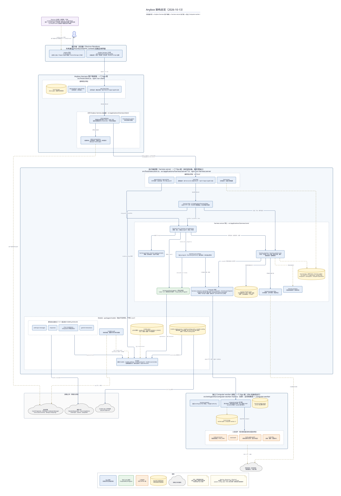

# Anybox 架构总览（2026-10-13，D2）

[文档首页](../README.md) · [组件手册](../modules/README.md) · [模块边界](../harness-module-boundary.md) · [组件协作总览](../harness-server-components.md)

核对日期：2026-10-13，按当日工作区源码绘制（HEAD `2e161e2`）。单页总览，使用 [D2](https://d2lang.com) 与 ELK 布局；源文件可直接编辑，SVG 与 PNG 为导出结果。四种协议、独立 Computer worker、项目文件与图片引用均为当前装配。

[可编辑 D2 源文件](anybox-architecture-2026-10-13.d2) · [矢量 SVG](anybox-architecture-2026-10-13.svg) · [PNG](anybox-architecture-2026-10-13.png)



## 图中边界

- **展示端**：`src/host/web/` 的 Anybox 外壳通过 `mount(container, context)` 挂载 `src/applications/harness/web/` 的 Anybox Harness 工作区；桌面版由 Electron 主进程以 `anybox-app://` 协议桥承载同一页面，并把客户端根与执行端根各放在一个 UtilityProcess。
- **Anybox Harness 客户端进程**：一个 Nya 根。常驻 `app.client-http`、`app.products` / `app.activity` 与 `local-storage`（client.sqlite）；打开 Anybox Harness 后装配 `client.gateway`、`client.connections` 与 `host.directory-picker`。网关固定连接版本与 `instanceId`，经白名单路由访问本机或远端 harness server。
- **执行端进程 · harness server**：每个实例一个 Nya 根。常驻 `host.http`、`host.access`、`app.products` / `app.activity`；打开 Agent 后装配 `harness.http`、harness server 核心（Run、RunRuntime、协议绑定、Session、Prompt、Projects、Project Files、Image Assets 与 Computer 协调）和 Models 包（配置存储、Vault、四种原生协议驱动、目录来源/缓存/调度）。业务 SQLite 由 `local-storage` 独占，各领域组件自行登记迁移域。
- **独立 Computer worker 进程**：另一个 Nya 根，持有执行器账本（worker.sqlite）、固定项目绑定、独占图片目录及 `tools.bash` / `tools.apply-patch` / `tools.processes` / `tools.files`；idle 时继续运行，停止 worker 服务才关闭其根。
- **进程之外**：模型 API、models.dev 公开目录、系统凭据（Keychain / Credential Manager / Secret Service）与作为路径基准的项目目录。

## 阅读约定

实线表示主要调用或交接，虚线表示数据、配置与资源归属；本图不枚举全部 `inject` 依赖。圆柱表示独占持久资源的组件，标签注明实际文件或目录。容器只表达进程或职责分组，不代表子 Context：每个进程仍只有一个根，图中全部组件直接安装在所在进程的根上。协议 Loop、`PreparedRunProgram`、execution、Agent 定义和 SQLite 记录提供方是所属组件的内部实现，不计作独立组件。

## 重新渲染

```bash
d2 --layout elk docs/architecture/anybox-architecture-2026-10-13.d2 docs/architecture/anybox-architecture-2026-10-13.svg
d2 --layout elk --scale 0.5 docs/architecture/anybox-architecture-2026-10-13.d2 docs/architecture/anybox-architecture-2026-10-13.png
```

ELK 不支持容器内单独设置 `direction`，`near` 常量会把对象放在主图外侧，因此图例与 NyaCore 说明合并为底部一行。

## 源码依据

| 区域 | 当前实现 |
| --- | --- |
| 展示端与桌面 | [宿主外壳](../../src/host/web/client.ts)、[Anybox Harness 工作区](../../src/applications/harness/web/harness-app.ts)、[桌面入口](../../src/entrypoints/desktop-main.ts) |
| 客户端根 | [客户端宿主](../../src/host/client.ts)、[客户端装配](../../src/applications/harness/client/runtime.ts)、[网关](../../src/applications/harness/client/gateway.ts) |
| 执行端根 | [执行宿主](../../src/host/execution.ts)、[应用运行时](../../src/applications/harness/server-runtime.ts)、[Models 装配](../../src/applications/harness/server-models.ts)、[核心组合](../../src/applications/harness/core/index.ts)、[业务 HTTP](../../src/applications/harness/http/harness-http.ts) |
| Computer worker 根 | [worker 入口](../../src/entrypoints/computer-worker-main.ts)、[worker 根装配](../../src/applications/harness/core/computer/worker-server.ts) |
| Models 包 | [组件](../../packages/models/src/component.ts)、[协议驱动](../../packages/models/src/protocols/)、[目录](../../packages/models/src/catalog.ts) |
