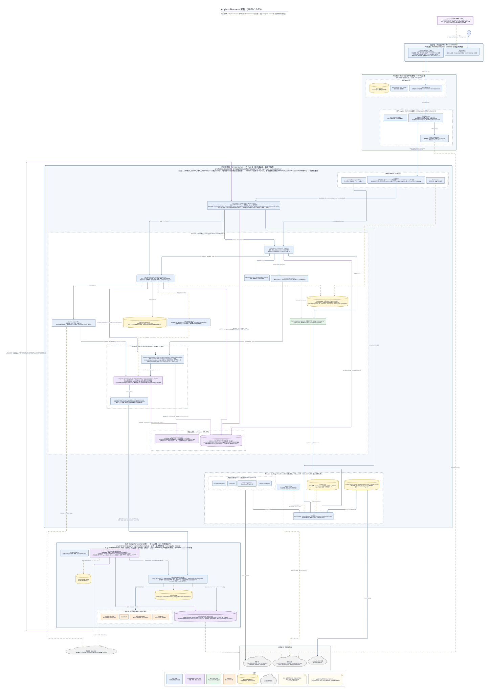

# Anybox Harness 架构（2026-10-15，D2）

[文档首页](../README.md) · [组件手册](../modules/README.md) · [模块边界](../harness-module-boundary.md) · [组件协作总览](../harness-server-components.md) · [可组合单元设计](../composable-units-design.md)

核对日期：2026-10-15，按当日工作区源码绘制（HEAD `fd161c6` 加上尚未提交的 U1 变更）。图中包含可组合部署单元 U0/U1：单元附着账本与拨出传输、Worker 路由、worker 侧附着账本与拨出循环、项目绑定 Computer 附着，以及 Web 的单元附着入口。单页总览，使用 [D2](https://d2lang.com) 与 ELK 布局；源文件可直接编辑，SVG 与 PNG 为导出结果。

本图作为 U1 架构参考保留，尚未反映后续 D0a workspace 拆包、D0a.1 应用独立 HTTP/认证与 Computer worker 独立管理。当前目录与装配以 [应用包设计](../application-packages-design.md)、[独立业务服务](../application-standalone-services.md)、[worker 管理](../computer-worker-management.md) 和组件手册为准；下方源码链接跟随现行目录，图源和导出保留绘制时的结构。

[可编辑 D2 源文件](anybox-harness-architecture-2026-10-15.d2) · [矢量 SVG](anybox-harness-architecture-2026-10-15.svg) · [PNG](anybox-harness-architecture-2026-10-15.png)



## 图中边界

- **展示端**：`packages/host/src/web/` 的 Anybox 外壳通过 `mount(container, context)` 挂载 `packages/app-harness/src/web/` 的 Anybox Harness 工作区；工作区新增“单元附着”设置分类（列出附着、生成一次性 Computer 附着码、撤销）和连接管理中每台设备的“附着到远端 harness server”入口。桌面版由 Electron 主进程以 `anybox-app://` 协议桥承载同一页面，并把客户端根与执行端根各放在一个 UtilityProcess。
- **Anybox Harness 客户端进程**：一个 Nya 根。常驻 `app.client-http`、`app.products` / `app.activity` 与 `local-storage`（client.sqlite）；打开 Anybox Harness 后装配 `client.gateway`、`client.connections` 与 `host.directory-picker`。网关固定连接版本与 `instanceId`，只放行拥有者侧 `/units` 路由，不代理单元侧 `/units/unit/*`。
- **执行端进程 · harness server**：每个实例一个 Nya 根。常驻 `host.http`、`host.access`、`app.products` / `app.activity`；`host.http` 对应用登记的 `http.selfAuthenticated` 前缀 `/units/unit` 跳过设备令牌，以 `principal: 'unit'` 交应用认证。打开 Agent 后装配 `harness.http`、harness server 核心和 Models 包。核心新增 `harness.unit-attachments`（独占 `unit-attachments` v1，本机单元 `local:models` / `local:computer` 自动 approved）、`harness.unit-transport`（内存邮箱、长轮询领取与回执、凭证认证）与 `computer-worker-router`（以同名 `computer.worker` / `computer.instance-provider` 按附着路由到回环客户端或单元传输）；`harness.projects` 升到 projects v2 绑定 Computer 附着，`harness.computer-operations` 升到 v3 在 scope 记录附着并在新声明前复核，`run-state` 升到 v11 保存 `unit_bindings_json`。形态由 `ANYBOX_COMPUTER_UNIT=local|remote` 选择：本机形态安装 `computer.local-worker` 并登记本机 Computer 附着，可把单个项目绑定远端附着；远端形态没有本机 worker，新项目默认绑定 `ANYBOX_COMPUTER_ATTACHMENT`。
- **独立 Computer worker 进程**：另一个 Nya 根，持有执行器账本（worker.sqlite，`computer-worker` v2 按附着区分 Run 授权）、固定项目绑定、独占图片目录及四个工具组件。新增 `computer.worker-attachments`（独占 `computer-worker-attachments` v1，单元凭证只在系统凭据命名空间 `anybox.computer-worker`）与 `computer.worker-dialout`（消费附着码，为每个 approved 附着维持一条到远端 harness server 的长轮询循环，工具图片经字节通道推送）。同一 worker 可同时服务本机 harness server（回环，`local:computer`）与远端 harness server（HTTPS 拨出），每个 Run 只归一个附着；idle 时继续运行。
- **进程之外**：模型 API、models.dev 公开目录、系统凭据（Keychain / Credential Manager / Secret Service，Models Key、客户端凭据与单元凭证各用自己的命名空间）与作为路径基准的项目目录。远端绑定项目的路径只对所绑定单元有意义。

## 两条 Computer 路径

1. **回环（本机形态）**：Run 接受事务从项目绑定取 `local:computer` → Computer Operations 固定 placement → Worker 路由 → `computer.local-worker` 经本地 HTTP 调用本机 worker 执行器；工具图片以 base64 内嵌返回，由 Operations 导入本机图片组件。
2. **拨出（远端附着）**：设备拥有者在 Web 生成附着码，worker 的拨出循环 `POST /units/unit/attach` 消费后保存凭证，之后以 `Unit <attachmentId>:<credential>` 长轮询 `GET /units/unit/poll`；harness server 侧 Worker 路由把该附着的 `claim` / `submit` / `get` / `query` 交给单元传输排队，循环领取后交本地执行器并 `POST /units/unit/replies` 回执；工具图片先 `POST /units/unit/bytes` 推送原字节、经 Session 导入为草稿，事实只带 `{ ref, pushed }`。撤销附着递增 epoch，两侧都取消并排空该附着的 Run。

## 阅读约定

实线表示主要调用或交接，紫色实线为单元相关路径，虚线表示数据、配置与资源归属；本图不枚举全部 `inject` 依赖。圆柱表示独占持久资源的组件，标签注明实际文件、目录或迁移域；紫色节点为 U0/U1 新增的单元组件。容器只表达进程或职责分组，不代表子 Context：每个进程仍只有一个根，图中全部组件直接安装在所在进程的根上。协议 Loop、`PreparedRunProgram`、execution、Agent 定义、工具库目录和 SQLite 记录提供方是所属组件的内部实现，不计作独立组件。

## 重新渲染

```bash
d2 --layout elk docs/architecture/anybox-harness-architecture-2026-10-15.d2 docs/architecture/anybox-harness-architecture-2026-10-15.svg
d2 --layout elk --scale 0.5 docs/architecture/anybox-harness-architecture-2026-10-15.d2 docs/architecture/anybox-harness-architecture-2026-10-15.png
```

ELK 不支持容器内单独设置 `direction`，`near` 常量会把对象放在主图外侧，因此图例与 NyaCore 说明合并为底部一行。图的高度由最长调用链决定，单元传输与附着账本之间不画认证边、改写在标签里，可让两者落在同一层。

## 源码依据

| 区域 | 当前实现 |
| --- | --- |
| 展示端与桌面 | [宿主外壳](../../packages/host/src/web/client.ts)、[Anybox Harness 工作区](../../packages/app-harness/src/web/harness-app.ts)、[单元附着界面](../../packages/app-harness/src/web/units-client.ts)、[桌面入口](../../packages/distribution/src/entrypoints/desktop-main.ts) |
| 客户端根 | [客户端宿主](../../packages/host/src/client.ts)、[客户端装配](../../packages/app-harness/src/client/runtime.ts)、[网关](../../packages/app-harness/src/client/gateway.ts) |
| 执行端根 | [执行宿主](../../packages/host/src/execution.ts)、[通用监听](../../packages/host/src/http-server.ts)、[应用注册](../../packages/app-harness/src/registration.ts)、[配置](../../packages/app-harness/src/server-config.ts)、[应用运行时](../../packages/app-harness/src/server-runtime.ts)、[Models 装配](../../packages/app-harness/src/server-models.ts)、[核心组合](../../packages/app-harness/src/core/index.ts)、[业务 HTTP](../../packages/app-harness/src/http/handler.ts) |
| 可组合单元 | [单元附着](../../packages/app-harness/src/core/unit/component.ts)、[单元传输](../../packages/app-harness/src/core/unit/transport-component.ts)、[Worker 路由](../../packages/app-harness/src/core/computer/worker-router.ts)、[本机 worker 客户端](../../packages/app-harness/src/core/computer/worker-client.ts)、[项目绑定](../../packages/app-harness/src/core/project/component.ts) |
| Computer worker 根 | [worker 入口](../../packages/distribution/src/entrypoints/computer-worker-main.ts)、[worker 根装配](../../packages/app-harness/src/core/computer/worker-server.ts)、[worker 附着账本](../../packages/app-harness/src/core/computer/worker-attachments.ts)、[worker 拨出](../../packages/app-harness/src/core/computer/worker-dialout.ts) |
| Models 包 | [组件](../../packages/models/src/component.ts)、[协议驱动](../../packages/models/src/protocols/)、[目录](../../packages/models/src/catalog.ts) |
| 组件说明 | [可组合单元模块](../modules/units/README.md)、[Computer 资源模块](../modules/computers/README.md) |
