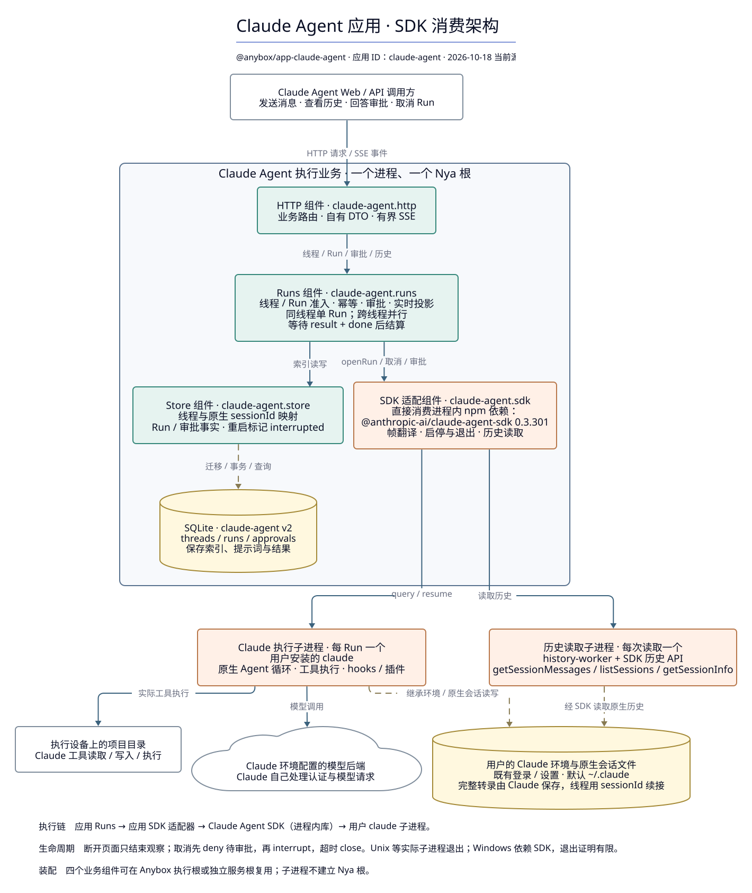

# Claude Agent 应用：直接消费 SDK 的架构（2026-10-18）

[文档首页](../README.md) · [应用组件手册](../modules/claude-agent/README.md) · [应用设计](../claude-agent-design.md)

对象是 **`@anybox/app-claude-agent`**（稳定应用 ID `claude-agent`），即直接依赖 `@anthropic-ai/claude-agent-sdk` 的应用。本图聚焦应用业务核心、SDK 消费方式、实际执行进程与数据归属。按 2026-10-18 当前工作区源码绘制（HEAD `973525d` 加尚未提交的变更）。

[矢量 SVG](claude-agent-architecture-2026-10-18.svg) · [PNG](claude-agent-architecture-2026-10-18.png) · [可编辑 D2](claude-agent-architecture-2026-10-18.d2)



核心执行链为：**应用 HTTP → 应用 Runs → 应用 SDK 适配器 → Claude Agent SDK → 用户安装的 claude 子进程**。

## 应用内部的四个业务组件

`installClaudeAgentBusiness()` 在执行进程的同一个 Nya 根安装四个组件。根由调用者提供；应用的线程、项目与 Run 是业务对象，不另建 Context。

| 组件 / 服务 | 职责与真实依赖 |
| --- | --- |
| HTTP / `claude-agent.http` | 提供线程、Run、审批、历史、目录与环境查询，以及有界 SSE；使用应用自有白名单 DTO。每个请求在首次异步步骤前，从根获取当前 Runs/SDK 服务代。 |
| Runs / `claude-agent.runs`、`claude-agent.run-admission` | 注入 Store 与 SDK。负责幂等与准入、同线程单活动 Run、跨线程并行、审批桥接、有界内存实时投影、取消、退出后结算，以及目录浏览和最近项目。 |
| Store / `claude-agent.store` | 注入 `local-storage`。在 SQLite 中维护线程、Run、审批与原生 sessionId 映射；执行端重启时将遗留 running/cancelling Run 标记为 interrupted，不自动重放。 |
| SDK 适配器 / `claude-agent.sdk` | 直接消费固定 `0.3.301` 的 Claude Agent SDK；唯一接触第三方 SDK 类型的边界。解析可执行文件，转换 SDK 帧、权限请求与历史数据，管理 Run 和历史读取子进程。 |

SDK 是进程内 npm 依赖，由适配组件调用。它不是额外的 Nya 组件或单独的常驻服务。HTTP DTO、SQLite 记录和其他业务组件使用应用自己的类型。

## 两条 SDK 消费路径

**执行路径**：Runs 持久接受 Run 后调用 `sdk.openRun()`，适配器用 SDK `query()` 启动用户的 `claude`。参数包含 cwd、prompt、可选 model/effort 和已有原生会话的 resume；流式输入模式保持 interrupt 可用。每 Run 一个 Claude 子进程，原生 Agent 循环、模型请求和实际工具执行在该 Claude 环境中完成。`canUseTool` 将工具权限或问题转为应用审批，界面回答经原回调返回。

**历史路径**：适配器为每次读取启动临时 `history-worker` 子进程，worker 直接导入 SDK 的 `getSessionMessages`、`listSessions`、`getSessionInfo`，读取转录、最近项目目录和会话标题，输出 JSON 后退出。父适配器限制时间和输出大小；取消或组件关闭时终止并等待 worker。它独立于每 Run 的 Claude 子进程。

用户可执行文件按 `ANYBOX_CLAUDE_AGENT_BINARY` → PATH → Unix `~/.local/bin/claude` 解析，并通过 `pathToClaudeCodeExecutable` 交给 SDK。执行设备需要已有可用的 Claude 登录与设置；适配器继承 HOME 和环境变量（含已有 `CLAUDE_CONFIG_DIR`），不会为应用新建隔离的 Claude 环境。

## 数据与执行资源

| 资源 | 所有者与内容 |
| --- | --- |
| SQLite：`claude-agent` v2 | 应用 Store 保存 `claude_agent_threads`、`claude_agent_runs`、`claude_agent_approvals`。内容包括线程标题/来源、项目路径、原生 sessionId、Run 提示词/结果/状态/实际模型与审批事实。 |
| 实时投影 | Runs 的有界内存视图与事件序号，用于 SSE 展示；重启后不会作为完整转录恢复。 |
| 原生会话历史 | Claude 保存的会话文件，默认位于 `~/.claude` 对应配置环境；完整转录不镜像到应用 SQLite。线程通过原生 sessionId 续接。 |
| Claude 认证与设置 | 复用用户既有登录、settings、hooks、插件和环境配置；模型认证和后端请求由 Claude 处理。 |
| 项目目录 | 位于实际执行设备，由 Claude 工具读取、写入或执行；应用自己的无状态目录浏览和最近项目也使用该设备路径。 |

## 生命周期

1. 接受 Run 前检查幂等键与线程占用；接受后持久保存记录，再开启 SDK 任务。原生 init 返回 sessionId 后固定在线程上，后续 Run 使用 resume。
2. 工具权限与问题经 `canUseTool` 进入审批记录，SSE 展示给用户；SDK 帧由适配器翻译后折叠为应用实时视图。
3. `result` 表示业务结果；Runs 先等待 result，再等待 `done`，之后保存终态、释放线程占用。Unix 适配器保存实际子进程句柄并等待退出，退出时清理进程组；Windows 由 SDK 启动，适配器没有同等独立退出证明。
4. 显式取消先进入 cancelling、deny 待审批，再 interrupt；等待结果和退出超时后 close。页面断开只结束观察。
5. 关闭业务装配先停止准入，等待已接受的启动边界，再取消 Run、等待结算与子进程/读取 worker 清理。Run 不跨执行端重启存活，历史线程仍可通过原生 sessionId 开始新 Run。

## 应用的装配入口

业务核心可以由 Anybox 注册适配装入已有执行根，也可以由 `anybox-claude-agent serve` 装入独立服务的唯一根。两者复用相同四组件，区别在外围的监听、设备认证和生命周期承载。独立服务提供业务 API，不提供完整的独立浏览器客户端。

正式安装的同包本机角色由应用私有协议经宿主通道衔接，`claude-agent-local-execution` 在 execution 根拥有内存 HTTP/SSE 观察资源，不新增公开监听、不建立设备连接或发行 token；图中的四个业务组件及 SDK 链路保持不变。客户端关闭只结束观察，业务停止仍使用原有 Products guard。旧 distribution 完整默认发行保留兼容配对，尚未整体迁入 D3。

应用自己的 Web、远端连接管理、凭据与网关属于调用侧适配，见[客户端连接](../modules/claude-agent/client-connections.md)和[客户端网关](../modules/claude-agent/client-gateway.md)。设备访问令牌与用户的 Claude 模型认证是不同资源。

## 源码依据

| 区域 | 当前实现 |
| --- | --- |
| 应用身份与依赖 | [definition.ts](../../packages/app-claude-agent/src/definition.ts)、[package.json](../../packages/app-claude-agent/package.json) |
| 四组件装配 | [server-runtime.ts](../../packages/app-claude-agent/src/server-runtime.ts)、[Anybox 注册适配](../../packages/app-claude-agent/src/registration.ts)、[独立服务入口](../../packages/app-claude-agent/src/server.ts) |
| HTTP / Runs / Store | [HTTP](../../packages/app-claude-agent/src/http/component.ts)、[Runs](../../packages/app-claude-agent/src/core/runs/component.ts)、[Store](../../packages/app-claude-agent/src/core/store/component.ts) |
| SDK 边界与执行 | [适配器](../../packages/app-claude-agent/src/core/sdk/adapter.ts)、[应用 SDK 契约](../../packages/app-claude-agent/src/core/sdk/port.ts)、[可执行文件解析](../../packages/app-claude-agent/src/core/sdk/executable.ts) |
| 历史读取子进程 | [history-worker.ts](../../packages/app-claude-agent/src/core/sdk/history-worker.ts) |
| 应用界面 | [Web](../../packages/app-claude-agent/src/web/app.ts)、[客户端注册](../../packages/app-claude-agent/src/client/registration.ts) |

## 重新渲染与验证

```sh
d2 --layout elk --elk-nodeNodeBetweenLayers 28 --elk-edgeNodeBetweenLayers 14 --elk-padding '[top=45,left=25,bottom=25,right=25]' --pad 28 docs/architecture/claude-agent-architecture-2026-10-18.d2 docs/architecture/claude-agent-architecture-2026-10-18.svg
d2 --layout elk --elk-nodeNodeBetweenLayers 28 --elk-edgeNodeBetweenLayers 14 --elk-padding '[top=45,left=25,bottom=25,right=25]' --pad 28 --scale 1 docs/architecture/claude-agent-architecture-2026-10-18.d2 docs/architecture/claude-agent-architecture-2026-10-18.png
npm run check
```

真实 Claude SDK 测试由 `ANYBOX_CLAUDE_AGENT_TESTS=1` 门控；普通 check 不代表真实 Claude 登录与跨平台执行验收。
