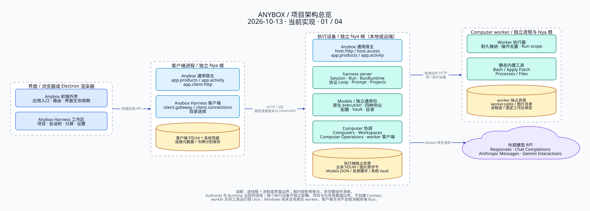

# Anybox 架构图 · D2

[文档首页](../../README.md) · [组件手册](../../modules/README.md)

基于 **2026-10-13** 的工作区源码绘制，源码基线为 `2e161e2`。图中描述当前实现；按职责聚合展示，箭头表示调用或数据流，并非穷举全部 Nya `inject` 依赖。每张图均提供可编辑 D2、可缩放 SVG 和 PNG。

| 图 | 说明 | 可编辑源码 | 矢量图 | 图片 |
| --- | --- | --- | --- | --- |
| 01 · 项目总览 | 界面、客户端、执行端、独立 worker 与外部模型 API | [D2](01-overview.d2) | [SVG](01-overview.svg) | [PNG](01-overview.png) |
| 02 · harness server | Run 准入、协议 Loop、RunRuntime、Session 与 Computer 协作 | [D2](02-harness.d2) | [SVG](02-harness.svg) | [PNG](02-harness.png) |
| 03 · Models | 通用包、原生 execution、配置、系统凭据与公开目录 | [D2](03-models.d2) | [SVG](03-models.svg) | [PNG](03-models.png) |
| 04 · Run 时序 | 幂等、接受、模型交换、工具观察、实际退出与原子结算 | [D2](04-run-lifecycle.d2) | [SVG](04-run-lifecycle.svg) | [PNG](04-run-lifecycle.png) |



## 关键边界

- **Anybox 是宿主，Anybox Harness 是应用，harness server 是其服务端核心。** 正式应用 ID 保持 `agent`；客户端与执行端分别装配应用目录、目标和运行时。
- 客户端、执行端和 Computer worker 各有独立 Nya 根。执行端的 Authority 与 Runtime 当前在同一进程。图中的职责分组不新增 Context；项目与任务是数据归属边界。
- Run 负责准入和控制；RunRuntime 同步接管 PreparedRunProgram，管理操作、取消、清理和结算。协议 Loop 解释原生结果，Models execution 持有私有凭据与可变原生上下文。
- Session 统一持有会话、对话树、Run、原生记录、事件与恢复游标。RunRuntime 仅注入 `harness.session-runs` 与 `harness.computer-operations`；图中的 Models 调用通过移交的 program 和 `RunHost` 发生。
- 执行端业务 SQLite、Models 非秘密 JSON、Models 目录缓存、客户端 SQLite 和 worker SQLite 分别归属、独占；总览的黄色节点汇总资源，**不表示它们共用文件或数据库**。图片保存原字节，文件引用保存文本快照；业务事务固定引用。
- Key 只保存在系统 Vault。目录刷新经 `models.source-data` 接纳定义，模型执行使用已保存配置；配置或密钥变更只影响新 execution。`models.generateText()` 已有单次纯文本生成实现，属于现有 Models 组件内部能力。
- 正常结束也要关闭 Run scope 并等待进程组退出，关闭 program 后才能结算。取消保留真实工具观察与部分补丁事实；清理失败不创建成功节点。客户端关闭不取消服务端 Run，空闲 worker 保持设备服务运行。
- Runtime 异常退出后，带恢复凭证且模型响应已保存的 Run 可查询原 worker 操作；`model-pending` 与无游标旧 Run 不自动重放。当前真实 worker 限 Unix，Windows 尚未支持实际工具执行；跨机器托管工作区与独立模型 exchange 尚属后续阶段。

## 源码依据

| 图 | 主要入口与证据 |
| --- | --- |
| 01 | [客户端宿主](../../../src/host/client.ts)、[执行宿主](../../../src/host/execution.ts)、[应用注册](../../../src/applications/harness/registration.ts)、[服务端装配](../../../src/applications/harness/server-runtime.ts)、[客户端装配](../../../src/applications/harness/client/runtime.ts)、[worker 根](../../../src/applications/harness/core/computer/worker-server.ts) |
| 02 | [核心组合根](../../../src/applications/harness/core/index.ts)、[Run](../../../src/applications/harness/core/run/component.ts)、[RunRuntime](../../../src/applications/harness/core/run/runtime-component.ts)、[协议绑定](../../../src/applications/harness/core/protocol-agents/registry.ts)、[Session](../../../src/applications/harness/core/session/component.ts)、[Computer Operations](../../../src/applications/harness/core/computer/operations-component.ts) |
| 03 | [Models 装配](../../../src/applications/harness/server-models.ts)、[Models 组件](../../../packages/models/src/component.ts)、[execution](../../../packages/models/src/execution.ts)、[目录调度](../../../packages/models/src/catalog.ts)、[Models 组件手册](../../modules/models/README.md) |
| 04 | [program / RunHost 契约](../../../src/applications/harness/core/run/program.ts)、[RunRuntime 操作与清理](../../../src/applications/harness/core/run/runtime-component.ts)、[Session 事务](../../../src/applications/harness/core/session/sqlite-records.ts)、[Computer 恢复与限制](../../modules/computers/README.md) |

## 重新生成

使用 [D2 官方 CLI](https://github.com/d2lang/d2/releases/tag/v0.9.0) **v0.9.0**，前三张使用 ELK，第四张使用 D2 sequence diagram；语法参考 [D2 文档](https://d2lang.com/)。本次 Windows CLI 压缩包经官方 `SHA256SUMS` 校验，SHA-256 为 `5f63b643de8f5a6dfb922d172e1b5496e4caf47497c33c4427cf1127f28c340f`。

在仓库根目录执行（D2 已在 PATH 时）：

```powershell
node docs/architecture/d2/render.mjs
```

CLI 不在 PATH 时显式指定本机路径：

```powershell
node docs/architecture/d2/render.mjs --d2 'C:/Tools/d2/d2.exe'
```

脚本使用项目已有的 `sharp` 生成 PNG，不下载运行时或目录数据，不添加 npm 依赖。Windows 默认字体为 `C:/Windows/Fonts/simhei.ttf` / `SimHei`；其他平台传入同一已安装 CJK 字体的 TTF 路径与字体族名称：

```sh
node docs/architecture/d2/render.mjs --font '/path/to/CJK.ttf' --font-family 'Installed Font Family'
```

SVG 保留 D2 内嵌的字体子集，便于离线查看。PNG 渲染显式使用相同本机字体，避免 librsvg 忽略内嵌字体时出现中文字宽不一致。编辑后先执行 `d2 fmt docs/architecture/d2/*.d2`（不展开通配符的 shell 请逐文件执行），再运行脚本；脚本依次检查语法、格式并重新导出。

## 本次验证

四份 D2 源码完成语法检查、格式检查和 SVG/PNG 导出，并检查中文显示、节点与连线布局。

按仓库约定运行了 `npm run check`：类型检查、构建及浏览器资源验证通过；测试共 1307 项，1029 通过、246 失败、32 跳过。失败主要包括 Windows 下 Unix Bash/Processes 限制、符号链接 `EPERM`、SQLite 清理 `EBUSY`，另有断言及资源相关失败。完整测试未通过。本次仅新增架构文档与绘图文件，没有修改运行代码，也没有将这些失败判定为本次文档引入或已修复。
