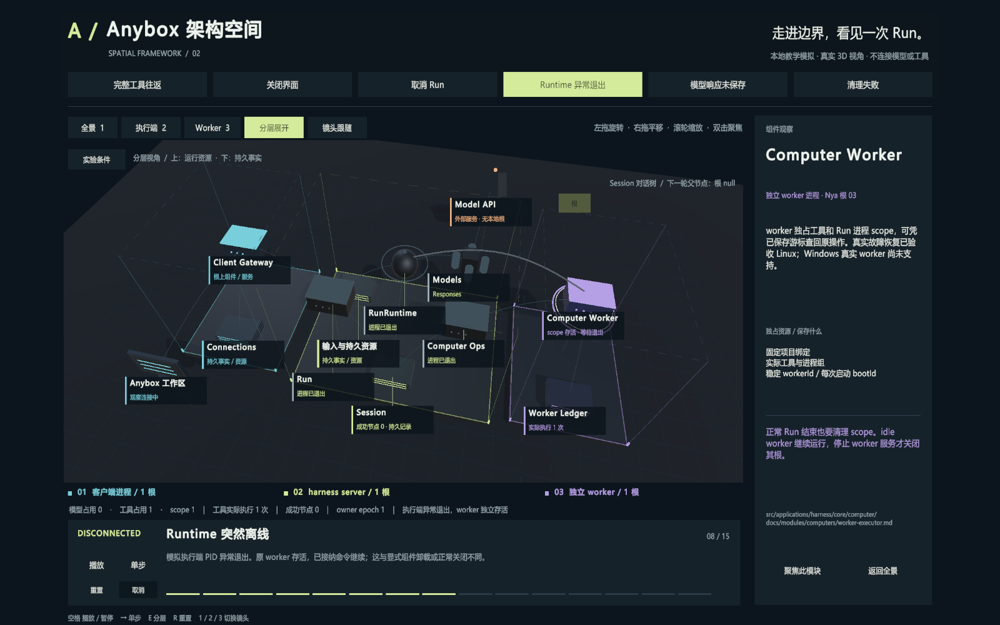
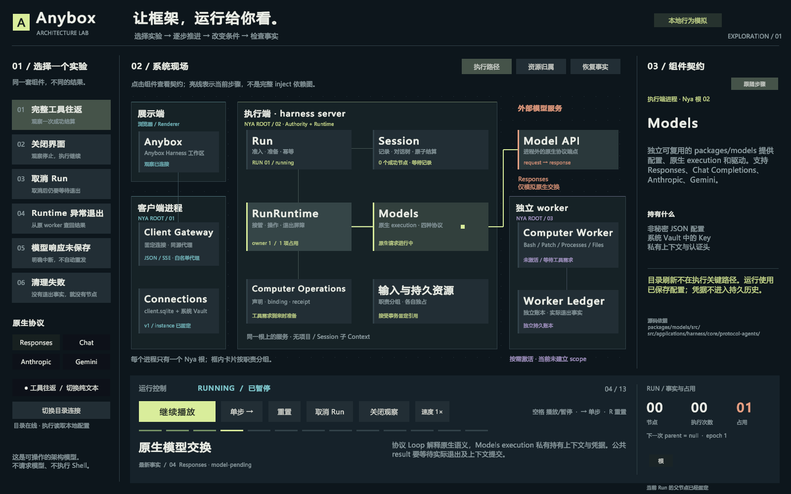

# Anybox 架构实验室 · Unity 交互原型

[返回文档入口](../../README.md) · [组件手册](../../modules/README.md) · [当前组件协作](../../harness-server-components.md)

这是 2026-10-13 的探索原型：让使用者通过推进 Run、改变观察条件、注入取消和故障、检查成功节点，理解 AnyboxV2 的框架边界。包含二维实验室与三维架构空间，共用一套确定性的行为模拟。使用 Unity 6.5、uGUI、TextMeshPro 与 Input System，界面为中文，参考画幅 1600 × 1000。

## 三维架构空间

新增场景为 `Assets/AnyboxArchitecture/AnyboxArchitecture3D.unity`。使用透视相机、真实网格、碰撞拾取和三维曲线路径；可以旋转、平移、缩放以及聚焦模块。原有二维场景和 SampleScene 保留。

三座平台分别表示客户端进程、harness server 执行端进程、独立 computer worker 进程。彩色立柱围出进程范围，每个进程一个 Nya 根；Authority 和 Runtime 位于同一个执行端平台。浏览器工作区和 Model API 在进程框外。

| 空间表达 | 要理解的含义 |
| --- | --- |
| 平台及同色边框 | 进程边界和该进程的 Nya 根 |
| 悬起的服务模块 | 当前运行职责；Runtime 私有 execution、工具操作等 |
| 底层叠片 | 持久记录、恢复事实、独占存储和输入资源 |
| “分层展开” | 抬起运行层，持久层保持原位；围框随之扩展 |
| 发光弧线和移动信号 | 当前步骤的行为方向，不是完整依赖图 |
| worker 周围的环 | Run 进程 scope 尚未实际退出 |
| Session 前方的晶体与连线 | 已成功结算的节点及显式父节点关系 |

层高是解释职责的视角，不表示真实部署层级或新的组件。Models 的上层模块侧重私有 execution，包内还有持久配置与 Vault；输入资源模块聚合多个既有组件，不能据此推断它们共享生命周期。底层记录在进程退出后仍存在，不表示 Session 服务仍在线。

建议先播放“完整工具往返”，再选择“Runtime 异常退出”，单步停在 disconnected 并展开分层：执行端运行模块变暗，Session 记录仍在，worker 的 scope 环仍亮；下一步恢复提升 owner，并查回原操作，实际执行次数保持一次。最后比较“模型响应未保存”和“清理失败”，观察为什么没有新成功节点。

- 左键拖动空白空间旋转，右键或中键拖动平移，滚轮缩放。
- 点击网格或标注查看职责；双击聚焦，或点击右侧“聚焦此模块”。底层资源采用较高俯视角，避免前排服务挡住视线。
- `1 / 2 / 3` 切换全景、执行端和 worker 镜头；`E` 展开 / 合拢层次。“镜头跟随”可让播放自动聚焦当前步骤。
- 空格播放 / 暂停，右方向键单步，`R` 重置，Esc 暂停。
- “实验条件”可切换四种协议、工具 / 纯文本、目录在线状态及关闭 / 恢复观察。接受中的 Run 锁定协议和父节点。
- 成功后选择右上方的根或节点，再运行形成分支；本地演示最多四个成功节点。

独立三维程序位于 Unity 项目的 `Builds/AnyboxArchitecture3D/AnyboxArchitecture3D.exe`。复制时需要保留整个构建文件夹。

## 如何体验

当前电脑的 Unity 项目为 `C:\AppData\UnityProjects\My project`，场景为 `Assets/AnyboxArchitecture/AnyboxArchitectureLab.unity`。打开场景并进入 Play 模式即可。原有 `SampleScene` 保留。

1. 点击“开始实验”或“单步”，观察 Run 准入、Session 接受、Runtime 接管、原生交换、worker 工具执行、资源退出与成功结算。
2. 选择“关闭界面”，比较观察断开与 Run 继续执行；也可随时点击“关闭观察 / 恢复观察”。
3. 选择“取消 Run”，或运行中手动取消。取消请求之后占用仍然存在，退出屏障满足后才写终态；工具副作用计数保留。
4. 对比“Runtime 异常退出”和“模型响应未保存”：前者提升 owner 后查回同一 worker 操作，后者 interrupted，不自动重发。
5. 选择“清理失败”，检查 scope 占用与没有新增成功节点的结果。
6. 成功后点击右下角的根或成功节点，再点“再运行 / 分支”，观察显式父节点与不可变历史。最多展示四个成功节点；重置后可重复探索。

点组件可查看职责、独占资源、关键约束和源码位置；“跟随步骤”恢复自动检查当前组件。“资源归属”和“恢复事实”切换卡片说明。协议选择创建新的模拟会话；接受中的 Run 禁止切换协议和父节点。纯文本开关展示不激活工具 worker 的路径，目录断开开关展示已保存模型配置可继续执行。

快捷键：空格播放 / 暂停，右方向键单步，R 重置，Esc 暂停。播放速度可在 1× / 2× 间切换。

## 模型的含义与边界

整个原型是本地、确定性的教学模拟，没有连接 Anybox 服务、模型 API、Vault 或真实工具；“执行次数”“占用”“节点”和信号动画都是模拟状态。四种协议共用生命周期示意，仅标识原生协议选择，不模拟各自真实编码器或模型输出。切换实验和重置会清空当前实验的模拟记录，不操作真实 Session。历史分支是顺序演示，未实现多 Run 并行控制。

展示端与三个进程边界分开：客户端根、执行端根（Authority 与 Runtime 同进程）、独立 worker 根。输入 / 持久资源卡片表示职责分组，并非新增组件。Agent 定义、协议 Loop、execution、项目和 Session 都没有被虚构为独立 Context。连线展示当前行为，不是完整 `inject` 图。

恢复实验只表达“原生模型响应已保存、原 worker 存活、有可用 resume cursor”的当前恢复窗口。显式卸载组件、正常关闭与 PID 强制退出语义不同。真实 worker 当前保留 Unix 装配限制，真实故障恢复已在 Linux 验收，Windows 真实 worker 尚未支持；Unity 在 Windows 上运行不改变这个产品边界。

本版围绕 Run 主路径保留必要细节：宿主 HTTP 认证 / 应用管理、目录接纳调度、图片和文件导入、完整工具库、归档等通过说明卡片概括，没有各自可操作的子流程。任何阶段简化都不能替代真实源码和行为测试。

## 源码与复现

本目录 `Assets/AnyboxArchitecture/` 是可复制的 Unity C# 源码，已同步到当前 Unity 项目。Unity 创建场景、字体和资源引用；仓库不手写或保存场景 YAML，也不纳入 Unity Library、构建缓存或系统字体文件。

| 文件 | 职责 |
| --- | --- |
| [LabSimulation.cs](Assets/AnyboxArchitecture/LabSimulation.cs) | 独立于 Unity API 的模拟状态与确定性实验步骤 |
| [LabContent.cs](Assets/AnyboxArchitecture/LabContent.cs) | 组件说明、边界、资源所有权与源码定位 |
| [ArchitectureLab.cs](Assets/AnyboxArchitecture/ArchitectureLab.cs) | uGUI 画面、按钮、信号动画、交互与会话树展示 |
| [LabEditor.cs](Assets/AnyboxArchitecture/Editor/LabEditor.cs) | 场景创建、中文静态字形图集、单场景本地 Player 构建 |
| [LabValidation.cs](Assets/AnyboxArchitecture/Editor/LabValidation.cs) | 四协议、六路径及手动操作的模拟行为检查 |
| [ArchitectureSpace.cs](Assets/AnyboxArchitecture/ArchitectureSpace.cs) | 透视相机、3D 模块、碰撞拾取、分层、信号、标注避让与 HUD |
| [SpaceEditor.cs](Assets/AnyboxArchitecture/Editor/SpaceEditor.cs) | 独立 3D 场景、前向渲染器、材质资源与独立 Player 构建 |
| [SpaceValidation.cs](Assets/AnyboxArchitecture/Editor/SpaceValidation.cs) | Play 模式流程、节点显示、分层、拾取与 HUD 命中检查 |

在包含 uGUI / TMP 与 Input System 的 Unity 6 项目中复制上述 `Assets/AnyboxArchitecture` 文件夹，非交互导入 TMP Essentials，然后使用菜单 `Anybox → Architecture Lab → Create or Open`。当前字体生成器从本机 Microsoft YaHei / DengXian 烘焙原型所需字形；换平台需提供可用的中文系统字体名称。静态字体图集只留在本地项目，修改文案后通过 `LabEditor.PrepareFont()` 补充字形。已有场景有未保存修改时，创建器会停止，避免覆盖它。

菜单 `Validate Simulation` 运行模拟状态检查；`Build Local Player` 只构建实验室场景到 Unity 项目的 `Builds/AnyboxArchitectureLab/AnyboxArchitectureLab.exe`，临时窗口设置在构建后恢复。原型 UI 在 Play / Player 启动时创建，场景保存 bootstrap 与字体引用。

三维版本使用菜单 `Anybox → Architecture Space → Create or Open 3D`。它在现有 URP 资产的 renderer 列表中追加专用前向渲染器，仅新场景的相机使用；原项目默认 2D renderer 保持原索引。材质模板与字体保存为 Unity 资源，确保独立构建保留所需着色器。`Build 3D Player` 只构建三维场景，完成后恢复窗口和产品名称设置。Play 中调用 `SpaceValidation.Start()` 可运行空间检查，结果保存在项目的 `Logs/space-validation.json`。

## 依据与验证

内容依据当前工作区，而非旧版动画的时序：

- [执行模块](../../modules/execution/README.md)、[RunHost / PreparedRunProgram](../../../src/applications/harness/core/run/program.ts)。
- [Computer 组件与当前恢复窗口](../../modules/computers/README.md)、[资源设计与验收边界](../../computer-resource-design.md)。
- [会话对话树](../../session-conversation-tree.md)、[Models 包](../../../packages/models/README.md)。
- [宿主与应用目录边界](../../harness-module-boundary.md)、[命名规范](../../naming.md)。

模拟行为检查覆盖成功节点屏障、实际退出、取消保留已发生事实、恢复去重、model-pending 禁止重放、未知退出不释放、纯文本不激活 worker、目录离线、父节点固定与顺序分支。检查结果只证明原型语义，不代表 Anybox 真正运行过模型或工具。

2026-10-13 本机验证：Unity 编译成功，92 项模拟行为断言通过；Play 模式逐步检查六条流程、全部说明卡和三个观察视角，无 TMP 文本溢出；34 个可用按钮的 EventSystem 命中检查通过，并实际点击验证了单步反馈。参考分辨率为 1600 × 1000，预览图直接捕获 Unity Game 画面。

三维版本另通过 80 项空间与交互检查，逐帧检查 83 个界面状态，无文本溢出。包括六种终态与三维成功节点一致、分层后运行模块抬升而 Session 保持原位、12 个模块聚焦后的物理射线拾取和可用 HUD 控件命中；结果见 [validation-3d.json](validation-3d.json)。共享的 92 项模拟断言再次通过。检查发现并修复了底层资源聚焦时被前排 Run 遮挡的问题。

三维 Windows x64 Player 的 BuildReport 结果为 `Succeeded`，已启动，启动日志未出现异常或着色器错误。同步 CLI 构建调用触发了一次 Pipeline 5 秒主线程等待超时，被计入构建日志；实际构建继续完成，耗时约 13 秒。另一个警告是 Player 不配置 RuntimePipelineConfig，和二维版本一致。三维几何、材质和中文布局已在 Editor Play 中检查；独立程序启动后窗口处于最小化状态，未把它描述为完成了独立窗口的鼠标实测。

Windows x64 独立 Player 构建成功，0 个构建错误，约 107 MiB；已启动并检查独立窗口的中文渲染与布局。唯一构建警告为没有配置 RuntimePipelineConfig，因此 Pipeline 在 Player 中禁用，符合演示程序无需编辑器控制服务的用途。演示程序位于上述 Unity 项目的 `Builds/AnyboxArchitectureLab/`；使用时保留整个文件夹，不能只复制 exe。

按仓库要求执行了 `npm run check`，三维版本完成时再次执行。两次的统计均为 1307 项、1029 通过、246 失败、32 跳过；类型检查、构建及浏览器资源边界校验通过。主要失败包括 189 项 `Bash component requires a Unix host`、9 项 `process component requires a Unix host`，以及 Windows 符号链接权限、SQLite 文件占用和 Shell 状态等待等；未将仓库全量检查描述为通过。本次仓库修改仅为原型源码、预览与文档导航，没有更改 Anybox 业务实现。
