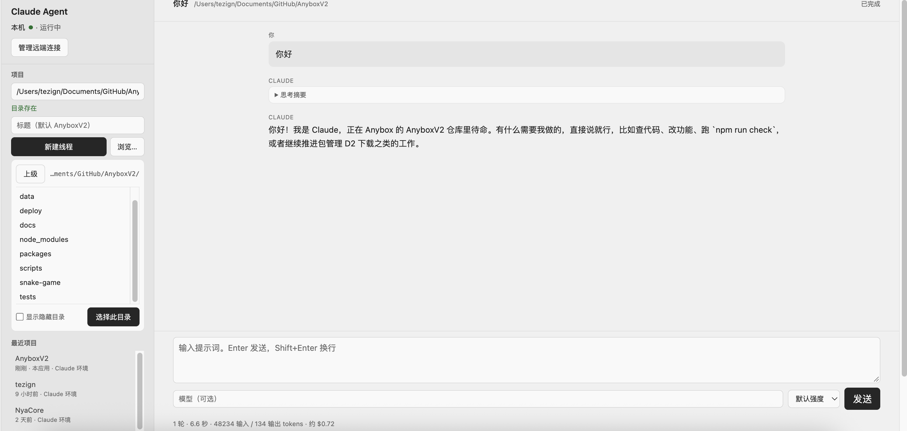
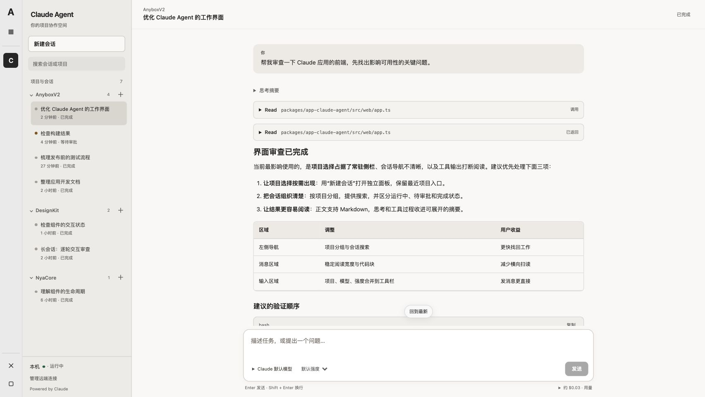
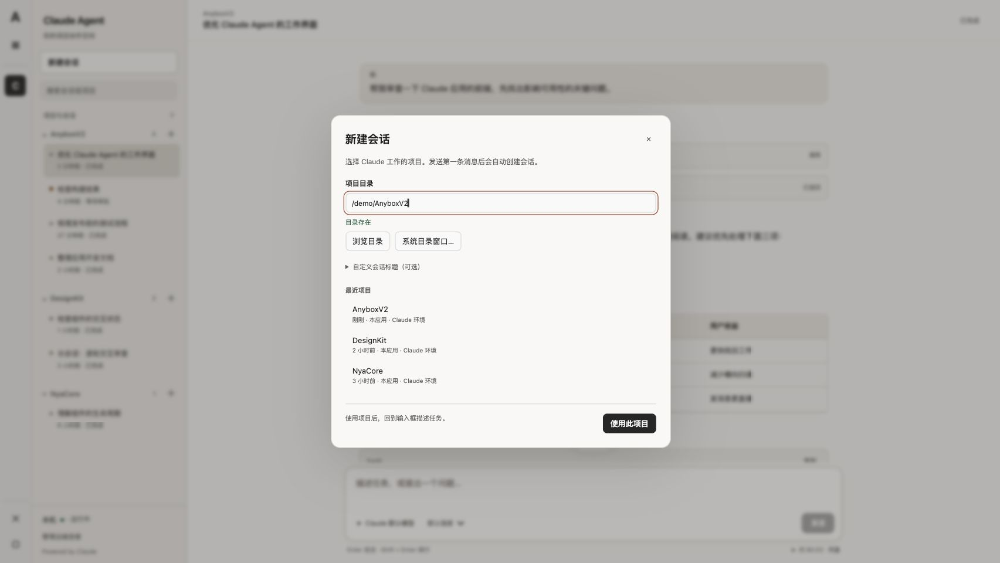
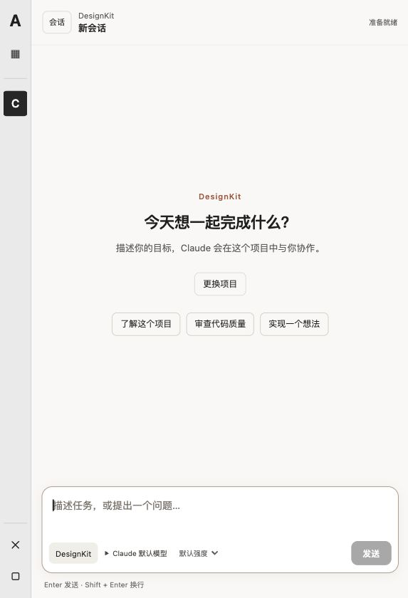
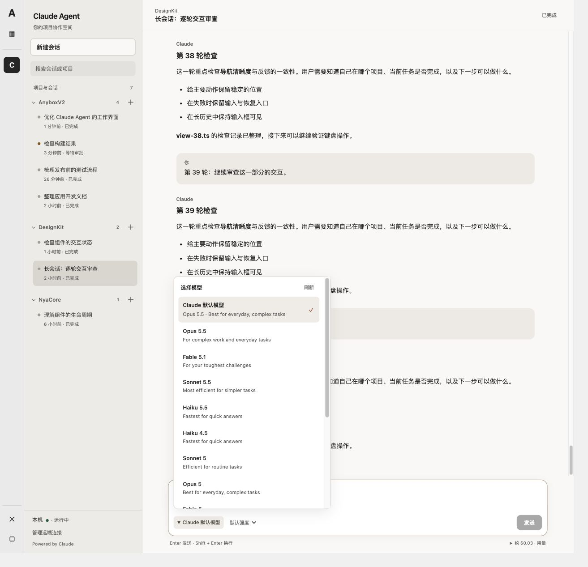

# Claude Agent 界面审计与改进

日期：2026-10-18。对应应用版本：0.1.3；模型选择补充改进为 0.1.4。源码与交互契约见 [Claude Agent 设计](claude-agent-design.md#web-界面)。

本轮目标是改善实际工作链路：找到项目与会话、开始任务、阅读执行过程、处理审批、继续输入。审计结合用户提供的真实页面、当前运行实例的只读检查、源码和浏览器行为验收。新版浏览器截图来自直接复用 Anybox 真实宿主 HTML、宿主前端模块和 Claude 正式应用模块的隔离夹具；其中项目、消息和执行结果为内存样本，不能视为真实模型执行证明。

## 审计结论

原界面的问题集中在信息组织与行为：侧栏把低频的目录设置放在最高优先级，压缩了高频会话导航；输入区和阅读区没有共同的尺度；执行时的滚动与键盘准入还会破坏用户操作。改进采用任务工作区：稳定的会话导航、按需项目选择、渐进展示的执行过程，以及统一输入区。

最左侧应用窄栏属于 Anybox 宿主；其右侧的项目与会话侧栏才属于 Claude Agent。两者不能混用：审批、长历史和新建等验收场景通过 Claude 自己的会话列表与新建入口进入，不能占据宿主应用导航。预览只登记 Claude Agent 一个应用；宿主的“我的应用”、应用快捷入口、关闭界面与停止按钮均使用真实宿主实现。

已有设计值得保留的部分包括：项目分组、执行设备身份、明确的审批选项、历史与实时结果区分、真实取消语义，以及跨应用隔离。重构继续沿用这些能力。

## 任务流程与截图

1. **找回正在进行的工作。** 原截图中路径、标题、目录浏览、最近项目占据侧栏绝大部分，真正的会话列表未进入可见区域。新版把新建、搜索和项目分组会话作为侧栏主体；设备与连接收到底部。

   

   

2. **选择项目、开始新会话。** 新建会话打开独立窗口，提供最近项目、执行设备路径与目录浏览。输入路径只验证，明确确认后才切换项目；取消不会切走原会话。系统窗口仍只对受信本机目标开放。可选标题收纳在折叠区，首条消息默认创建会话。

   

3. **描述任务并发送。** 主区空态给出可编辑任务建议；建议只填入输入框。模型选择和思考强度位于同一输入卡片底部；模型面板直接展示 Claude 当前环境返回的名称与说明，自定义名称收在次级入口，项目短名保留完整路径提示。输入自动增长，空输入禁用发送；Enter、表单和按钮共同检查 Run 准入。

   

4. **阅读结果并处理执行中的请求。** 助手正文支持安全 Markdown，思考、工具参数和结果默认收起，错误结果展开。审批位于输入区上方，标题和会话列表都提示待处理状态；允许、会话允许、拒绝继续使用 SDK 明确支持的选项。已在隔离夹具中点击允许，核对审批消失、Run 完成与输入恢复。

5. **上翻历史、切换会话并继续。** 已在长历史场景检查局部滚动与“回到最新”；行为测试验证上翻后刷新不拉回底部。各会话独立保留提示词、模型、强度与重试键；延迟提交不覆盖后来打开的会话，后来编辑的新草稿不被旧成功回执删除。存在草稿时参与退出保护，底部提供明确丢弃入口，包括设备已不可达的草稿。

## 发现与落实

| 优先级 | 问题及证据 | 本轮处理与验收 |
| --- | --- | --- |
| P0 | 原始截图的侧栏被创建表单和目录树占满，找不到会话；低频设置与高频导航竞争空间 | 项目选择改 dialog，导航成为侧栏可滚动主体；最近项目仍在选择窗口可达 |
| P0 | `app.ts` 在活动 Run 每次 render 强制滚到底部，阻止阅读历史 | 距底部小于 80px 才跟随；上翻保持，提供回最新；有行为回归 |
| P0 | Enter 直接调用 submit，绕过 disabled 按钮，活动 Run 仍能请求第二个 Run | 所有提交入口共用 `composerBlock`；保留可编辑下一条草稿；键盘与表单双入口回归 |
| P1 | 模型自由输入占据整行，收纳后仍只有历史建议，用户无法浏览当前可选模型 | 单一输入卡片；0.1.4 增加当前执行设备/项目的 SDK 模型目录、默认项、选择状态及失败重试，保留次级自定义输入 |
| P1 | 纯文本显示 Markdown 标记；工具原始 JSON 和 ID 展开会淹没正文 | 应用自有安全 GFM renderer、代码复制、表格；工具/思考摘要披露，保留展开选择 |
| P1 | 多处重复 Claude 作者标识，过程和最终正文层级相同 | 过程使用紧凑摘要，同一连续助手区域减少重复标签；用户消息保留原文 |
| P1 | 全窗高度叠加宿主容器，可能造成整页滚动和输入区位置不稳 | 根使用容器高度与 min-height:0，只滚导航/转录；桌面与窄窗口无文档横向溢出 |
| P1 | 通用按钮选择器特异性压过局部导航样式 | 低特异性基线和明确局部样式；核对新建按钮文字、焦点和选择态 |
| P1 | 切换会话共用输入，提交回执可能写入另一会话或清除新输入 | 按设备/目标保存页面内存草稿，捕获提交目标与正文；迟到成功和失败隔离 |
| P1 | 所有草稿阻止退出后，设备消失可能令草稿不可达而永久阻止退出 | 草稿窗口列出全部未发送内容并允许显式丢弃；不自动删除内容 |
| P1 | 窄屏隐藏侧栏时，内部 dialog 可能继承不可见；Escape 可能同时关闭窗口与抽屉 | dialog 显式可见，Escape 优先交给原生窗口；从主区直接选择项目已实际验证 |
| P2 | 线程数增长后缺少查找入口，长路径难以辨识 | 会话标题/项目路径本地搜索、短目录名与完整路径 title、文字状态与计数 |

## 成熟产品参考与采用范围

- [Claude Code Desktop 官方参考](https://code.claude.com/docs/en/desktop)：会话侧栏、任务开始时的环境/项目/模型选择、可收纳的工作过程。采用其工作组织和渐进披露原则，实际选项仍以 Anybox 当前契约为准。
- [Cursor Agent 官方概览](https://cursor.com/docs/agent/overview)：任务输入、执行观察与停止操作的明确分工。采用稳定输入区、清楚的执行/停止状态和结果阅读层级。

以上是设计依据，未逐像素复制品牌界面。当前没有对应后端契约的附件、文件引用、Git diff 审查、线程重命名/归档、权限模式切换和 worktree 控件没有加入本轮界面。0.1.4 的模型目录只采用当前执行设备 Claude SDK 的 `supportedModels()` 返回值，不把历史模型名当作可用目录；预览夹具默认的两项明确标记为模拟模型；可通过 `--model-catalog <JSON路径>` 载入先前读取的非秘密目录快照，不由夹具启动真实 Claude。

## 验证与限制

- `npm run check` 已通过：1999 项测试，1985 通过、14 项按环境门控跳过，0 失败；覆盖类型检查、全部工作区构建和浏览器静态依赖图。
- `tests/claude-agent-project-panel.test.mjs`：项目窗口、路径确认、焦点恢复、取消和迟到结果隔离。
- `tests/claude-agent-reconnect.test.mjs`：断线补读、Run 准入、滚动、独立草稿、迟到提交和退出保护。
- `tests/claude-agent-transcript.test.mjs`：安全 Markdown、HTML 惰性、URL 限制、代码复制、大小/深度上限及工具折叠对账。
- `node tests/helpers/claude-agent-browser-host.mjs`：真实宿主与正式应用组件的隔离可交互复验，只替换内存 API；提供完成、审批、长历史与空态 URL。可用 `--port <port>` 指定端口；兼容旧预览 hash，统一迁入宿主的 `#/apps/claude-agent/host/...` 路由。无需真实模型调用。

本轮浏览器检查覆盖桌面与窄于 760px 的窗口、项目窗口、任务建议、首条消息创建、审批和阅读。焦点、禁用状态、原生窗口语义和文字状态有直接检查；没有宣称完整 WCAG 合规，也没有做真实读屏、触屏键盘、所有操作系统或远端断网的人工验收。草稿仅在当前页面内存保存，强制刷新/关闭不保证恢复；宿主正常退出、生效与卸载仍须通过 canClose 和实际 dispose。真实 Claude SDK 验收继续由原有显式环境开关门控。

## 本机升级结果

0.1.3 已生成可直接安装目录 `data/claude-agent-ui-0.1.3-20261018`，包含完整运行依赖与已构建的 macOS arm64 目录适配器；通过运行中宿主的显式回环端点，以目录本地授权安装成功。安装请求为 `claude-ui-013-20261018-install`。

早期生效请求 `claude-ui-013-20261018-activate` 被页面生命周期保护以 `activation-browser-unavailable` 拒绝，原生效批次已取消。用户完全退出旧应用后，原宿主也已退出；使用同一 profile、数据库和 3000 origin 重新启动宿主，先完成待生效的 0.1.3，再正式安装并生效 0.1.4。未伪造页面退出、放宽 guard 或重放未知副作用。

2026-10-18 17:14（Asia/Shanghai）核验：selected 为 0.1.4、pending 为空，client/execution 的实际身份均为 0.1.4 且 ready。安装请求 `claude-ui-014-20261018-after-full-codex-exit-install` 为 installed；生效批次 `47174387-9b5a-4738-bbc2-ca373ad26114` 为 completed。正式网关 `/api/client/v1/apps/claude-agent/local/v1/apps/claude-agent/models?cwd=…` 返回 HTTP 200、13 个当前环境模型选项（含默认项），查询未发送用户消息。

本次正式浏览器自动验收受到 `forbidden-origin` 拒绝，未降低来源校验或伪造请求头；用户刷新现有正式页面并展开模型列表后，已明确确认“已看到模型列表”。下文模型截图仍是先前的隔离预览，不能视为正式页面截图。

## 0.1.4 模型选择补充

用户指出模型面板只有名称输入、没有当前可选项。原因是 0.1.3 只消费 `/models/recent`，该接口返回历史请求/实际模型名，无法代表当前设备的可选目录。0.1.4 新增应用自有的 `GET /models?cwd=…`，由当前 Claude 环境的 SDK 控制查询提供目录；前端打开时直接展示默认项与模型列表，按设备/项目隔离，提供加载、失败和重试状态；SDK 的 `default` 行合并到默认选项，避免重复显示。目录读取不发送用户消息，也不创建业务 Run。自定义名称保留为次级入口，不代替目录。

0.1.4 已经由正式包管理流程安装为不可变快照，并完成两角色生效；实际身份与实时接口核验见上面的本机升级结果。隔离预览继续只用于场景复验。

本机控制查询实测返回 13 项（含默认项），成功后等待查询进程退出，未发送用户消息。当前隔离预览使用本次本机读取的模型目录快照，其余会话、项目和执行结果仍为演示数据；预览中的“刷新”只重读该快照，不代表重新查询真实设备。正式应用的刷新则调用当前执行设备 SDK。

0.1.4 完整检查：`npm run check` 通过，2015 项测试、2001 通过、14 项按环境门控跳过、0 失败。新增 `claude-agent-model-picker.test.mjs` 的 8 项行为覆盖目录列表、选择后提交、默认去重、失败重试、设备/项目切换与取消、Escape 和自定义名称 Enter；`claude-agent-models.test.mjs` 的 7 项覆盖模型白名单、控制查询、退出等待与取消/超时/超限。浏览器已核对 13 行（默认合并）、选择标签与恢复默认。
