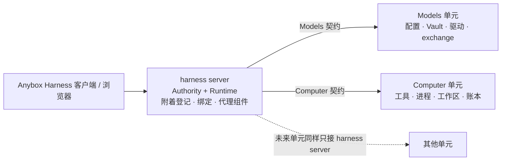
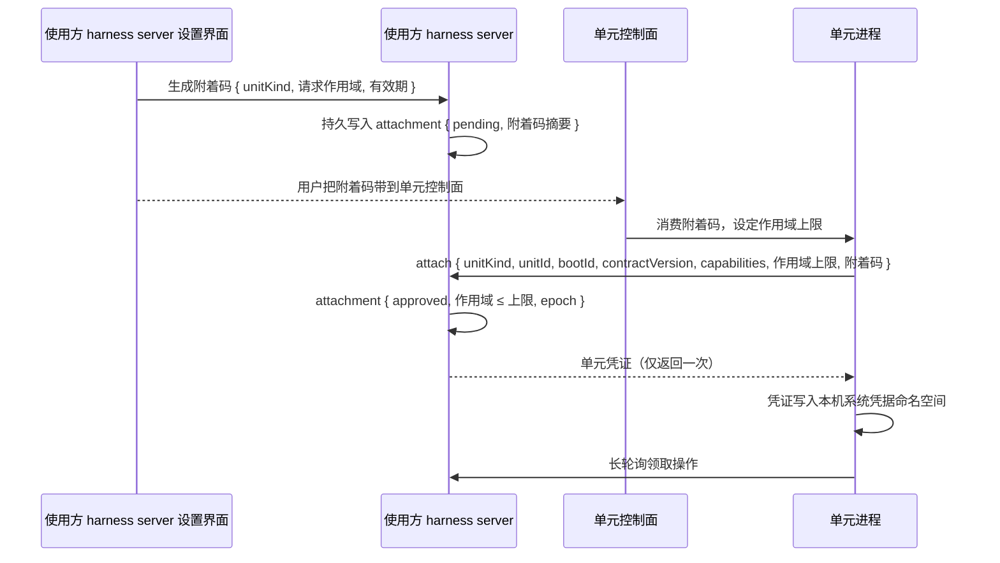

# 可组合部署单元设计

[文档首页](README.md) · [组件手册](modules/README.md) · [Computer 资源设计](computer-resource-design.md) · [原生协议框架](native-protocol-agent-framework-design.md) · [宿主与应用边界](harness-module-boundary.md) · [部署说明](harness-server-deployment.md)

状态：**目标设计；U0 附着登记已实施，U1 起待实施**。日期：2026-10-14，依据工作区 HEAD `9aa9318` 的源码与文档以及本次 U0 实现，组件说明见[单元附着](modules/units/unit-attachments.md)。本文定义 Anybox Harness 的"可部署单元"规则，并以 harness server、Models、Computer 三个单元为首批实例说明如何让它们各自独立部署、任意跨机器组合。未来可能拆出更多单元；它们按本文规则接入，不另起一套契约。本文不改变现有组件文档描述的当前行为，当前实现以源码和行为测试为准。本文与 [Computer 资源设计](computer-resource-design.md) 的阶段关系见 1.4 节。

## 1. 目标、范围与非目标

### 1.1 目标

三个单元各自能独立运行在不同机器上，并且任意组合都是合法部署：

| harness server | Models | Computer | 典型场景 |
| --- | --- | --- | --- |
| 本机 | 本机 | 本机 | 当前默认形态 |
| 远端 | 远端 | 远端 | 当前"客户端连远端"形态 |
| 远端 | 远端 | 本机 | 远端 Agent 操作用户自己的电脑 |
| 本机 | 远端网关 | 本机 | 团队统一保管密钥与配额，个人机器执行 |
| 本机 | 本机 | 远端沙箱 | 密钥不出本机，危险操作在隔离环境执行 |
| 远端 | 本机 | 远端 | 密钥只在用户手里，其余托管 |

对场景表的三点说明：

- 远端单元必须在线才能接纳操作。第 6 行把 Models 放在用户机器上时，用户机器离线期间远端 harness server 的新 Run 在准入阶段被拒绝，已接受的 Run 按 4.6 节的失联规则处理。
- 第 3 行的"本机 Computer"就是该设备本机 harness server 拥有的 worker。用户设备上的 Anybox Harness 执行目标必须运行，worker 在本机自动附着之外再附着到远端 harness server，见 4.2 节。
- 第 5 行的远端沙箱必须提供系统凭据服务来保存附着凭证。没有系统凭据服务的容器沙箱不在本文范围，见 1.3 节。

核心要求只有一句话：**单元之间的边界必须是位置透明的契约**。harness server 不关心 Models 和 Computer 在哪台机器，只关心它们提供同样的契约、具有稳定身份与代次、各自持有自己的持久事实。

### 1.2 单元的定义

| 单元 | 职责 | 当前落点 |
| --- | --- | --- |
| harness server | Agent 定义、项目与会话、Run 准入与 RunRuntime、原生记录、恢复游标、Prompt、客户端 API | 执行端 Nya 根，`src/applications/harness/core/`、`http/` |
| Models | 模型定义与连接、系统 Vault 中的密钥、四种原生协议驱动、模型 execution、公开目录 | 同一执行端根上的 `@anybox/models` 组件 |
| Computer | 工具契约执行、进程 scope、文件读写、工作区绑定、耐久执行账本 | 独立 worker 进程根，`core/computer/worker-*.ts` |

### 1.3 非目标

- 不拆分 harness server 内部的 Authority 与 Runtime。Runtime 独立部署仍由 Computer 资源设计第四阶段负责；本文 U2 只承接该阶段中"模型 execution 移交给独立 owner"的部分，并把 owner 放进 Models 单元进程，见 1.4 节。
- 不做会话跨 harness server 迁移，不做多 harness server 之间的项目同步。
- 不引入多租户权限模型。单元之间需要双向身份与作用域，但 harness server 对客户端仍是单拥有者；Models 单元被多个 harness server 共用时只以附着区分调用方，不建立用户概念。
- 不承诺外部副作用 exactly-once。同 ID 去重只保证重传不被当作新声明。
- 不改变 Models 独立包、每进程一个 Nya 根、密钥只在系统 Vault 等既有约束。
- 不支持没有系统凭据服务的单元宿主。附着凭证与模型 Key 一样只能保存在系统凭据库，不回退到文件或 SQLite。容器沙箱若要成为 Computer 单元，需要后续单独设计凭据提供方，本文不预留接口。

### 1.4 与 Computer 资源设计的阶段关系

| 本文阶段 | 依赖的 Computer 资源设计阶段 | 明确不包含的内容 |
| --- | --- | --- |
| U0 契约与登记 | 阶段 1、2（已完成） | 无 |
| U1 Computer 跨机器 | 阶段 3 中"固定远端 worker 通过认证连接"与"在所绑定实例上校验 binding"两项 | 阶段 3 的 portable-managed、checkpoint、产物保存与写权移交；U1 的工作区仍是 pinned-local，路径只对所绑定单元有意义 |
| U2 Models 本地独立进程 | 阶段 4 的模型 exchange owner 与 Session 的 exchange 事务端口 | 阶段 4 的 Runtime 独立部署；U2 完成后阶段 4 剩余部分只需把 Runtime 移出进程，不再触碰模型所有权 |
| U3 Models 远端与共用 | 无新增依赖 | 无 |
| U4 通用化 | 无 | 阶段 5 的弹性提供方以 Computer 单元形式接入：提供方启动实例后由实例附着，不改本文契约 |

两份文档的阶段编号各自独立。实施顺序为 U0、U1、U2、U3、U4；阶段 3 剩余部分与 U2 互不依赖，可以并行。

## 2. 单元必须满足的七条规则

这七条是现有设计里已经零散存在的做法，统一写成准入标准。以后新增单元时逐条对照。

| 规则 | 含义 | 现有对应物 |
| --- | --- | --- |
| 稳定身份与代次 | 重启不变的 `unitId`；每次启动变化的 `bootId`；只在语义变化时递增的 epoch | workerId/bootId、historyScopeEpoch、驱动 generationId、instanceGeneration |
| 独占状态 | 自己的持久存储；不与其他单元共享数据库；不假设跨单元原子性 | 业务 SQLite、Models JSON 与 Vault、worker SQLite |
| 统一操作生命周期 | 声明（幂等 ID 加摘要）、启动、带游标的观察、`result`、`done`、取消请求、关闭报告 | OwnedOperation、Computer 回执、NativeExecution 与 PreparedNativeExchange |
| 位置透明 | 在 harness server 的根上以同一服务名出现；本地实现与远端代理可互换，核心代码不改 | `models`、`models.settings`、`computer.worker`、`computer.instance-provider` |
| 附着与信任 | 单元向 harness server 登记身份和凭据；harness server 持久记录附着及其代次与作用域 | U0 的[单元附着](modules/units/unit-attachments.md)账本与本机自动附着；远端拨出、凭证认证仍缺失，本机 worker 发现仍依赖共享目录中的 `endpoint.json`，见 [worker-client.ts](../src/applications/harness/core/computer/worker-client.ts) |
| 绑定固定 | Session 或 Run 接受时固定具体单元实例与代次；旧代次的提交被拒绝 | 协议绑定快照、instanceGeneration、workspaceEpoch、runOwnerEpoch |
| 字节与控制分离 | 大对象走独立通道，按摘要寻址，字节先耐久保存再发布引用 | 图片导入凭证、文件快照保留凭证；目前只在本机目录 |

规则不要求单元之间的网络方向固定。逻辑上所有操作由 harness server 发起；传输层可以是 harness server 连接单元，也可以是单元拨出后 harness server 经该连接下发。两种传输下契约相同。

## 3. 拓扑：星形，harness server 居中

- **只有 harness server 组合其他单元。** Models 与 Computer 互不感知，也不互相调用。每新增一个单元只需定义它与 harness server 之间的一条契约，契约数量随单元数线性增长。
- **客户端只与 harness server 通信。** 用户在 Anybox Harness 的设置里看到已附着的 Models 端点和 Computer，并为 Agent 或 Session 选择绑定，与现在选模型、选执行设备的方式一致。远端单元不向客户端暴露接口。
- **harness server 的业务库仍是 Session 与 Run 的唯一事实来源。** 附着记录与绑定也保存在那里。自由组合针对的是资源，不是拆散控制面。
- **单元内部仍是一个 Nya 根。** 远端单元以独立进程运行自己的根；harness server 根上安装对应的代理组件。不建立项目、Session、Run 或单元子 Context。
- **每个单元有自己的控制面。** 单元拥有者在控制面行使同意权，harness server 拥有者在自己的设置里行使同意权，两侧都同意才形成附着，见 4.2 节。

## 4. 通用单元契约

### 4.1 身份

| 字段 | 变化时机 | 用途 |
| --- | --- | --- |
| `unitKind` | 不变 | `models`、`computer` 或未来类型 |
| `unitId` | 永不变化 | 附着记录、绑定与账本的稳定键 |
| `bootId` | 每次进程启动 | 区分"同一单元的新一代"；首次接纳操作时固定，重试回原代查回 |
| `contractVersion` | 契约升级 | harness server 拒绝不兼容版本，不做隐式降级 |
| 语义 epoch | 单元自定义 | Models 的连接 historyScopeEpoch、Computer 的 workspaceEpoch 等，由单元在能力声明中给出 |

三种形态的身份来源：

- 本机自动拉起的 worker 以附着本身标识，`unitId` 固定为 `computer-local`。它的实际 workerId 与 bootId 仍只在操作绑定时由 Operations 固定（providerRef 与 workerBootId）；打开 Authority 不读取 worker 目录，不会为了身份而创建执行资源。独立运行的远端 worker 在附着时提交自己的 workerId 作为 `unitId`。
- 同进程 Models 没有独立进程，其 `unitId` 固定为 `models-local`，`bootId` 由附着组件在每次装配时生成，只进入 Run 的绑定引用，不持久保存。改为独立进程后是新的 `unitId` 与新附着；绑定旧附着的在途 Run 按单元永久丢失处理，不自动改绑。
- harness server 自身继续使用 `host.access` 的 instanceId。单元附着时固定目标 harness server 的 instanceId，不接受其他实例借用同一附着。

### 4.2 附着

附着是两侧拥有者都同意某个单元为某个 harness server 服务的持久事实。同意分两步：harness server 拥有者在设置里生成一次性附着码，单元拥有者在单元控制面消费附着码并设定作用域上限。

| 单元 | 单元控制面 | 单元侧同意方式 |
| --- | --- | --- |
| Computer | 该设备本机 harness server 的连接管理页面；harness server 经回环把附着命令转发给自己的 worker | 设备拥有者填写附着码，选择允许的项目目录与工具契约集合 |
| Models（独立进程） | 拥有它的 harness server 的 Web 模型设置；首次启动尚无拥有者时由单元入口的 `attach` 命令建立管理附着 | 拥有者在 Web 为其他 harness server 填写附着码，选择允许的模型配置与配额 |
| Models（同进程） | 无，由组合启动器自动完成 | 无 |

- 附着记录属于 harness server 业务库的新迁移域，建议名 `unit-attachments` v1，由新的附着组件登记自己的表，通用存储不解释领域数据。
- 附着状态为 `pending`、`approved`、`revoked`，单调不可逆转回 `pending`。附着码一次性且有有效期，过期的 `pending` 记录可以清理。撤销立即关闭新操作准入，已接受操作按各自生命周期收尾，不因撤销伪造取消完成。
- 作用域有两层。单元侧上限在附着时由单元声明并保存在单元自己的记录中；harness server 侧作用域只能在上限内收紧，保存在附着记录中。任一层变化都递增附着 epoch，不影响已接受操作。撤销可由任一侧发起：单元侧撤销立即停止接纳并删除本地凭证，harness server 侧撤销停止新声明。
- Computer 的作用域是允许的项目目录与工具契约集合；Models 的作用域是 `manage` 或 `execute`，以及 `execute` 下允许的模型配置与配额，见 5.2 节。
- 一个 Computer 单元可以同时持有本机自动附着和多个远端附着。worker 账本与授权按附着区分：`attachmentId` 进入 `claimRun` 与 `submit` 的授权字段，不进入声明摘要；每个附着的作用域上限由 worker 在接纳时检查。
- 本机 harness server 与自己的 worker 之间沿用现有 `endpoint.json` 回环引导。它只负责发现本机 worker 进程，不构成授权事实；授权事实只有附着记录。
- 本机单元也走附着：组合根把本机单元声明给附着组件，组件在启动事务中幂等创建已批准的本机附着（附着 ID `local:<kind>`，无凭证），不经过附着码；本机附着不可撤销或收紧。这样本地与远端只有传输和批准方式不同，Run 与 Session 的代码路径相同。

### 4.3 操作生命周期

所有跨单元操作使用同一形状，与 [RunHost.perform()](../src/applications/harness/core/run/program.ts) 的持久屏障顺序对齐。

| 步骤 | 内容 | 现有依据 |
| --- | --- | --- |
| declare | `{ operationId, kind, declarationDigest, declaration, authorization: { attachmentId, ownerId, ownerEpoch }, binding: { unitId, bootId } }`；同 ID 同摘要返回原回执，不同摘要冲突 | Computer `submit` 与 WorkerSubmission |
| receipt | 单元耐久接纳后返回 `{ state, receipt }`；接纳不代表启动 | WorkerOperation.receipt |
| observe | 按 `cursor` 读取耐久事实：状态变化、Computer 输出 chunk 与偏移、结果引用；重复读取返回同一段 | Codex 输出 chunk 与 offset、WorkerOperation.state |
| stream | 有界临时投影：模型流式帧；允许丢帧，不按游标回放，不作为恢复事实 | 现有协议 Loop 的流式展示帧 |
| result | 业务结果，可早于退出 | OwnedOperation.result |
| done | 工作与清理实际退出；拒绝表示清理失败 | OwnedOperation.done |
| control | `{ controlId, targetOperationId, kind: cancel \| close-scope }`，独立幂等、单调 | Computer `cancel` / `close-scope` 提交 |
| report | 关闭 execution 或 scope 后的结构化报告，冻结后不再改变 | NativeExitReport、tool-process-cleanup 观察 |

harness server 的 RunRuntime 不感知单元在本地还是远端：它调用代理组件，代理组件把这八步映射到传输。声明先在 harness server 业务库落盘，再发给单元；单元回执丢失时按同 ID 查回；断网只改变连通性状态，不把 running 改成 failed。

`observe` 与 `stream` 的区分沿用现有规则：Computer 的输出 chunk 带偏移并耐久保存，属于 `observe`；模型流式帧只是有界临时投影，属于 `stream`。Models 单元不耐久保存流式帧，harness server 在版本化记录提交后以记录渲染，断连期间丢失的帧不补发。

首期传输采用单元拨出的双向 HTTP：单元长轮询领取声明与控制，单元以 POST 回传回执、耐久事实与流式投影；不使用 WebSocket。本机回环保留现在 harness server 直接请求 worker 的方向。两种传输下步骤与幂等规则相同。

### 4.4 字节通道

控制消息保持小而可持久，大对象走独立通道：

- 对象按 SHA-256 与字节长度寻址，附带 MIME 类型。引用形如 `{ sha256, byteLength, mimeType }`，与现有 [NativeImageResourceRef](../packages/models/src/native-types.ts) 一致。
- 字节先在接收方耐久保存并返回凭证，之后引用才能发布到账本或原生记录。顺序与现有图片 `retainIn` 与文件快照保留凭证相同。
- 跨网络传输方向固定为推送：harness server 把图片字节推给 Models 单元，Computer 单元把工具读取的图片字节推给 harness server。不要求任何一侧能被对方主动连接。
- 当前 worker 把图片以 base64 内嵌在 WorkerOperation 中返回，这只适用于回环传输；跨网络改为引用加字节通道，base64 不进入任何账本或历史。
- Models 单元只做有界暂存：字节按摘要保存在单元自己的暂存目录，保留到对应 exchange `done` 且记录提交为止，之后可回收。harness server 的 `harness.image-assets` 仍是图片唯一的长期拥有者。
- 回收按保留凭证进行，未被引用的对象可由各自单元清理；跨单元不做分布式 GC，只做保留凭证到期。

### 4.5 绑定固定

| 层级 | 固定内容 | 失效规则 |
| --- | --- | --- |
| Agent 或 Session 默认 | 首选的 Models 附着与 Computer 附着 | 只影响新 Session 或新 Run，与现有默认模型设置一致 |
| Run 接受事务 | 具体附着 ID、单元 `unitId`、`bootId` 或 instanceGeneration、附着 epoch、模型快照 | 任一不匹配时拒绝续接，不静默改用当前单元 |
| 操作声明 | 绑定写入摘要外的独立字段 | 重试不能重解析目标；替代单元不得接收可能已启动的操作 |

现有 runOwnerEpoch、instanceGeneration、workspaceEpoch 三层栅栏不变，附着 epoch 作为第四层：附着被撤销或作用域收紧后，旧 epoch 的新声明被拒绝，已接受操作继续到退出。附着栅栏比较附着 ID、种类、`unitId` 与 epoch；`bootId` 只记录不比较，同进程 Models 的续接本来就从记录重开 exchange，worker 的 boot 已由操作绑定校验。

### 4.6 恢复与协调

- 每一侧只维护自己的账本。harness server 保存声明、绑定与观察；单元保存接纳、启动、结果与清理事实。两边以 `operationId` 协调，不建立跨库事务。
- harness server 重启后按现有活跃 Run 恢复流程查回原操作；单元重启后先识别自己的原资源与账本，再以新 `bootId` 回答查询。
- 单元永久丢失时，其 starting 与 running 操作进入 outcome-unknown，保留已知事实，不向替代单元重发。
- 单元迟到的结果可以保存为原操作的事实，但不能覆盖新绑定下的工作区 head，也不能让已结算的 Run 重新开放。
- 失联规则对所有单元一致，沿用 Computer 资源设计 6.3 节：取消、关闭 scope 与关闭 execution 的请求先持久记录；远端未确认时本地观察按关闭期限退出并报告"未确认远端退出"，close 聚合错误，禁止创建成功节点；重新连通后继续处理未完成的取消与清理。Models 协议代注销同样只在单元报告本代 execution 实际退出后才算完成。

## 5. 三个单元的映射

### 5.1 Computer

当前 worker 已经满足身份、独占账本、回执式操作生命周期与代次栅栏四条规则，差的是附着、位置透明的网络接入与字节通道。

| 现状 | 位置 | 目标 |
| --- | --- | --- |
| 只监听 127.0.0.1，拒绝非回环来源 | [worker-server.ts](../src/applications/harness/core/computer/worker-server.ts) | 支持单元拨出附着；本机仍可保留回环传输 |
| 通过共享目录中的 `endpoint.json` 发现 | [worker-client.ts](../src/applications/harness/core/computer/worker-client.ts) | 由附着记录与代理组件发现；`endpoint.json` 只保留给本机引导 |
| 没有附着与控制接口 | 无 | worker 增加回环控制接口：消费附着码、列出与撤销附着；本机 harness server 的连接管理页面提供入口 |
| 实例提供方只确认本机 worker | [worker-instance-provider.ts](../src/applications/harness/core/computer/worker-instance-provider.ts) | 远端实例提供方按附着查询健康、代次与能力，提供同一 `computer.instance-provider` 服务名 |
| 工作区只有 pinned-local，身份即绝对路径 | [workspace/port.ts](../src/applications/harness/core/workspace/port.ts) | U1 保持 pinned-local，路径只对所绑定单元有意义；portable-managed 留给 Computer 资源设计阶段 3 剩余部分 |
| 项目文件读取与目录浏览在 Authority 本机 | `harness.projects`、`harness.project-files` | 当项目绑定到远端 Computer 时经 Computer 契约的只读查询面读取；复用已保存快照不激活 Computer |
| 图片以 base64 内嵌回传 | [worker-port.ts](../src/applications/harness/core/computer/worker-port.ts) | 改为引用加字节通道 |

[ComputerWorkerPort](../src/applications/harness/core/computer/worker-port.ts) 的 `info`、`claimRun`、`submit`、`get`、`shutdown` 已经是契约的本地形态；远端代理实现同一接口，只替换传输与发现。`harness.computers`、`harness.workspaces`、`harness.computer-operations` 的事务参与方式不变。

**只读查询面。** Computer 契约在 Run 所属的耐久操作之外增加只读查询面：列目录、搜索、读取文本文件的整文件或行范围，参数与现有 `harness.project-files` 和目录浏览一致。它不经过操作账本，原因是草稿阶段的文件引用由用户发起，不属于任何 Run，没有 owner 授权与进程 scope；读取幂等、可自由重试，只固定附着、`unitId` 与 instanceGeneration。读到的内容仍由 harness server 的 `harness.project-files` 以保留凭证保存为不可变快照，事实归属不变。依赖上，`harness.project-files` 与目录浏览按项目绑定选择本地文件系统提供方或经 `computer.worker` 的远端提供方；Session 注入 project-files，Operations 注入 worker，两者都不反向依赖 Session，不形成环。

本单元的验收目标是"远端 harness server 操作用户本地电脑"，对应 1.4 节对阶段 3 的部分依赖，不包含正在运行进程的迁移与写权移交。

### 5.2 Models

当前 Models 是同进程组件：`openNative()` 返回带闭包的 [NativeExecution](../packages/models/src/native-types.ts)，`prepareExchange()` 与 `start()` 在同一进程内持有驱动状态与凭据。要变成单元，需要一个进程边界上的对外面，而 Computer 资源设计第四阶段的"独立模型 exchange owner"正是这个接缝：一个持久拥有模型 execution、不随 Runtime 重启消失的组件。本文要求把它设计为 Models 单元的服务端，而不是 harness server 内部的又一个组件。

| 面 | 内容 | 保持不变的约束 |
| --- | --- | --- |
| 设置面 | 管理附着经完整 `models.settings`：定义、连接、配置、Key 状态、目录刷新；使用附着只得到允许配置的只读列表与可用原因，不含 Key 状态、地址与认证方式 | Web 仍只通过 `models.settings` 管理 Key，且只有管理附着的 harness server 能做；使用方 Web 显示"由该单元管理"并隐藏 Key、地址与启停控制 |
| 执行面 | 打开 execution 返回非秘密 NativeModelSnapshot 与能力；每次交换接受增量 intent 与资源引用，返回版本化记录与流式投影；取消；关闭返回 NativeExitReport | 密钥只在 Models 单元读取一次；记录为 JSON，不含凭据、认证头或句柄；`result` 等实际退出后才返回；流式帧不是事实 |
| 资源面 | 图片字节由 harness server 推送到 Models 单元的字节通道并有界暂存 | base64 不进历史；未声明图片能力的模型仍返回结构化不支持结果 |

协议驱动代租约跨越进程边界时，`generationId` 作为字符串传递，含义不变：注销撤销本代、取消本代 execution 并等待退出，新 Run 固定新代，旧 Run 不被替换实现。跨网络时"等待退出"按 4.6 节失联规则执行，只有单元报告退出才算完成。续接兼容仍按连接、远端模型、定义版本、语义参数与 historyScopeEpoch 校验。

每个独立 Models 单元恰有一个管理附着，作用域为 `manage`；其余为使用附着，作用域为 `execute` 并列出允许的模型配置与配额。管理附着由单元入口的 `attach` 命令在首次启动时建立，之后共享给其他 harness server 的操作都在拥有者的 Web 完成。一个 Models 单元被多个 harness server 共用是新情况，附着、调用方身份、作用域与配额属于 Models 单元服务端，不进入 `@anybox/models` 包：服务端在调用包之前把附着作用域映射为允许的配置 ID 并检查配额，包继续假设单一受信调用方，连接配置队列只由管理附着的操作进入。这保持包"不导入本项目 `src/`"的约束。

Models 单元服务端是 Anybox Harness 应用职责内的组件，位于 `src/applications/harness/` 下 U2 实施时创建的目录，进程入口位于 `src/entrypoints/`，消费 `@anybox/models` 公共入口，不新增 npm 包。它独占 exchange 账本与字节暂存目录，并在单元所在机器的系统凭据命名空间保存附着凭证。

### 5.3 harness server

harness server 是组合者，新增的东西集中在边缘：

- **附着组件**：登记 `unit-attachments` 迁移域，提供附着码生成、附着查询、批准、撤销与凭证；处理单元拨出连接。
- **远端代理组件**：以同一服务名提供 `models`、`models.settings`、`computer.worker`、`computer.instance-provider` 等服务；只拥有连接与观察，Effect 关闭只断开本地观察，不取消远端已接受工作。
- **绑定字段**：Session 默认与 Run 接受事务增加附着引用与 epoch，沿用 run-state 迁移账本的后续版本。
- **Web 设置**：展示附着列表、附着码生成、批准与作用域、Agent 或 Session 的单元选择；使用附着下的模型设置为只读视图；本机 worker 的远端附着入口位于连接管理。
- **不变的部分**：Run、RunRuntime、协议 Loop、Session 记录与恢复规则只依赖服务名与契约，不感知部署形态。

## 6. Nya 装配

每个进程仍只有一个根。harness server 的组合根按配置为每个单元选择"本地组件"或"远端代理组件"之一，两者提供相同服务名；核心组件通过 `inject` 声明的依赖不变。

| 单元 | 本地形态 | 远端形态 |
| --- | --- | --- |
| Models | 现有 `@anybox/models` 组件装配在 harness server 根 | 远端代理组件提供 `models`、`models.settings`、`models.protocols` 视图；Models 单元进程的根装配完整 Models 包与 5.2 节的服务端 |
| Computer | 现有本机 worker 客户端与实例提供方 | 远端代理组件提供 `computer.worker` 与 `computer.instance-provider`；Computer 单元进程的根装配现有 worker 执行器与四工具 |

- 代理组件的 `apply` 只建立连接与登记观察后返回，不等待远端就绪阻塞启动；远端不可用表现为操作准入失败，不是组件 FAILED。
- 代理的 Effect 取消并等待本地观察退出；远端已接受的操作继续到各自退出，由账本协调。这与现有"客户端 Effect 只关闭观察"的规则一致。
- 组合根不复制依赖图，也不在运行期切换同一服务名的实现。切换单元形态需要重新装配 harness server。
- 部署形态由 `src/entrypoints/` 的配置选择，使用环境变量声明每个单元的形态与附着引用，变量名在 U0 实施时随组件文档确定；不引入 dotenv。
- 单元进程使用自己的入口与根，不复用 harness server 的业务库。worker 的数据目录保存 computer-worker 账本与 `endpoint.json`，本机自动拉起的 worker 继续使用 `${harnessDatabasePath}.computer-worker`。同一目录同一时间只能由一个 worker 进程持有。同一台机器服务多个 harness server 时不启动第二个 worker，而是让同一个 worker 持有多个附着。

## 7. 信任与安全

- **双向身份**：harness server 以 instanceId 出示身份，附着码在生成时绑定该 instanceId；单元以 `unitId` 与附着时签发的单元凭证出示身份。设备令牌只代表客户端对 harness server 的拥有者权限，不向任何单元下发，单元也不接受它。任何一侧都不接受代理注入的身份头。
- **用户同意**：Computer 单元能在用户机器上执行任意 Shell，所以附着码必须由设备拥有者在该设备本机 harness server 的连接管理中消费，并在那里设定项目与工具上限，撤销立即生效。Models 单元持有密钥，由其管理附着的 harness server 拥有者决定允许哪些模型配置被哪个使用附着调用。
- **作用域与配额**：单元侧上限与 harness server 侧作用域分别写入各自记录，harness server 在声明前检查，单元在接纳时再次检查；两边都拒绝才算安全。
- **密钥不动**：Key 只在 Models 单元的系统 Vault；单元凭证只在单元所在机器的系统凭据命名空间；harness server 业务库只存凭证摘要与引用。没有系统凭据服务的宿主不能成为单元。
- **审计**：附着的创建、批准、作用域变化与撤销写入附着账本；每个跨单元操作的声明与回执已在现有账本中。
- **传输**：远端地址必须是 HTTPS 或等价的受信信道；本机回环可用 HTTP。TLS 由外部代理或单元自身管理，不按域名或转发头推断本机身份。

## 8. 持久化与兼容

| 边界 | 新增 | 不变 |
| --- | --- | --- |
| harness server 业务库 | `unit-attachments` v1；run-state v11 在 `harness_runs` 增加 `unit_bindings_json`（均已实施） | 既有迁移域、同事务参与方式、旧 JSON 只读 |
| Models 单元 | 执行面的 exchange 账本（第四阶段 model-exchanges）；有界字节暂存目录；管理与使用附着记录；系统凭据命名空间中的单元凭证 | JSON 配置、Vault、目录缓存、历史版本 |
| Computer 单元 | 按附着区分的授权记录；系统凭据命名空间中的单元凭证；回环控制接口 | computer-worker v1 账本与目录 |

- 不建立跨单元事务。每个单元在自己的存储中登记迁移。
- 默认部署形态不变：本机三单元同机，本机 Models 仍是同进程组件，本机 Computer 仍走回环。已有项目、会话、模型配置、worker 目录不需要迁移；本机附着记录在升级后首次启动时由组合启动器幂等创建。
- 旧 Run 没有附着引用时按本地形态解释，不补写历史。
- 关闭顺序沿用现有规则：先停止新 Run 准入，取消并等待所属操作退出，再卸载根上组件；远端单元上已接受的操作由其自身账本收尾，harness server 下次启动后协调。

## 9. 分阶段实施与验收

| 阶段 | 交付 | 验收 |
| --- | --- | --- |
| U0 契约与登记（已实施） | 本文契约定稿；附着组件与 `unit-attachments` v1；附着码生成、消费与撤销的服务 API 及拥有者侧 HTTP 路由；本机 `models-local` 与 `computer-local` 附着的幂等自动批准；Run 接受事务固定附着引用，恢复接管前校验 | 现有全部行为测试通过；本机形态无用户可见变化；升级后首次启动自动创建本机附着记录；验收记录见下 |
| U1 Computer 跨机器 | 单元拨出附着与本机连接管理的附着入口；worker 按附着区分授权；远端实例提供方；字节通道；Computer 只读查询面及 project-files 与目录浏览的远端提供方 | 远端 harness server 操作本地电脑完成 Bash、Apply Patch、文件引用、目录浏览与图片工具；网络中断、单元重启、harness server 重启三种故障注入后账本一致且无重复副作用；撤销附着后新声明被拒绝、在途操作正常退出 |
| U2 Models 本地独立进程 | 第四阶段 model exchange owner 作为独立进程，提供执行面与字节暂存；harness server 通过代理组件调用；`attach` 命令建立管理附着 | 四种协议文本、工具、流式、图片与重启续接测试在独立进程形态下通过；Runtime 进程 SIGKILL 后模型响应不丢失；流式帧丢失不影响记录提交 |
| U3 Models 远端与共用 | 远端附着、管理与使用附着作用域、调用方配额、密钥不出单元 | 两个 harness server 共用一个 Models 单元，使用方看不到 Key 状态与地址，各自作用域生效；撤销附着后新 Run 被拒绝、在途 Run 正常退出 |
| U4 通用化 | 附着与代理按 `unitKind` 通用；新增一个示例单元验证规则 | 新单元只新增自己的契约、代理与进程入口，不改 Run、RunRuntime 与 Session |

阶段之间对 Computer 资源设计的依赖见 1.4 节。每个阶段结束运行根 `npm run check`，并补充对应的故障注入行为测试；真实跨机器 HTTPS 与系统凭据验收单独门控记录。

U0 验收记录（2026-10-14）：新增 [单元附着组件](modules/units/unit-attachments.md)、`unit-attachments` v1 迁移域与 run-state v11；组合根把 `models-local`、`computer-local` 登记为本机单元，Run 准入固定两者的绑定引用，Session 接受事务复核，恢复接管前校验；HTTP 增加拥有者侧的列出、生成附着码与撤销路由，Run DTO 与 Web 不变。行为测试覆盖纯规则、附着码消费与过期、作用域上限、撤销 epoch、本机附着不可撤销、接受事务拒绝过期引用、恢复时失效引用结算失败不改绑、关闭等待。macOS / Node.js 24.16.0 上 `npm run check` 类型检查与构建通过，1314 项测试中 1302 项通过、11 项按原门控跳过、1 项失败；该失败是 `tests/computer-worker.test.mjs` 的真实 worker 图片用例，在未改动的 HEAD 上同样失败，属于本机环境既有问题，不由本阶段引入。未调用真实模型、系统 Vault 或远端单元，未修改 NyaCore。

## 10. 对未来单元的要求

新单元按第 2 节七条规则逐条对照后才能接入，并且只接 harness server。可预见的候选有产物存储、浏览器或桌面操作、知识检索。按现有约定，不为它们预建目录或组件；本文只约束它们接入时的契约形状。

## 11. 待决定事项

- Models 共用时配额的计量单位与超限行为。
- 附着凭证的轮换与过期策略。
- 流式投影的回传节奏：按帧立即 POST 还是固定间隔批量。只影响延迟，不影响事实。
- 使用附着的 harness server 能否请求 Models 单元刷新公开目录，还是只能由管理附着触发。倾向只由管理附着触发，使用方看到的可用原因随目录接纳更新。
