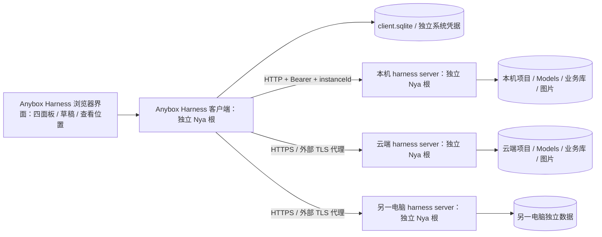

# Anybox 宿主与 Anybox Harness 应用边界

[文档首页](README.md) · [组件手册](modules/README.md) · [部署说明](harness-server-deployment.md)

目标边界以[应用模块化分发与按需安装](application-packages-design.md)为准：用户先下载最小 Anybox 核心，再安装独立应用。D0a 已完成源码工作区与最小契约拆分；应用客户端连接业务已独立归属，D0b 已完成生命周期接入与基础能力按消费者装配，应用包安装尚待实施。[发行与独立运行角色](runtime-roles-and-distribution.md)继续固定桌面、客户端服务、harness server 与 Computer worker 的独立进程和部署原则。

D0a.1 先实现[应用业务服务独立运行](application-standalone-services.md)。应用自己的 HTTP、认证与服务入口不导入 host 或 distribution；Anybox 注册适配在已有根上复用相同业务装配，另加活动保护和统一启停。没有公共 HTTP/认证抽取，也不因独立运行改变原默认命令、进程划分、数据文件或迁移。

Anybox 是宿主产品，Anybox Harness 与 Claude Agent 分别是独立应用包；SQL 与目录窗口为基础包，执行设备连接、凭据、配对和转发由各应用独立实现。`host` 仅依赖 `application-api`、自身控制记录使用的 SQL 提供方和 Nya，不依赖应用、连接、目录、Models 或业务 Vault。`distribution` 在核心之外保留当前静态默认组合、桌面/CLI 角色入口与兼容启动器；默认客户端只额外登记目录能力的惰性提供方，按兼容消费者启停，最后消费者实际退出后才释放；连接组件随所属应用启停。业务名称、稳定 ID 和数据归属见[命名规范](naming.md)。

## 实际目录

```text
packages/
  application-api/src/            核心身份/状态类型；可选 node、web、nya 适配
  host/
    src/applications/             注册校验、运行归属、目标与活动准入
    src/client.ts, execution.ts   显式接收目录的通用宿主
    src/access.ts                 实例身份与令牌摘要
    src/component.ts, http-server.ts, client-http.ts 监听器与应用分派
    src/web/, web/                外壳控制器、HTML 与样式
    src/desktop/                  通用进程、RPC、页面协议、退出与消息契约
  app-harness/
    src/registration.ts           服务端注册入口
    src/definition.ts, assets.ts  纯元数据与资源清单
    src/server-*.ts               配置、Models 与按需业务装配
    src/server.ts                 单应用独立服务与唯一根关闭
    src/server-access.ts          独立服务访问组件，兼容既有身份/令牌表
    src/core/, http/, client/, web/ Harness 业务、网关与浏览器实现
    web/                          模板、图标与样式
  app-claude-agent/
    src/                          注册、配置、索引、SDK、Run、HTTP、客户端与界面
    web/                          专属样式
  storage-sqlite/src/             显式 SQL 端口、迁移账本与排他 SQLite 提供方
  directory-picker/src/           目录窗口、Electron 取消适配与原生源码
  distribution/src/
    composition/                  默认兼容组合
    entrypoints/                  CLI、桌面与角色启动器
    desktop/                      默认路径配置与应用 smoke；通用适配已归 host
    resource-probe.ts             H0 资源归属验证
  models/                         通用 Models 与离线快照
  api-key-manager/                系统凭据适配与旧凭据兼容
```


`packages/host/src/` 不导入具体应用。通用宿主工厂显式接收注册目录，空目录仍可启动；`packages/distribution/src/entrypoints/` 在宿主之外选择正式应用和默认配置。新增应用修改其自身目录与组合入口。Anybox Harness 只依赖 `application-api` 公开的注册、运行时和 HTTP 契约，核心业务不依赖浏览器、客户端网关或进程入口。

客户端只导入 `@anybox/app-harness/client/registration`；服务端只导入 `@anybox/app-harness/registration`，共享 `definition.ts` 不加载两侧运行时。`entrypoints/anybox-main.ts` 在解析角色后动态导入相应 main，桌面后台也使用独立的 `desktop-client.ts` 与 `desktop-execution.ts`。`npm run web` 默认纯客户端，`web:local` 才使用组合启动器。

前端外壳管理左侧应用入口及其管理浮层、全局路由和界面生命周期；窄条右侧只提供无装饰的挂载容器，全部布局由当前应用内部组件从顶边开始呈现。宿主不在右侧显示标题栏、标签栏、操作栏、通知或加载失败页。关闭界面和停止应用控制位于窄条底部，应用列表、状态及重载入口位于管理浮层。应用拥有自己的导航、内容、操作、模板和样式。Anybox Harness 直接挂载项目与会话工作区，侧栏保留一处设备选择和连接管理；模型与 Prompt 是工作区设置分类，设备 Agent 启停放在连接管理，不另设功能页面顶栏。安全展示 DTO、校验和解码位于 `core/view/` 等无 DOM 入口，浏览器只导入允许的纯函数和 type-only 契约，不引入 execution。HTTP DTO 不包含凭据引用、原生恢复记录、execution、租约和 result/done 句柄。Models 驱动负责原生传输，协议 Loop 决定工具与续轮，RunRuntime 管理操作、取消与退出。

## 进程与资源边界



每个进程一个应用 Nya 根，不增加模块、项目或任务子 Context。执行宿主常驻通用业务存储、访问管理、产品控制、活动准入和 API；打开该设备上的 Anybox Harness 时装配完整 Models、Prompt 与 Agent 执行能力。Models 包含现有目录，Prompt 包含 Agent Prompt 绑定，Agent 依赖两者并装配 Projects、Session、图片/文件、Computer 协调及 worker 客户端、执行闭环。四种工具与执行账本安装在独立 computer worker 的唯一根，按需连接或启动；它不共享 Authority 业务 SQLite。客户端常驻自己的 SQLite、应用控制和 HTTP 外壳；本机目录窗口按兼容消费者装配，最后消费者实际退出后释放。打开各应用时分别安装自己的连接、凭据与代理，不安装执行服务。选择远程 Agent 不启动本地执行。

上述常驻产品控制与活动服务是 Anybox 托管组合的职责。应用独立服务由自己的工厂创建唯一根及必需提供方，不安装宿主产品/活动组件。Harness 安装自己的 `harness-access` / `harness-listener`，Claude Agent 安装自己的 `claude-agent-access` / `claude-agent-listener`，再安装相同业务装配；应用自行完成准入、取消与退出等待。同一旧业务文件只允许一个持有者，切换运行方式先正常关闭原实例。

API 监听器及请求由 `host-application-api` 独占，常驻入口只依赖宿主访问、产品控制及活动准入，业务路由按请求取得已启用能力的当前服务；Models 路由仍是内部函数。客户端监听器和静态页面由 app-client-http 独占；Anybox Harness 内部上传和转发流由按需 client-gateway 独占，连接与凭据由各应用私有组件独占并随所属应用启停，静态映射不是额外组件。依赖清理顺序由 Nya 决定。宿主 `prepareClose()` 同步关闭产品控制、业务、Run 与 HTTP 准入并等待控制和装配队列；`close()` 同时清理整个根与排空 HTTP 已受理写入、保留租约，避免先等待 Run 而延迟取消 Run。`installHarnessServerCore()` 返回的安装句柄 `close()` 只卸载该次安装的 harness server 核心组件，不关闭宿主提供的 Models、业务库、图片组件或整个根。运行期产品停用通过产品控制服务执行，忙碌时拒绝；直接 Run 服务同样检查关闭状态。网络连接 `dispose()` 只中止客户端读取和观察，不发远程取消或关闭命令。应用正常关闭取消并等待所属 Run，独立 idle worker 持续运行；停止 worker 服务才关闭其根。Runtime 进程异常退出后的工具等待接续与系统部署边界见 [Computer 资源设计](computer-resource-design.md)。

## 身份、请求与状态

执行端业务库 `host-access` v2 保存稳定 instanceId、设备令牌摘要与可空受管 owner 元数据；旧 v1 令牌保持非受管身份。桌面本机配对仅撤销自己 owner 的令牌，公开列表不返回 owner 或秘密。所有设备令牌拥有相同单用户权限，Prompt 使用 `local-web-user`。客户端根上的两个应用分别以 `agent-client-connections` v2 和 `claude-agent-client-connections` v2 复用该根唯一的 SQL 连接，各自拥有私有表和迁移域，并记录桌面本机连接 ID 与 instanceId 的归属，完整凭据由独立系统凭据命名空间保存，修改先登记意图再写凭据再提交引用，失败保留旧配置。

网关只接受已登记 connectionId 和公开路由白名单。每个请求捕获配置版本、地址、凭据及期望实例，不跟随重定向、不自动重试写入，不传递浏览器认证头。修改地址必须重新验证原 instanceId。客户端 ID 编码为 `h:<instanceId>:<resourceId>`；传输时在资源字段解包，正文与模型原生参数不改写。跨实例输入拒绝发送。

面板以资源身份固定设备，设置以当前显式选定连接固定设备；切换设置目标不改变已保存面板。SSE 按实例分组，单端错误只影响所属面板，离线时保留已存布局与 pending。项目文件读取发生在目标设备，图片上传和预览经所属连接网关。没有会话迁移、文件同步、跨实例重试、远程任意 URL 代理或执行调度。

## 迁移与验证

旧业务格式保持兼容；主机访问数据、客户端连接和应用打开目标分别拥有独立迁移域。SQLite 排他锁、旧无主锁处理、旧浏览器状态确认与发行物使用见[部署说明](harness-server-deployment.md)。测试入口为 `remote-harness-server.test.mjs`、`harness-client.test.mjs`、`deployment-boundaries.test.mjs` 和既有全部行为测试。`npm run check` 同时验证 Models 与应用。

应用新增、多应用切换和退出契约见[通用宿主设计](products-v1.md)与[接入说明](application-development.md)。通用层不导入 Anybox Harness 领域；浏览器外壳不静态依赖 Anybox Harness 模块，应用入口由目录动态加载。
