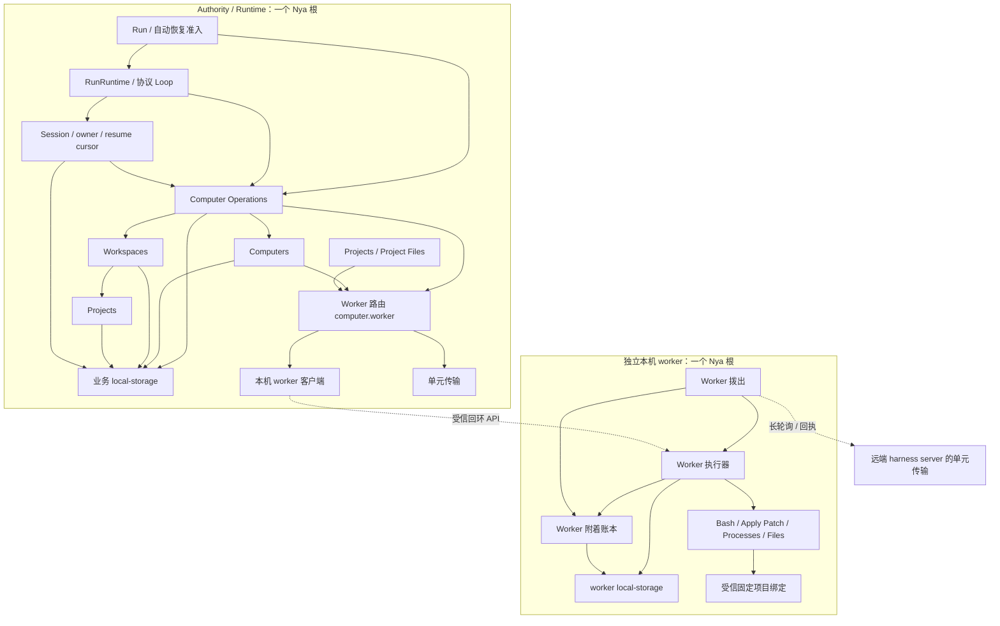
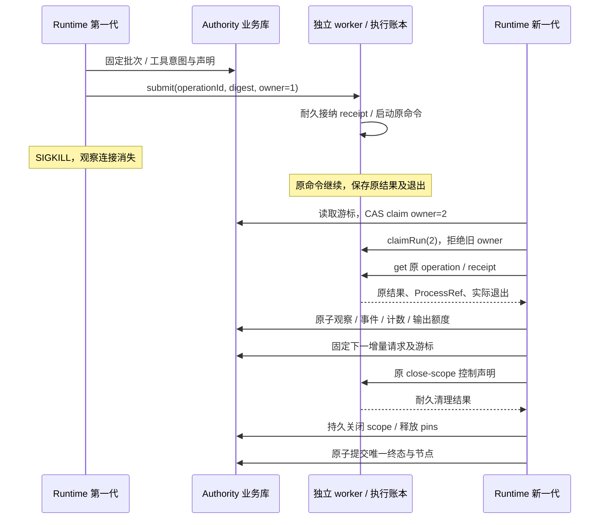

# Computer 资源模块

[返回组件手册](../README.md) · [资源设计与演进](../../computer-resource-design.md)

本模块实现 Computer 资源契约和独立本机 worker。Authority 与 Runtime 当前留在 harness server 的同一个 Nya 根；worker 使用独立进程及唯一根，持有工具和执行账本。模型响应已持久保存后的工具等待、结果消费及清理可以在 Runtime 重启后接续，正在等待未保存模型响应的 Run 仍明确 interrupted。

| 组件 | 服务 | 当前职责 |
| --- | --- | --- |
| [Worker 路由](worker-router.md) | `computer.worker`、`computer.instance-provider` | 按附着把同一契约路由到回环 worker 或拨出的远端 worker，按需确认实例 |
| [Computers](computers.md) | `harness.computers` | 逻辑资源、按需实例确认、共享激活和实例 pin |
| [Workspaces](workspaces.md) | `harness.workspaces` | 稳定项目映射、pinned-local 准备、scope binding 和归属释放 |
| [Computer Operations](computer-operations.md) | `harness.computer-operations` | 工具声明、两端接纳去重、固定绑定、结果回收和耐久取消/清理协调 |
| [本机 Worker 客户端](local-worker-client.md) | Authority 根的 `computer.local-worker`、`computer.local-worker-control` | 按需启动或查回独立进程，拥有本地 HTTP 观察；经回环转发设备拥有者的附着控制 |
| [Worker 执行器](worker-executor.md) | worker 根的 `computer.worker` | 独占 worker 账本、工具 scope、实际执行与只读查询面；按附着区分 Run 授权并检查作用域上限 |
| [Worker 附着账本](worker-attachments.md) | worker 根的 `computer.worker-attachments` | 本单元服务的 harness server 记录、作用域上限与系统凭据命名空间中的单元凭证 |
| [Worker 拨出](worker-dialout.md) | worker 根的 `computer.worker-dialout` | 消费附着码，为每个 approved 附着维持到远端 harness server 的长轮询循环 |
| [Worker 固定项目绑定](worker-project-bindings.md) | worker 根的 `harness.projects` | 拒绝项目查询，只允许工具使用已固定 workspacePath |

创建项目、Session、纯模型 Run 和计划工具不准备计算实例或工作区。Shell 和文件工具才建立需求，并在执行前准备 binding。Session 通过同步事务端口接纳声明、owner 和 resume cursor；Operations 固定 placement 后派发到 worker。RunRuntime 不再直接 inject 四种工具服务，原进程内执行路径被独立 worker 取代。

下图节选当前 inject 依赖，箭头指向被依赖的服务；Session 的图片、文件等既有依赖省略。

每个 Run 由恰好一个附着拥有：本机 harness server 经回环以 `local:computer` 提交；远端 harness server 的请求由拨出循环领取，授权字段取自投递该请求的附着，设备拥有者在消费附着码时设定的目录与工具上限在每次接纳事务里再次检查。项目绑定到一个 Computer 附着（[Projects](../sessions/projects.md)），Run 接受事务从项目绑定取 Computer 引用；Authority 侧的 Computer Operations 把它写入 scope，新声明前复核附着仍有效，远端附着的声明保留在逻辑计算机 `unit:<attachmentId>` 上，规格取附着记录中单元声明的平台与架构。组合根按 `ANYBOX_COMPUTER_UNIT` 选择形态：本机形态安装本机客户端并登记 `local:computer`，新项目默认绑定本机、也可显式绑定远端附着；远端形态没有本机 worker，新项目默认绑定 `ANYBOX_COMPUTER_ATTACHMENT`。两种形态都由 [Worker 路由](worker-router.md)提供同名服务。Computer 契约另有不经操作账本的只读查询面（stat、列目录、搜索、读取文本），Projects 与 Project Files 对远端绑定的项目经它读取，快照仍由 harness server 保存。

worker 存活时，Runtime 进程 SIGKILL 不取消已接纳命令；新 owner 查询原 receipt/result，工具结果、事件、限额和成功节点按已提交事实推进。Codex session_id 仍绑定原 worker/Run，stdin 和输出领取按 operation ID 去重。worker 自身故障且无法证明执行事实时保留 outcome-unknown，不重放；没有新恢复信封的旧 Run 继续 interrupted。显式卸载 Runtime 组件、撤销依赖及正常关闭应用仍取消并排空所属 Run；idle worker 保持独立设备服务。

下图展示当前已持久保存模型响应后的接续窗口；两代 Runtime 分别装配 Authority，业务库始终只有一代进程独占。

本模块不提供跨机器迁移、portable-managed、checkpoint 或独立模型 exchange。模型请求已发出而响应未保存时停止自动重发；任意 Runtime 阶段接续属于第四阶段。远端项目仍以绝对路径登记，宿主的目录选择器只浏览 harness server 本机。验收与后续边界见[设计文档](../../computer-resource-design.md)与[可组合单元设计](../../composable-units-design.md)。

实际 worker 依据当前 Windows、macOS 或 Linux 的原生进程后端可用性装配，缺少匹配产物时关闭启动准入。三平台共享服务、账本、文件与图片组件；各平台原生进程故障、系统凭据及完整发行包仍须分别验收，不能以受控替身测试替代。
