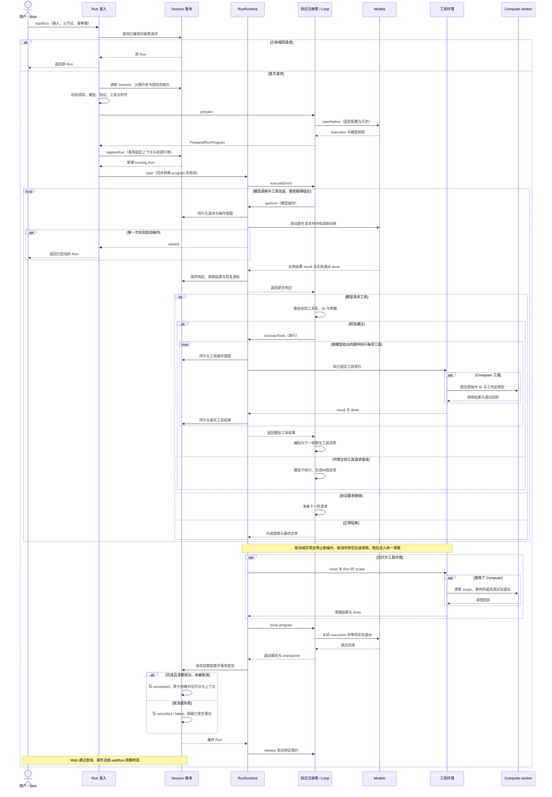

# Anybox Harness Run 执行时序图

[返回执行模块](README.md) · [Run 准入与控制](run.md) · [RunRuntime](run-runtime.md)

一次新 Run 从幂等检查和准入准备开始，经原生协议的模型与工具循环，最后等待资源实际退出并提交终态。`startRun()` 返回、模型输出最终文本、Run 完成是三个不同的时刻；成功对话节点只在清理完成后，与 Run 终态一起提交。

下图覆盖新 Run 的主路径；取消和失败也汇入统一清理与结算。启动恢复的 owner 接管、原操作查询和未知副作用处理见 [RunRuntime 的进程重启接续](run-runtime.md#进程重启接续)。

## 时序与生命周期边界

- 图中将协议注册表、准备好的 program 与协议 Loop 归在同一泳道便于阅读：注册表负责准备和绑定，program 内的 Loop 解释原生响应并决定续轮；这不表示新增或合并 Nya 组件。Runtime 通过 program 提供的启动回调调用 Models，不解释原生停止原因。
- 已接受的同一幂等请求返回原 Run；同键但输入不同会冲突。接受前的校验或准备失败不创建 Run，接受后的交接失败仍须清理并结算。`startRun()` 也可能返回提前结算的 Run，完成判断使用 `waitRun()`。
- 每个模型或工具操作都先保存意图，再启动并持有句柄，等待 `result` 和 `done` 后保存观察。工具调用的 `done` 只证明该次调用退出；仍由 Run scope 持有的长进程在最终关闭 scope 时终止并等待。
- 工具环境按 Session 固定的快照路由。Computer 环境经 Computer Operations 派发给独立 worker，其他受信环境自行提供执行；关闭 Run 的 scope 不停止空闲 worker 服务。合法 ID 对应的未知工具名或参数错误可整批拒绝并反馈模型，累计最多三批；无法关联的 ID、损坏原生 JSON 或超过额度会终止执行。
- 取消和执行异常可发生在图中的任意运行阶段；存储可用时，取消后仍提交已经发生的真实观察，写入失败则关闭新操作准入并报告状态故障。清理失败不能被普通取消掩盖，也不能创建成功节点；结算写入未确认时保留恢复边界，不重放未知副作用。中止 `waitRun()` 的等待信号只结束该次等待，不取消 Run。

## 源码与行为验证入口

- [Run 准入、准备与所有权交接](../../../packages/app-harness/src/core/run/component.ts)
- [协议准备与绑定](../../../packages/app-harness/src/core/protocol-agents/registry.ts)及[模型与工具交换管道](../../../packages/app-harness/src/core/protocol-agents/shared.ts)
- [Runtime 操作屏障、工具串行执行与统一清理](../../../packages/app-harness/src/core/run/runtime-component.ts)
- [Session 接受与原子结算](../../../packages/app-harness/src/core/session/sqlite-records.ts)
- [核心行为测试](../../../tests/harness-server-core.test.mjs)、[工具循环测试](../../../tests/tool-loop.test.mjs)及[对话树与结算测试](../../../tests/conversation-tree.test.mjs)
