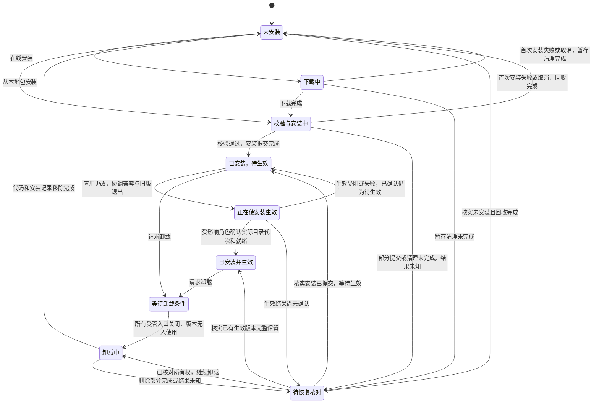
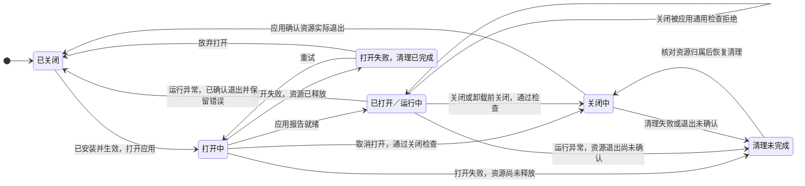

# Anybox：NyaCore 应用的宿主应用

[文档首页](README.md) · [组件导航](modules/products/README.md) · [应用接入](application-development.md)

Anybox 宿主负责应用从下载、校验、安装、版本生效、打开运行、关闭到卸载的生命周期，以及应用界面承载、宿主自己的身份、设置和管理记录。宿主不介入应用业务；应用负责自己的业务初始化、准入、运行和清理，通过通用契约向宿主报告就绪、忙碌、退出及错误。

本文先定义目标生命周期，再说明当前实现。2026-10-17 已实施 D0a 源码拆包、D0a.1 应用业务服务独立运行、客户端业务独立归属、D0b 生命周期接入与基础能力按需装配，以及 D1.1 安装事实与操作账本基础；D1.2 已增加独立空宿主、完整签名应用包及只读验证/准备工具，见[归档与产物](modules/package-management/archives.md)。D1.3 已接入[本地文件安装与中断恢复](modules/package-management/installation.md)，提供文件导入、安装查询、取消和显式恢复，成功登记已安装待生效，不自动启动业务。D1.4 已接入最小宿主的正式角色加载、生效和全页面保护，D1.5 已接入本机卸载与代码回收，默认保留数据；下载仍待 D2，旧 distribution 默认完整静态组合迁入由 D3 推进。源码包拆分和 Nya 组件装配不代表软件包安装已经完成。能力缺口、源码证据与实施顺序统一见[应用包设计](application-packages-design.md)。

## 宿主与应用的职责

| 宿主负责 | 应用负责 |
| --- | --- |
| 下载包、校验来源及兼容性、安装、版本生效、卸载代码及安装记录 | 业务数据格式、迁移和兼容，默认保留的数据及显式删除实现 |
| 加载声明的入口、发起打开或关闭、等待就绪或实际退出、记录生命周期错误 | 初始化业务、判断能否关闭、停止接收业务、取消并排空自己的资源 |
| 承载、切换和释放界面，协调未保存内容等关闭阻碍 | 内部页面、布局、草稿以及 `canClose`、`dispose` 的具体实现 |
| 核对宿主管理的各角色和版本使用者，协调更新及整体退出 | 应用自己的连接、配对、访问凭据、转发、后台工作及独立服务 |
| 宿主自己的身份、设置和管理元数据 | 应用业务设置、业务认证、密钥、数据库及恢复规则 |

宿主只解释应用身份、版本、入口、生命周期阶段、通用阻碍和错误，不认识 Session、Run、Models、Computer、Claude 审批等业务概念。应用在通用关闭契约中决定如何停止内部工作；宿主不得通过查询业务表、调用业务取消接口或理解领域状态来实现停止和卸载。SQL、目录选择、系统凭据适配可以按消费者使用，复用不使其成为最小宿主必备能力，也不形成应用间共享业务层。

## 目标生命周期

以下是目标设计，尚不是当前 `ProductView.state` 的实现枚举。软件包安装状态、运行状态、界面挂载状态分别记录；`desiredEnabled` 只表达后台运行目标，不能表达应用是否安装。

### 包的下载、安装与卸载

图示为首次安装与卸载的主路径。更新时，新版本沿下载、校验、安装、待生效流程作为候选版本推进，当前生效版本和运行实例仍独立保留；下载或安装失败、取消后，只有暂存清理完成才结束该事务，已有安装与运行不受覆盖。版本生效先检查通用关闭保护，协调受影响入口关闭并核实旧版本使用者释放，再提交所选安装快照并由所属管理者启动相关角色；只有取得实际目录代次与就绪回执后才报告生效完成。选择快照、旧角色退出、新角色启动和就绪分别记录进度，不假定与业务库或进程存在跨边界原子事务。部分角色切换时分别展示实际版本，失败保留已确认事实或待恢复记录，不能把未经确认的候选版本报告为已生效。包事务与恢复规则见[应用包设计](application-packages-design.md)。

安装、版本生效、打开应用是三个动作。首次安装和生效不会自动打开应用；用户打开后才启动所选运行入口或挂载界面。只有界面的应用只需界面入口和清理契约，不要求后台、HTTP、SQL、设备连接或 worker。

卸载先阻止该应用的新打开与版本切换，再经通用关闭契约处理已打开界面和宿主管理的运行入口。未保存内容、忙碌、退出未确认或其他角色仍使用代码时，保持“等待卸载条件”，由应用提供通用阻碍说明。指向本次安装版本目录的客户端、执行端、worker、桌面及静态资源等使用者均释放后才能移除代码；系统服务或其他外部管理的实例只能请求其所有者协调并等待释放，宿主不能越权停止。独立部署、并未使用本次安装代码的远端服务不因客户端卸载而被停止。若无法核对版本使用者，继续等待，不能将失联视为退出。

卸载默认只移除应用代码、版本指向及安装记录，保留应用业务数据和凭据。业务数据删除是独立的显式操作，由应用或数据所有者执行；宿主不按迁移域清表、不推断密钥 namespace，也不把删除业务数据作为卸载成功条件。删除或清理部分完成时保留恢复记录，不能显示“未安装”。

### 应用的打开、运行与关闭

运行状态按声明的入口或运行实例记录，并汇总供应用管理使用；一个应用可以只运行客户端入口，不因安装了其他角色而自动启动它们。`running` 表示该入口完成通用就绪流程，不表示远端设备在线、模型 Key 已设置或其他业务条件已满足；应用须能自行呈现业务设置和错误。

打开失败只有在已登记资源释放完成后才能进入“打开失败，清理已完成”。关闭只有在应用确认实际退出后才能完成；观察断开、请求超时或收到业务结果均不能替代资源退出。清理未完成保留本代归属和错误，禁止覆盖旧实例或删除仍被使用的版本，恢复操作必须核对实际资源事实；能否就地恢复由相应实现保证，不能预设重试一定成功。

关闭界面只经 `canClose`、`dispose` 释放该界面，不停止可独立运行的后台入口；切换应用仅改变可见性，隐藏界面仍可保持挂载。完整“关闭应用”协调所选受管入口及其界面，关闭成功后仍保留已安装代码和业务数据。无后台入口的应用，关闭界面即完成它本次打开的释放。关闭远端客户端不推导远端业务停止；需要停止的实例必须有明确生命周期所有者。

实现时通过最小通用契约报告就绪、关闭阻碍、停止准入、取消、实际退出及阶段错误，不把应用业务状态搬入宿主。当前契约能覆盖哪些部分、还需补齐哪些版本及退出记录，以[能力缺口与实施顺序](application-packages-design.md)为准；本节不预建新的组件或服务。

## 目录与进程边界

当前 Anybox 按受信代码目录承载 NyaCore 应用，提供应用注册、组件装配、启停、静态资源和前端工作区。正式目录目前提供 Anybox Harness（稳定 ID `agent`）与 Claude Agent（稳定 ID `claude-agent`，见 [Claude Agent 设计](claude-agent-design.md)）；应用随项目构建，不从网络安装执行代码。客户端和执行端各有一个 Nya 根，分别注入 `ApplicationRegistration[]`。同一个 ID 可以在两个进程使用不同装配：Anybox Harness 客户端按需装配自身连接、凭据与网关，harness server 装配 Models、Prompt、Session、Run、工具和业务 HTTP 适配器；设备连接与凭据由各应用独立拥有，客户端打开时分别装配 `client.connections` 或 `claude-agent.connections`，停止时各自清理，不设应用间共享业务提供方。普通应用可以只注册在客户端。

目录注册校验 ID、静态地址、MIME、Web 入口和兼容路由归属。列表顺序等于目录顺序。`ApplicationRegistration` 保存受信工厂、HTTP 服务键和本地资源清单；`ProductDefinition/ProductView` 只含名称、图标、说明、同源浏览器入口及状态，不含 Node 路径、凭据或运行句柄。新增应用无需改 Products、监听器、工作区管理或 Anybox Harness。

通用宿主位于 `packages/host/src/`：`applications/` 管注册和运行归属，`web/` 管外壳与应用工作区，通用 HTTP 负责监听和分派。Anybox Harness 的注册、核心业务、执行适配器、客户端和浏览器实现集中在 `packages/app-harness/src/`。`packages/distribution/src/entrypoints/` 选择正式目录、读取环境变量并处理进程信号，通用宿主不导入 Anybox Harness。业务存储契约为 `packages/storage-sqlite/src/port.ts`；当前客户端与执行端宿主分别装配一个 SQLite 提供方，供宿主控制记录及当前受信组合使用，应用组件自行在 apply 中登记业务迁移域。这是现有组合方式，不是每个应用必须使用宿主业务库的接入要求。Models 配置库、目录缓存和 Vault 仍归 harness server，延续独占路径规则。SQL、目录适配是独立基础包，连接业务则在各应用自己的模块内；D0b 已按启用入口的真实消费者装配基础提供方，最后消费者释放后等待其实际退出；宿主自己使用的 SQL 作为常驻消费者保留，不因复用自动增加宿主业务职责。

`application-api` 核心、`/web`、`/node` 和 `/nya` 适配分开导出。应用的 `createRuntime`、HTTP 及界面均按真实需要选择；纯界面应用不需要创建后台运行时。宿主在目录中标记 `runtime`/`http`，界面不为纯界面应用发后台 open/stop。D0b 按入口能力声明执行 SemVer 兼容和可用性检查；必需能力未满足时在业务工厂调用前阻止该入口，可选能力未满足时把降级选择交给应用。每个运行代取得冻结的能力版本元数据，实际服务仍通过本轮 Nya deps 使用；两个应用继续各自提供私有连接管理界面。

## 当前能力选择与后台装配

`providers` 接收受信的延迟提供方声明，宿主不选择具体业务实现。`applications/providers.ts` 只负责版本选择、消费者归属、相交能力/服务的操作协调和安全诊断；组件依赖、重启及清理由 Nya 管理，不创建额外 Context 或复制依赖图。声明未被消费时不调用工厂；初始化通过通用 signal 取消并等待实际退出；正常停止先等待应用释放，再关闭最后一个消费者所用的提供方。无关应用和提供方可以独立推进。

`ProductView.capabilities` 只返回能力 ID、版本范围、required、状态及所选版本。ready 在尚未打开时表示兼容的候选可用，不表示已经初始化；打开后按实际提供方状态报告。缺失、不支持、不兼容、与已使用版本冲突及初始化/清理失败分别呈现。能力门禁阻塞后可显式重试；已经装配的 Nya 组件仍按其依赖自动就绪。纯界面应用只做声明诊断，不初始化未使用的后台提供方，也不生成后台目标。

## 当前后台装配与停止

本节的“装配代”指同一进程根内 Nya 组件及资源的一次生命周期，代码中的 `ApplicationInstallation.install()` 也是这个含义；它不下载或安装软件包。D1.3 的软件包安装独立拥有暂存、不可变目录和安装回执，成功后保留为待生效；D1.4 正式角色使用确切安装快照及父子使用锁加载，D1.5 卸载在全部入口实际退出后回收固定安装容器；Products 的停止仍只改变运行目标，不能代替包卸载。remove 批次的新角色 ready 后先进入 reclaiming，全部版本 removed、remove 操作 completed 才显示已卸载。默认完整静态发行仍保留。

目录的 `runtime`/`http` 标记由真实注册入口派生。为保留既有 DTO 状态枚举，纯界面条目在必需能力检查通过时使用 `state: 'running'` 表示界面可以打开，未通过时为 blocked；始终保持 `desiredEnabled: false`，不创建 `app_product_targets` 后台目标记录，也不调用后台工厂。界面是否已经挂载仍由浏览器工作区记录。

Products 按应用 ID 保存独立运行目标、控制队列、状态和错误，同一应用串行、不同应用独立推进。宿主先创建通用控制门面，打开时通过能力门禁并取得使用租约后才调用应用业务工厂。`createApplicationRuntime` 为每个装配代同步登记 Fiber、Effect disposer 和 AbortSignal；全部组件直接装配在进程根上，依赖拓扑由 Nya inject 管理。启动中途失败清理已登记资源；重新打开建立新装配代。过期回调使用本代信号确认归属。`desiredEnabled` 持久保存是否期望后台运行，既不表示文件已经安装，也不表示界面已经打开。

当前状态仍使用 `disabled/applying/running/blocked/failed`，与目标状态的对应如下：

| 当前状态 | 当前事实与目标对应 |
| --- | --- |
| `disabled` | 后台未运行，对应目标运行“已关闭”；不代表“未安装” |
| `applying` | 打开、停止、重试共用的处理中状态，尚未分别表达“打开中”“关闭中” |
| `running` | 组件就绪；纯界面应用还复用此值表示入口可打开，不能用它判断后台或界面已经运行 |
| `blocked` | 组件已装配但依赖未就绪，依赖恢复后同代可自动就绪；不代表下载或安装等待 |
| `failed` | 仍需结合错误阶段判断：`startup` 为启动失败，`cleanup` 为清理失败；类型另保留 `storage` 阶段，当前目标写入失败会在改变目标前拒绝控制调用 |

inspect 投影实际 Fiber：awaitStable 后仍 PENDING 即 blocked；依赖恢复后同一装配自动变为 running。清理已确认的初始化失败可显式 retry；组件已进入 FAILED 时，Nya 公共诊断无法证明既有回滚是否完整，当前保守保留清理未确认状态。清理失败保留错误与装配记录，禁止覆盖、重新打开或重试，并在整根退出时继续报告，当前要求重启宿主；目标图中的恢复清理能力仍需后续实现，不能把当前 `failed` 直接等同于“已关闭”。

停止（以及会撤销现有装配的 retry）先同步检查 Activity 和应用注册的通用 guard，再冻结该应用准入。忙碌拒绝发生在目标写入前；目标提交失败释放冻结并保留原值。保存关闭目标后取消观察、等待真实 release，再撤销本应用 Fiber 并等待 Effect。guard 的内部判断归应用；例如 harness server 用它覆盖 Run 准备至资源实际退出，宿主只处理 guard 的通用结果。注册本身归装配代所有，重开不累积旧 guard。关闭界面不会调用后台 stop。

整根关闭先同步停止产品控制、活动和运行时准入，并开始 HTTP 排空；等待已接受控制及装配队列后，根清理与 HTTP 排空并行等待。HTTP 可以持有等待应用实际退出的租约，不能先等待全部请求再启动根清理，否则会阻塞应用取消。各应用组件取消并等待自己拥有的资源，Activity 最终等待全部租约释放；宿主只聚合通用退出与清理错误，不用超时冒充退出。关闭门面不可复用；持久运行目标保留，重启按各自目标恢复。

## HTTP 与静态资源

当前常驻监听器负责宿主实例令牌校验、同源校验、应用管理与分派。拥有者的应用请求也经过这一外层令牌门禁；应用声明的 `selfAuthenticated` 路由交由应用自行认证。应用自己的业务 HTTP、独立服务认证和领域处理仍归应用，不因此进入宿主：

| 入口 | 客户端 | 执行端 |
| --- | --- | --- |
| 目录与控制 | `/api/client/v1/products` | `/api/v1/products` |
| 应用业务 | `/api/client/v1/apps/:appId/...` | `/api/v1/apps/:appId/...` |

运行管理保留 list/get/open/stop/retry，控制 POST 体为空对象。该运行 API 不提供用户定义、模块组合或软件包安装；D1.3 的独立 `/api/client/v1/app-packages` 负责文件安装、查询、取消和显式恢复。应用归属由注册路由确定；伪造 `X-Anybox-Product-Id` 不能切换归属。请求在第一次异步调用前 authorize 并登记 Activity，通过根固定当前 HTTP 端口；harness server 同步捕获本次领域服务快照。不会把旧请求转交重开后的服务。

适配器接收相对 URL、appId、actorId、监听器关闭信号和 retainUntil。handle 等待实际处理退出；SSE 等待流关闭，OwnedCall 等待 done。已接受 Run 通过 retainUntil 将 Activity 延续至原生退出，但单独关闭 HTTP 不取消或等待 Run。监听器关闭信号取消观察与未完成资源请求；已接受控制、普通业务写入继续结算并尽可能返回结果。旧 Anybox Harness 路径是登记的兼容别名，指向同一处理器。

实例信息只由宿主与注册应用声明能力：宿主提供 `products.v2`，目录的 `http.capabilities` 声明应用静态协议，已安装适配器的 `capabilities()` 补充动态能力。Anybox Harness 静态声明项目、附件和 SSE 协议，目录浏览能力按实际 Projects 服务提供。未注册 Anybox Harness 的宿主不带这些业务能力。

外壳只声明 HTML、外壳 CSS、HTTP 工具和工作区模块。Anybox Harness 的模板、图标、样式和浏览器模块由应用资源清单声明。`npm run build` 校验全部登记文件、JS 相对依赖、HTML/CSS 资源和 MIME，拒绝 Node/bare module 依赖。发行脚本也校验复制后资源图。

## 浏览器工作区

外壳与应用界面分别归 `packages/host/src/web/` 和各应用的 `web/`。最左侧窄条是不同应用的入口，按注册目录顺序显示全部应用，并标记当前应用。右侧整块区域由当前应用内部组件从顶边开始呈现；外壳只提供无装饰的挂载容器，不显示 Anybox 标题栏、顶部应用标签栏或宿主操作栏。共同的 mount、route 和生命周期契约不规定应用内部页面结构。

Anybox Harness 直接呈现一个项目与会话工作区。侧栏底部将一处可操作的紧凑“执行设备”选择器与只显示图标的设置按钮放在同一行；选择器保留屏幕阅读器标签，并通过 title 提示完整设备名称。选择器固定新增项目的设备及模型、Prompt 设置的管理范围，侧栏项目与会话树只展示所选 instanceId，并直接接在仅保留添加项目按钮的顶部操作栏下方，不显示应用名称文字或设备名称标题。项目行右侧按钮在该项目中新建会话，空工作区“新建会话”使用该设备的侧栏选中项目；原选择属于另一设备时重新选择当前设备的项目，无项目或所选项目不可用时禁用。离线或未启动的目标不会回退展示其他设备项目。已有跨设备会话面板保留，全量项目资源仍用于面板、模型与附件的原设备归属，以及全局归档查询。设置提供“会话设置”“模型管理”“Prompt 管理”“已归档会话”“管理连接”五个分类，连接管理作为同一弹窗内的面板呈现。连接分类展示全部设备，归档列表跨设备、跨项目查看和恢复，不受所选设备筛选限制；这两个分类隐藏当前执行设备提示。切换分类或关闭弹窗时保留已挂载表单和非秘密草稿；用户关闭或按 Esc 时清空连接的未保存访问令牌和已发行令牌的临时展示，临时停用应用保留已有草稿。未保存修改会阻止设备切换及界面重建。模型、Prompt 不再使用独立功能页面或顶部标签；旧功能页面地址只读兼容为统一工作区位置，不自动打开设置。每台设备的 Agent 状态及“启动 Agent”“停止 Agent”操作放在连接管理中，宿主窄条继续控制 Anybox Harness 客户端应用。

外壳原生 import 已登记入口，调用 `mount(container, context)`，得到 setActive/canClose/dispose。context 提供 appId、仅在声明 HTTP 时提供的同源 apiBase、应用内 route、生命周期 signal 和 domId。全局 location/history 归外壳；应用只订阅和修改自己的路由。

每个应用最多一个已打开界面。左侧入口切换已有挂载使用 select，不重复执行 open 或打开业务目标；首次打开尚未运行的应用才进行应用启动。切换保留挂载 DOM、草稿、滚动和数据，后台 panel hidden 且 inert。左侧应用导航使用上/下方向键、Home/End 移动焦点，Enter/Space 打开或切换应用，并支持焦点恢复。

左侧窄条底部的“关闭界面”与“停止应用”图标按钮具有包含当前应用名称的 title 和 aria-label。“关闭界面”先检查 canClose，再等待 dispose，只销毁当前应用的前端界面；关闭后选中其他已打开界面。左侧应用入口始终保留，可以再次进入。“停止应用”是独立的后台控制，成功停止后关闭对应界面，忙碌或停止失败时保留界面。

宿主失联时，缓存目录只保留应用身份，状态显示为暂时无法确认，暂停后台控制并保留界面和草稿。停止响应未知时通过新的目录读取核对，不自动重放写入；确认 disabled 才关闭界面，applying 继续观察，失败则明确说明。核对读取不能复用控制前的过期轮询，恢复连接后更新实际状态并清除失联提示。

“我的应用”在左侧窄条打开管理浮层，显示应用列表、状态和启停控制，不替换或停用当前应用界面。宿主通知、加载状态、界面失败和“重新加载界面”入口都在该浮层呈现；重新加载只重建界面，不改变后台目标。没有活动界面时右侧挂载区域保持空白，管理入口仍可使用。

已打开界面的顺序、内部路由和活动应用保存于 `sessionStorage: anybox.apps.workspace.v1`。为兼容已有工作区，继续保留原有 tabs 字段及其数据结构，它记录已打开界面，不表示顶部仍有标签栏；左侧应用入口顺序始终来自注册目录。全局地址为 `#/apps/:appId/...`。后台应用导航只改自身记录，不改地址。首次初始化可通过应用兼容解析器读取旧 Anybox Harness 位置。刷新、历史导航或工作区恢复不会隐式启动已停止的应用或 Agent。

Anybox Harness 只在 activation reason 为 open 时自动打开所选设备的 Agent；连接管理也提供显式打开、停止操作。选择设备、切换应用、刷新或恢复位置不隐式启动目标，连接到远端不会启动本机执行。连接编辑/删除只重建 Anybox Harness；全局事件仅在激活时处理，停用取消拖拽和尺寸修改、退出模态顶层显示；激活后重新测量布局。Agent 草稿、树位置和分屏继续由 Anybox Harness 保存，设置按所选设备管理其模型和 Prompt。

## 当前数据兼容与验收

沿用 `app-products` v2，无新增表版本。事务补齐当前目录缺失行，新应用默认关闭；现有 agent 目标保留。旧执行库首次迁移检测 run-state 并恢复 Anybox Harness；旧组合库只读取内置 agent 目标，保留自定义 JSON 和历史但不装配。不在当前目录的目标记录仍保留。

`npm run check` 包括目录、并发、忙碌拒绝、失败回退、观察真实退出、旧数据库、两进程部署、Models/Anybox Harness 和浏览器资源图测试。`tests/helpers/test-application.mjs` 是仅用于测试的正式注册应用，拥有独立 Nya 服务、迁移域、API 和带输入框的页面，不安装 Models/Anybox Harness。`node tests/helpers/products-browser-host.mjs` 用临时数据库、内存凭据、受控模型提供 Anybox Harness + Notes 浏览器验收。具体步骤见[接入说明](application-development.md)。
